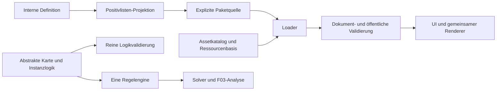

# Architektur

Native ES-Module, Node-Test-Runner und Playwright sind umgesetzt. Kein Framework
und kein Buildschritt im Browser. Der statische Export benennt Module für
MIME-kritische Hosts in `.js` um.

`src/engine/`: Hexgeometrie, Legalität, Prädikate, Routengenerator, Solver und reine
Validierung. Keine Assets, Datei-/Netzwerkzugriffe oder DOM-Abhängigkeiten.
`src/puzzles/`: ausführbare Schemas, Dokumentvalidierung, Analyse, öffentliche
Projektion und Loader mit expliziter Quelle. `src/assets/`: Metadaten-/Platzierungs-
und Grafikgeometrieverträge. `src/ui/`: Darstellung, Browser-Bilddekodierung und
Bedienung. `scripts/lib/`: Node-Adapter für Identitäten und gepinnte Archive.
`src/generation/`: reine, deterministische abstrakte Kartengenerierung mit
separater Struktur-/Routenanalyse und optionalen Eignungsfiltern;
[Schnittstellen und Reproduktion](MAP-GENERATION-F04B.md). Keine Assetabhängigkeit.
PR 2 ergänzt ein explizites geografisches Katalogprofil sowie
`src/assets/assignment.mjs` für reine, getrennte Assetzuordnung. Der Node-Adapter
`scripts/lib/released-asset-catalog.mjs` lädt einen ausdrücklich gewählten,
freigegebenen Release und übernimmt Auswahl und Anker in den bestehenden Kontext.
Die feste Diagnose `scripts/sample-catalog-maps.mjs` verlangt Release-ID und
Hintergrund und lädt diesen Kontext selbst. Provenienz steht separat im Bericht;
Profile, Karten- und Rätselidentitäten bleiben unverändert. Der Ladeweg benötigt
Git-Historie und startet keine Bildprüfung. Aufruf und Reproduktion:
[Katalog-Releases](CATALOG-RELEASES.md#phase-c-freigegebener-generierungskontext-und-diagnose).
`scripts/lib/asset-catalog.mjs` bleibt das Entwicklungswerkzeug für neue
Katalog-/Bildprüfungen mit Python/Pillow. Fehlende Illustration ändert keine
abstrakte Karte; der freie Generierungsmodus bleibt erhalten.

Engine und Renderer kennen keine produktiven Rätselnamen oder Bestandszahlen.
Die Anwendung wählt eine lokale Quelle; Inhaltspakete liefern öffentliche Rätsel,
Assetmetadaten und Ressourcen. Die garantierte UI-Basis bleibt getrennt von
kontrollierten Fixtures und optionalen Inhalten.

Verbindliche Details: [Regeln](RULESET-GEZEITENKARTEN-2.md),
[Daten/Assets/Pakete](PUZZLE-FORMAT.md), [Identitäten](PUBLICATION-ARCHIVE-V2.md),
[Dienste](PUZZLE-SERVICES-F03.md), [Konsolidierungsbericht](CONSOLIDATION-F01-F03.md).
