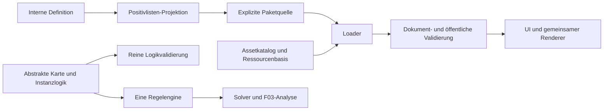

# Architektur

Native ES-Module, Node-Test-Runner und Playwright sind umgesetzt. Kein Framework
und kein Buildschritt im Browser. Der statische Export benennt Module für
MIME-kritische Hosts in `.js` um.

`src/engine/`: Hexgeometrie, Legalität, Prädikate, Routengenerator, Solver und reine
Validierung. Keine Assets, Datei-/Netzwerkzugriffe oder DOM-Abhängigkeiten.
`src/puzzles/`: ausführbare Schemas, Dokumentvalidierung, Analyse, öffentliche
Projektion und Loader mit expliziter Quelle. `src/assets/`: Metadaten-/Platzierungs-
und Grafikgeometrieverträge. `src/ui/`: Darstellung, Browser-Bilddekodierung und
Bedienung. `scripts/lib/`: Node-Adapter für Identitäten und gepinnte Archive.
`src/generation/`: deterministische kataloggerechte Geografie mit getrennten
Struktur-/Routenanalysen und ausdrücklich aktivierten Eignungsfiltern. Der einzige
Generator verlangt ein geografisches Kapazitätsprofil. `src/assets/assignment.mjs`
leitet dieses aus dem Katalog ab und belegt die erzeugte Karte anschließend mit
konkreten Motiven über eine globale Zuordnung. Geografie enthält weder Asset-IDs
noch Renderdaten. Allgemeine Hex- und Rätselverträge bleiben unabhängig von
Generatorregeln wie dem Objektabstand.

`scripts/lib/released-asset-catalog.mjs` lädt einen explizit gewählten freigegebenen
Release samt gepinnter Ressourcen aus Git. `scripts/lib/map-batch.mjs` orchestriert
ausschließlich Zielzahlbatches unter explizitem Versuchsbudget (Format 3), akzeptiert
nur vollständig belegte Karten und erhält ursprüngliche Versuchsindizes sowie
getrennte Ergebnisindizes. Einzel-Replay prüft den gesamten Datensatz am
aufgezeichneten sauberen Programmcommit. Die feste Diagnose
`scripts/sample-catalog-maps.mjs` verwendet denselben Datensatzbauer und dieselben
Analyseaggregate; keine zusätzliche Generierungsstrategie.

`scripts/lib/map-contact-sheet.mjs` prüft beide gespeicherten Datenströme und
rendert ausschließlich ausgewählte vollständige Ergebnisse mit den gemeinsamen
Grafikdiensten und unveränderten Releasebytes. Spätere Rätselgenerierung kann
an gültiger Geografie und konkreter Motivbelegung ansetzen. Sie benötigt keine
historischen Modusparameter. Es wird noch keine Rätselgenerierung implementiert.

[Einziger Generator-/Batchvertrag, CLI und Replay](CATALOG-COMPLIANT-GENERATION.md),
[Kontaktübersicht](MAP-CONTACT-SHEET.md), [Katalogfreigaben](CATALOG-RELEASES.md).
`scripts/lib/asset-catalog.mjs` bleibt das Entwicklungswerkzeug für neue
Katalog-/Bildprüfungen mit Python/Pillow.

Engine und Renderer kennen keine produktiven Rätselnamen oder Bestandszahlen.
Die Anwendung wählt eine lokale Quelle; Inhaltspakete liefern öffentliche Rätsel,
Assetmetadaten und Ressourcen. Die garantierte UI-Basis bleibt getrennt von
kontrollierten Fixtures und optionalen Inhalten.

Verbindliche Details: [Regeln](RULESET-GEZEITENKARTEN-2.md),
[Daten/Assets/Pakete](PUZZLE-FORMAT.md), [Identitäten](PUBLICATION-ARCHIVE-V2.md),
[Dienste](PUZZLE-SERVICES-F03.md), [Konsolidierungsbericht](CONSOLIDATION-F01-F03.md).
