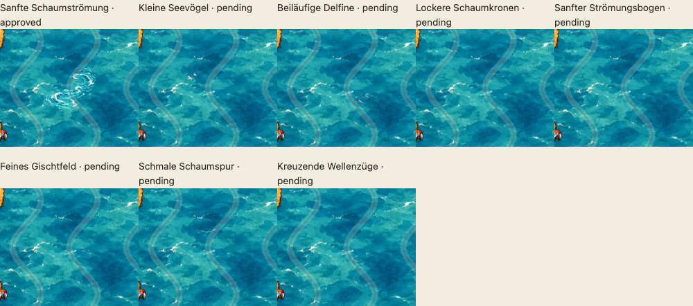

# Abschluss der kleinen Kartenmotive – PR #65

> Historischer Bericht der Gestaltungsrunde. Die Produktion ist beendet; aktuelle Verwendungsentscheidungen und Prüfergebnisse stehen im [Konsolidierungsbericht](ASSET-CONSOLIDATION-65.md). Die offenen Wasserillustrationen werden gemäß Issue #70 zurückgestellt.

19.10.2026 · Branch `feature/asset-library-integration` · Ausgangsstand `70487e9` · kein Merge.

## Verbindliche Verwendung

Unbefahrbare Orte belegen ein oder mehrere vollständig gesperrte Hexfelder. Befahrbare Orte belegen jeweils ein befahrbares Hexfeld und können Bezugspunkte in Rätselhinweisen sein. Freie Kartenmotive bleiben unbenannt, befahrbar und niemals Hinweisreferenzen. Die [verbindliche Einordnung](WORLD-AND-STYLE.md#verbindliche-einordnung-der-kartenmotive-abschluss-pr-65) ist mit der technischen Dokumentation konsolidiert.

Keine neuen technischen Assettypen: Unbefahrbare/befahrbare Orte bleiben `geographic` mit `passable=false/true`. Freie Motive bleiben `decoration` ohne Regelwirkung und ohne `placeId`. Die sechs bisherigen v1-Dateien behalten ihre stabilen IDs und den vorhandenen Typ `accent`; nur die technische Rolle wird der ausdrücklich präzisierten Ortsfunktion angepasst.

Später höchstens **0–3 freie Kartenmotive pro Karte**, sparsam eingesetzt. Die vorhandene Galerie enthält drei feste Beispielkarten mit 3/3/2 freien Motiven. Keine Zufallsplatzierung, kein Eingriff in Spielrätsel, Rätselgenerator oder Issue #68. Keine neuen permanenten Ortslabels oder orangefarbenen Ringe.

## Künstlerische Freigaben

Die Aufzählung bestätigt ausdrücklich **sechs** kleine Ortsmotive: Fässer, Boje, Ruderboot, Kiste, Flaschenpost, Treibholz mit Seetang. Es wird **keine siebte Ortsfreigabe** aus der früheren Zehnerzählung abgeleitet. Zusätzlich ist die unveränderte Schaumströmung v1 als freies Kartenmotiv freigegeben.

Alle sieben exakten PNGs und der Meeresuntergrund sind bytegleich mit `70487e9` und den damaligen Exportbelegen. Nur diese Kombinationen auf `sea-blue-01` erhalten Approval-Hashes. Die zwölf bisherigen Freigaben werden vollständig erhalten. Ergebnis: **19 exakte Freigabepaare**; andere Hintergründe bleiben pending. [Nachweis](reviews/water-finale/approval-audit.json).

Die bisherigen Vögel und Delfine v1 sind ausdrücklich nicht freigegeben und bleiben historische Vergleiche. Die Schildkröte wird zurückgestellt, nicht als aktuelles statisches Motiv eingesetzt und erhält keine Freigabe. Eine mögliche spätere Animation wird hier nicht implementiert.

## Letzte offene Sichtungsrunde

| Motiv | Datei unter assets/library/ | Künstlerischer Status |
|---|---|---|
| Kleine Seevögel | `flavor-gulls-v2.png` | pending – überarbeitet |
| Beiläufige Delfine | `flavor-dolphins-v2.png` | pending – überarbeitet |
| Lockere Schaumkronen | `flavor-foam-flecks-v1.png` | pending – neu |
| Sanfter Strömungsbogen | `flavor-current-arc-v1.png` | pending – neu |
| Feines Gischtfeld | `flavor-spray-v1.png` | pending – neu |
| Schmale Schaumspur | `flavor-foam-trail-v1.png` | pending – neu |
| Kreuzende Wellenzüge | `flavor-cross-ripples-v1.png` | pending – neu |

Alle sieben neuen Dateien bleiben auf allen drei Hintergründen **ohne Approval-Hashes**. Vögel und Delfine sind deutlich kleiner und außerhalb der Hexmitte angeordnet; auch die fünf Wasserillustrationen verwenden unterschiedliche dezentrale Positionen, Größen und Richtungen. Die bestehende freigegebene Schaumströmung bleibt unverändert zum Vergleich verfügbar.

## Herstellung und feste Grafikgrenzen

Eingebautes `image_gen`; [vollständiger Promptsatz](reviews/water-finale/generation-prompts.json), [gezielte Entfernung unerwünschter Wasserflächen aus dem Vogelmaster](reviews/water-finale/gulls-refinement-prompt.json) und [Präzisierung der kleinen Delfinkonturen](reviews/water-finale/dolphins-refinement-prompt.json). Alle endgültigen [Malvorlagen](reviews/water-finale/masters/) bleiben erhalten. Keine fremden Stockbilder.

`scripts/export-water-finale.py` verwendet die bereits etablierten `prepare_source`, `strict_mask`, gemeinsamen Geometrieverträge und den unabhängigen vollständigen Alpha-Pixelprüfer. Es resampelt die **vollständige** RGBA-Leinwand proportional und füllt auf **360×408** transparent auf. Größe und dezentrale Position werden ausschließlich beim Authoring in die Datei eingebrannt. Keine geometrische Maskierung der Kunst, kein Abschneiden, Drehen oder individuelles Transformieren zur Laufzeit. Der vorhandene Filter entfernt nur isolierte Alpha-1-Exportreste; bedeutungsvolle Alpha-Pixel und weiche Ränder bleiben erhalten.

Jeder neue Export wird an sämtlichen **25** gültigen Einzelhexankern auf vollständige Pixelquadratdeckung geprüft, auch bei Alpha=1. Die Motive dürfen optisch an Hexzwischenräume heranrücken, aber nicht in Nachbarzellen überzeichnen. [Pixel-/Positionsbericht](reviews/water-finale/pixel-audit.json). Zusätzlich prüfen unabhängige Tests die tatsächlichen PNGs auf kleine Ausdehnung, Abstand zur Hexmitte und starke Verkleinerung der Tiere gegenüber v1.

## Galerie und vollständige Übersicht

[Bestehende Galerie](http://127.0.0.1:4184/dev/asset-library.html#minigrafiken): alle acht aktuellen freien Motive in 1:1-Kartengröße, wählbare Vergrößerung, drei sparsame Beispielkarten, sechs freigegebene Ortsmotive als eigene Gruppe, unveränderte Schalter für Hexgrenzen und echte Stundenzeichen/Route. Historische Tiere und zurückgestellte Schildkröte sind nur noch als solche verlinkt. Die vorhandenen Rand-/Innenprüfpositionen bleiben zugänglich.

Die [vollständige Assetübersicht](ASSET-INVENTORY-65.md) enthält alle **40 Katalogeinträge** einschließlich technischer Platzhalter, historische, aktuelle und zurückgestellte Verwendungen, Rollen, Befahrbarkeit, Dateien, künstlerische Zustände und tatsächliche Approval-Hashes. Zusätzlich werden acht Legacy-Zuordnungen, drei Hintergrunddateien und alle weiteren Grafikdateien unter assets/ aufgeführt. Der gleiche Katalogbestand ist in der bestehenden Galerie unter „Vollständige Katalogübersicht“ direkt einsehbar. [Maschinenlesbares Inventar mit allen vollständigen Hashes](reviews/water-finale/full-inventory.json).

## Validierung und offene Punkte

Lokal bestanden:

- **108 Unit-Tests**, vier eindeutig lösbare Rätsel, vollständige Katalog-/Datei-/Hashvalidierung: 40 Bilder, drei Hintergründe, 19 exakte Freigabepaare.
- Vollständiger Alpha-Bildvalidator für alle 40 Katalogbilder, **13 Bildregressionen** (421,9 Sekunden), **fünf Export-/Flächenregressionen**, **zwei zusätzliche Prüfungen** für die kleine dezentrale Schlussserie und ihre fehlenden Freigabe-Hashes.
- Alle **175** neuen Motiv-/Ankerkombinationen streng geprüft, **null** Alphapixel außerhalb der eigenen Sicherheitsfläche. Die Tierbreiten betragen deutlich unter 45 % der historischen v1; Details im Pixelbericht.
- **40 Galerie-Browserfälle**: je 20 in Chromium und WebKit auf Desktop und Mobil. Zusätzlich vier Browser-Aufnahmekonfigurationen mit exakten PNG- und Meeresprüfsummen. Die neuen Fälle prüfen die sechs hinweisfähigen befahrbaren Orte, acht referenzfreie freie Motive, Karten mit höchstens drei freien Illustrationen, keine aktuelle Schildkröte/alten Tierfassungen und die vollständige 40-Zeilen-Inventartabelle.
- Tatsächliches Veröffentlichungs-ZIP: **100 Dateien**, alle **40 Katalog-PNGs bytegleich**, Katalog mit 19 Freigaben und sieben neuen pending-Versionen. **Vier ZIP-Browserfälle** auf Desktop, Smartphone, iPhone und iPad unter einem Auslieferungsunterpfad bestanden.

Im ersten WebKit-Lauf hatten zwei bestehende Fälle lokale Zeitüberschreitungen; alle neuen Schlussrundenfälle bestanden bereits dort. Der vollständige unveränderte zweite Lauf besteht **20/20**. Keine Assertions oder Zeitlimits wurden gelockert. Die 27 Paket-Fehlerfixtures und sämtliche sachfremden UI-Tests wurden nicht vollständig erneut ausgeführt und werden nicht als lokal bestanden gezählt.

[Prüfzusammenfassung](reviews/water-finale/validation-summary.json) · [Erhaltung](reviews/water-finale/preservation-audit.json) · [Browserbeleg](reviews/water-finale/browser-audit.json) · [ZIP-Beleg](reviews/water-finale/package-audit.json).

Nach dem Push beobachtete CI-Ergebnisse werden getrennt in PR #65 und im Abschluss ausgewiesen. Die bekannten CI-Abhängigkeiten (fehlendes Pillow im Unit-Job bzw. externe Paketquellenfehler) dürfen lokale Prüfergebnisse nicht in eine vermeintliche CI-Freigabe umdeuten.

**Künstlerisch offen ist die Sichtung der sieben neuen/überarbeiteten Dateien.** Historische oder zurückgestellte Motive und die reduzierte Felsnadel werden durch diese Runde nicht nachträglich genehmigt.
