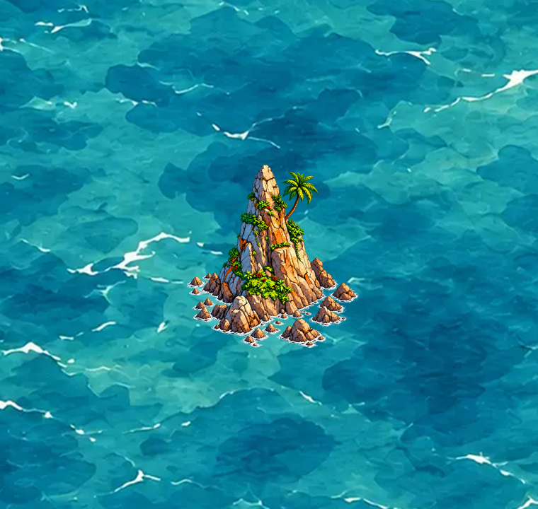
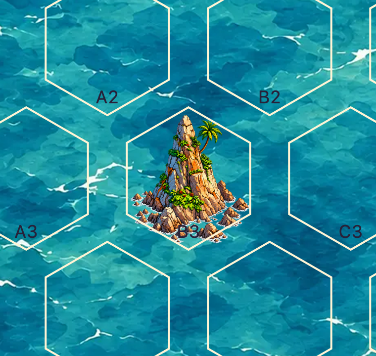

# Felsnadel: erster Einzelhex-Prototyp (#45 / PR #65)

**Ergänzung 19.10.2026:** Die wasserreiche ursprüngliche Generierung ist inzwischen als ausdrücklich gewünschte, eigenständige Alternative integriert. [Vergleich beider Varianten](FELSNADEL-WATER-COMPARISON-65.md). Die hier dokumentierte wasserreduzierte PNG-Datei bleibt bytegleich als nicht bevorzugte Vergleichsfassung `pending`. Ausschließlich die wasserreiche Fassung ist nach ausdrücklicher Nutzerentscheidung auf `sea-blue-01` künstlerisch freigegeben und bevorzugt; echte Spielmarkierungen sind noch nicht geprüft. Die folgenden Produktions- und Prüfbelege betreffen weiterhin die wasserreduzierte Fassung. Die Beschreibung des ersten Bearbeitungsablaufs in diesem Bericht legt keine allgemeine Regel für Wasserflächen fest.

**Technisch gültiger Prototyp; künstlerische Abnahme und Hintergrundfreigabe ausstehend.** Die einzelne hohe Felsnadel ist als `land-coast.island.h1.basalt-spire.v1` mit `passable: false`, `geometry.cells: [[0,0]]` und `stage: illustration` im vorhandenen Katalog registriert. Ihre Kombination mit `sea-blue-01` bleibt ausdrücklich `pending`. Kein veröffentlichtes Rätsel verwendet sie; die Publikationssperre für ungeprüfte Kombinationen bleibt wirksam.

Datei: [basalt-spire-v1.png](../assets/library/basalt-spire-v1.png), **360×408 px**, statisches RGBA-PNG. SHA-256: `d68f277f4b6bec2b4950a6341f1fac7a0360abe3d638065b047fc5c39ca78ae0`.

## Gestaltung und tatsächliche Erzeugung

Maßgebliche Nutzerreferenz ist die Felsnadel oben rechts in `Tropische Inselwelten im Aquarellstil.png`. Die mittlere Insel in `Drei Inselkarten im Aquarellstil.png` dient als Vergleich für Größe, Perspektive und Farbwirkung. Beide sind Stilstudien und wurden weder als gültige Assets übernommen noch aus ihren Vergleichsflächen ausgeschnitten.

Die neue Illustration wurde mit dem eingebauten OpenAI-Tool `image_gen` erzeugt und in einem zweiten Bildbearbeitungsschritt vom breiten türkisfarbenen Wasserkranz befreit. Übernommen wurden die hohe verjüngte Ockerspitze, die kühle linke Schattenseite, Vegetation auf Felsabsätzen, eine Palme und ein breiter nach vorne auslaufender felsiger Fuß. Schmale weiße Brandungsstriche bleiben; in den offenen Zwischenräumen scheint das echte Meer durch. [Vollständige Erzeugungs- und Überarbeitungsprompts](reviews/felsnadel/generation-prompts.txt).

**Die Bildgenerierung allein lieferte keine normgerechte Datei.** Ihr überarbeitetes Ergebnis besitzt 1177×1336 px mit echtem Alpha. Der dokumentierte Authoring-Export tastet die komplette Quellleinwand mit einem einheitlichen Faktor von `265/1177 ≈ 0,2251486831` und Lanczos3 ab; die rasterbedingt gerundeten Exportmaße sind 265×301 px. Diese werden mit links 47, oben 57, rechts 48 und unten 50 transparenten Pixeln zur endgültigen Leinwand ergänzt. Das Motiv wird weder anhand einer sichtbaren Bounding-Box beschnitten noch verzerrt. Es gibt keine Maskenanwendung und keine Alpha-Schwellwertbereinigung. Die übliche Quantisierung/Filterung beim Verkleinern ist Bestandteil dieses einmaligen PNG-Exports.

Der Export wählt eine Einpassung innerhalb der gemeinsamen zulässigen Pixel aller 25 Kartenpositionen, mit zwei Pixeln zusätzlichem seitlichem Abstand je Zeile. Die Zwischenfassung mit 274×311 px bestand die lokale Maske, verletzte aber an A1 mit Alpha > 0 bei Pixel `(90,75)` die Kartenrandschutzzone. Sie wurde verworfen; der vorliegende Export korrigiert das ohne Abschneiden. [Exakte Exportparameter](reviews/felsnadel/export-metadata.json).

## Geometrie und Prüfbelege

Die unveränderte `single.png`/`single.json` aus PR-Stand `c21a1aa` ist verbindlich. Zulässig sind ausschließlich vollständig enthaltene ¼×¼-SVG-Pixelquadrate; auch Alpha 1, Schatten und Brandung müssen passen. Die endgültige Datei enthält 33.860 sichtbare und 113.020 vollständig transparente Pixel. Ihre sichtbare Pixelgrenze liegt einschließlich bei `[58,73,309,337]`; die Datei bleibt trotzdem vollständig 360×408 px und geometrisch zentriert.

| Prüfung | Ergebnis |
| --- | --- |
| PNG, RGBA, 360×408, statisch, keine EXIF-Drehung | bestanden |
| Alpha > 0 gegen Originalmaske | **0 unzulässige Pixel** |
| Vollständige Pixelquadrate gegen lokalen Vertrag, vorhandener PR-Prüfer | bestanden |
| Derselbe Prüfer gegen `placementContract` an **allen 25** tatsächlichen Ankern A1–E5 | **25/25 bestanden** |
| Katalog-, Pfad-, Herkunfts- und Hashprüfung | bestanden; fünf Assets, drei Hintergründe |
| Vorhandener Bildvalidator und zwölf Bildregressionen | bestanden |
| Unit-Tests | **88/88 bestanden** |
| Vorhandene Paket-/Exportregressionen | **27/27 bestanden** |
| Unabhängiger Puzzlevalidator | vier Rätsel weiterhin jeweils genau eine Lösung |
| Bestehende Galerie in Chromium Desktop/Mobil und WebKit Desktop/Tablet, DPR 1/2 | **4/4 Ansichten bestanden**, je vier Prüfpositionen |

[Pixelbericht mit allen Ankern und Dateihash](reviews/felsnadel/pixel-audit.json) · [Browserbericht mit tatsächlich gemessenen Maßen](reviews/felsnadel/browser-audit.json).

Die Pixelprüfung verwendet unmittelbar `check_image` und `PixelFootprint` aus `scripts/check-library-images.py`, keinen Ersatzprüfer. Zusätzlich wurden alle sichtbaren Pixel gegen die originale Alpha-Maske verglichen. Die Erweiterung der Katalog-Unitprüfung lässt die vier technischen Platzhalter bestehen und prüft für den Prototyp die unbefahrbare Klassifikation, `pending` und die weiterhin wirksame Publikationssperre.

## Vorschau in der vorhandenen Galerie

Wie bisher `python3 scripts/dev-server.py` starten, `/dev/asset-library.html` öffnen und unter **Asset zur Einzelprüfung** `land-coast.island.h1.basalt-spire.v1` wählen. Hintergrund `sea-blue-01`; Hexgrenzen und grüne Grafikfläche sind unabhängig schaltbar. Die existierende Galerie zeigt A1 und B3 für ungerade sowie A2 und B2 für gerade Zeilen, jeweils Rand und Innen. Galerie und Renderer wurden nicht geändert; es gibt keine zweite Werkbank.

Der gemeinsame Renderer verwendet unverändert die vollständige Leinwand mit **90×102 SVG-Einheiten**, ohne individuellen Transform, Versatz oder Clip. Das ist der feste Vertrag von vier Quellpixeln pro SVG-Einheit. Responsive Skalierung gilt gleichmäßig für die gesamte Karte. In Chromium und WebKit wurden sowohl diese Maße als auch identische X-/Y-Skalierung, fehlende Clipping-Attribute, erfolgreich dekodierte 360×408-Quellen und ausbleibende Lade-/JavaScriptfehler geprüft.

Die folgenden Bilder stammen direkt aus der **bestehenden Galerie**. Für den nativen Export wurde dasselbe Galerie-SVG mit vier Bildschirmpixeln pro SVG-Einheit aufgenommen: Das Meer besitzt damit seine Originalauflösung 2252×1892 und das Asset seine unveränderten 360×408 px. Die Ausschnitte zeigen B3 mit Umgebung, ohne das Asset umzuskalieren. Das Meer ist die Originaldatei mit SHA-256 `e33cf0d09477e93588cfc209bb0ab9b224d7624139d707fede23a390b14f2582`.

## Offene Abnahme und Grenzen

- Menschliche Entscheidung über Stiltreue, Detaillesbarkeit, ausreichend massive Wirkung als unbefahrbarer Ort sowie die weiße Brandung. Der Entwurf bewahrt die charakteristische Silhouette, ist jedoch eine neue Illustration und keine identische Kopie der Studie.
- Die vorhandene Galerie zeigt Hexgrenzen/Koordinaten; zwei echte Stunden-/Ausschlussmarkierungen und reale Ortsnamen gehören nicht zu dieser bestehenden Ansicht. Deren visuelle Überlagerung wurde deshalb nicht behauptet oder durch erfundene Symbole simuliert. Eine separate transparente UI-Vorlage wurde nicht gebaut.
- Die mobilen Prüfungen verwenden simulierte Ansichtsgrößen und DPR in Chromium/WebKit, keine physischen Geräte. Technische Prüfergebnisse sind keine künstlerische Freigabe.
- `pending` bleibt bestehen. Vor einer veröffentlichten Platzierung sind menschliche Freigabe mit Prüfer/Datum und Hashes sowie die im Basis-PR bereits offene Browser-Bildladefehlerbehandlung B6 erforderlich. Bestehende Rätseldaten, Bewegungsregeln und Legacy-Motive wurden nicht verändert.
- Herkunft: KI-generierte neue Datei auf Grundlage der vom Nutzer bereitgestellten Projektreferenzen. Keine fremden Stockmotive hinzugefügt; keine darüber hinausgehende Wiederverwendungslizenz für die Referenzen behauptet.

Das erzeugte Quell-PNG, Exportskript, vollständige Galerie-Screenshots und ergänzende Audit-Skripte bleiben zusätzlich im lokalen Arbeitsordner `output/felsnadel/` erhalten. Die Produktion einer ganzen Bibliothek und allgemeine Galerieerweiterungen gehören nicht zu diesem Prototyp.
