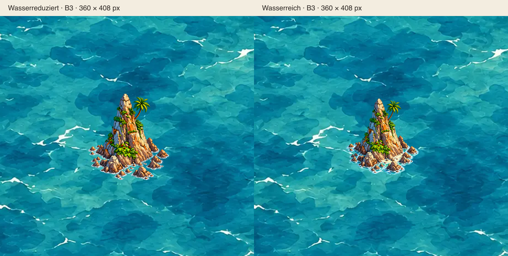
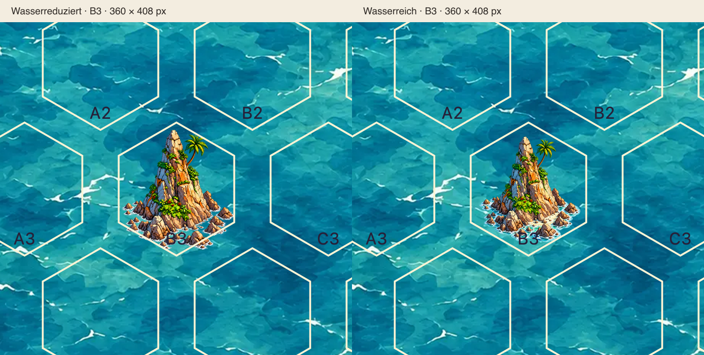

# Felsnadel: zwei Wasserfassungen zur gemeinsamen Auswahl

Stand 19.10.2026, PR #65 / Issue #45, Branch `feature/asset-library-integration`. **Beide sind technisch gültige Alternativen desselben Inselmotivs; beide bleiben künstlerisch und für `sea-blue-01` ungeprüft (`pending`).** Die wasserreiche Fassung ist eine ausdrücklich gewünschte gestalterische Alternative. Sie wird nicht als fehlerhafter Zwischenstand geführt. Der Katalog legt keine bevorzugte Variante fest. Es entsteht kein zweiter geografischer Ort und keine neue Regel für Wasserflächen oder Transparenz.

## Dateien, Registrierung und Pixelprüfung

| | Wasserreduziert, unverändert | Wasserreich, neu |
| --- | --- | --- |
| PNG | [basalt-spire-v1.png](../assets/library/basalt-spire-v1.png) | [basalt-spire-water-v1.png](../assets/library/basalt-spire-water-v1.png) |
| Asset-ID | `land-coast.island.h1.basalt-spire.v1` | `land-coast.island.h1.basalt-spire-water.v1` |
| Maße und Format | 360×408, statisches RGBA-PNG | 360×408, statisches RGBA-PNG |
| `geometry.cells` / `passable` / `stage` | `[[0,0]]` / `false` / `illustration` | `[[0,0]]` / `false` / `illustration` |
| Sichtbare Pixel | 33.860 | 29.483 |
| Davon Alpha 1 | 1.112 | 2.114 |
| Unzulässige sichtbare Pixel in `single.png` | **0** | **0** |
| Vollständige Pixelquadrate lokal | bestanden | bestanden |
| Vollständige Pixelquadrate an A1–E5 | **25/25 bestanden** | **25/25 bestanden** |
| Hintergrundfreigabe `sea-blue-01` | `pending` | `pending` |

SHA-256 der wasserreduzierten Datei, vor und nach dieser Ergänzung bytegleich:

```text
d68f277f4b6bec2b4950a6341f1fac7a0360abe3d638065b047fc5c39ca78ae0
```

SHA-256 der wasserreichen Datei:

```text
21986016dcaf203ae7e2036cf19e35e1437d23fc90b196c87b46b26c1a7fd2cd
```

Die unabhängigen Prüfläufe beider Varianten verwenden den **unveränderten** vorhandenen Prüfer `check_image` / `PixelFootprint` aus `scripts/check-library-images.py`. Jeder Pixel mit Alpha > 0 wird als vollständiges ¼×¼-SVG-Quadrat gegen den lokalen Vertrag und alle 25 `placementContract`-Flächen geprüft. Die originale Alpha-Maske wird zusätzlich pixelweise verglichen. Der neue bestehende Bildtest `test_both_spire_variants_fit_all_25_board_positions` wiederholt diesen Nachweis in CI. [Vollständiger Bericht für beide Dateien](reviews/felsnadel-water/pixel-audit.json).

## Verwendete Quelle und einmaliger Export

Die ursprüngliche wasserreiche `image_gen`-Datei vom 18.10.2026 ist noch vorhanden: `exec-cec45435-7e44-4380-a021-010e56a82777.png`, 1177×1336 RGBA. Sie wurde unmittelbar verwendet. Es gab keine neue Bildgenerierung und keine künstlerische Änderung an Insel, Brandung, Felsen oder Küstensaum. Der unregelmäßige transparente Außenübergang stammt aus dieser Originaldatei; weder ein kreisförmiger Verlauf noch eine geometrische Schnittkante wurde ergänzt.

Zum vollständig unbeschnittenen Einpassen einschließlich aller schwachen Alpha-Ränder an allen 25 Kartenpositionen wurde die komplette Quellleinwand beim Authoring proportional mit Lanczos3 auf **232×263 px** abgetastet (`232/1177 ≈ 0,1971112999`) und durch transparente Ränder auf 360×408 ergänzt: links/rechts 64 px, oben 72 px, unten 73 px. Es wurde keine Maske auf das Bild angewendet, kein Wasser abgeschnitten und kein Alpha-Schwellwert gesetzt. Die normale Filterung/Quantisierung beim Verkleinern gehört zum einmaligen Export. [Exportparameter, Originaldateiname und Quellhash](reviews/felsnadel-water/export-metadata.json).

**Sichtbarer Kompromiss:** Die bisherige wasserreduzierte Datei verwendet einen Authoring-Faktor von `265/1177`. Für die größere Ausdehnung der wasserreichen Quelle beträgt der neue Faktor `232/265 ≈ 87,55 %` davon. Die neue Insel erscheint somit ungefähr **12,45 % kleiner** und etwas tiefer innerhalb ihrer Leinwand. Die bestehende Datei bleibt unverändert. Dieser Motivgrößenunterschied ist Teil des gelieferten Vergleichs und wird nicht durch eine zusätzliche Bildskalierung kaschiert. Es wurden keine Wasserflächen geopfert, um eine gleiche Felshöhe zu erzwingen. Ob diese Einpassung gestalterisch überzeugt, bleibt Gegenstand der gemeinsamen Abnahme.

## Identischer Vergleich in der vorhandenen Galerie

`/dev/asset-library.html` enthält beide IDs automatisch in **Asset zur Einzelprüfung**. Hintergrund `sea-blue-01` wählen und zwischen beiden IDs wechseln. Galeriecode, Renderer, Voronoi-Geometrie und Kartenarchitektur bleiben unverändert. Beide Varianten erscheinen an denselben bestehenden Prüfpositionen A1/B3 und A2/B2, Rand/Innen, gerade/ungerade Zeilen.

Für den Vergleich wurden jeweils dieselbe Position **B3**, dieselbe Originaldatei `sea-blue-01.webp`, derselbe SVG-Ausschnitt und derselbe Kartenmaßstab verwendet. Der Renderer setzt beide vollständigen Leinwände mit **90×102 SVG-Einheiten** ohne individuellen Transform, Versatz oder Clip. Die nativen Aufnahmen nutzen vier Bildschirmpixel pro SVG-Einheit: Originalmeer 2252×1892, jeweils 360×408 Bildschirmpixel pro Asset. Der identische Ausschnitt ist 760×720 px bei `(336,586)`. Die Beschriftung über den zwei Ansichten gehört ausschließlich zum Vergleichsbild und verändert keine Spielgrafik.

Links ist jeweils wasserreduziert, rechts wasserreich. Der Kartenmaßstab ist identisch; der oben dokumentierte Größenunterschied stammt allein aus dem Authoring-Export.





### Beobachtungen zum Wasserübergang

Bei der wasserreichen Variante bleibt unmittelbar am Felsfuß ein hellerer, stärker türkisfarbener Flachwasserbereich sichtbar. Er verbindet die vorgelagerten Felsen optisch mit der Insel und hebt sich bewusst vom dunkleren bzw. gröber strukturierten Originalmeer ab. Die Außenkante folgt einer unregelmäßigen Küsten-/Brandungsform und läuft mit variabler Transparenz aus. Im B3-Ausschnitt ist keine rechteckige oder hexagonale Schnittkante zu erkennen. Der Farb- und Texturunterschied zum Originalmeer bleibt erkennbar; die Überblendung ist kein Nachweis einer universellen Hintergrundverträglichkeit.

Die wasserreduzierte Variante zeigt in den Zwischenräumen unmittelbar die Originalmeerstruktur; vor allem die weißen Brandungsstriche setzen die Küste ab. Beide lösen den Übergang sichtbar unterschiedlich. Keine dieser Beobachtungen setzt eine allgemeine Gestaltungsregel oder erteilt eine Freigabe. Die Vergleichsansichten und die vier Galeriepositionen dienen der anschließenden menschlichen Entscheidung über Natürlichkeit, Größe und Farbwirkung.

## Tests und verbleibende Abnahme

- Katalog-/Bildvalidator: sechs Assets, drei Hintergründe; beide PNGs mit explizitem Alpha und gültigen Pixelmaßen.
- **13/13 Bildregressionen bestanden**, einschließlich des neuen vollständigen Nachweises beider Fassungen an allen 25 Positionen.
- **88/88 Unit-Tests bestanden**; beide Fassungen sind unbefahrbar, `pending` und für ungeprüfte produktive Platzierungen gesperrt.
- **27/27 Pakettests und 4/4 Deployment-Browserprüfungen bestanden**. Das tatsächlich erzeugte/entpackte ZIP lädt beide Illustrationen unter dem Unterpfad auf Desktop, Smartphone, iPhone/WebKit und iPad/WebKit. Der bisherige Deploymenttest mit pauschal exakt vier Katalogeinträgen wurde auf die vier technischen Platzhalter und unabhängig dekodierbare PNGs beider Illustrationen umgestellt. Der Fehler des vorherigen CI-Laufs lag in dieser veralteten Testannahme, nicht in einem ungültigen Bild.
- Die vorhandenen Galerie-/Renderer-Browserprüfungen sind um den Wechsel beider Varianten bei identischen Bildmaßen und Ankern erweitert. Ergänzende Galerieaufnahmen in Chromium Desktop/Mobil und WebKit Desktop/Tablet bei DPR 1/2 sind erfolgreich; beide IDs sind unabhängig auswählbar. [Messbericht](reviews/felsnadel-water/browser-audit.json).
- Ein erster lokaler paralleler Browserlauf scheiterte an `ERR_CONNECTION_RESET` beim Laden von `mobile-views.mjs`; dies betraf den vorhandenen DPR-2-Test. Die serielle Wiederholung des gesamten Asset-Browserfiles bestand mit **10/10 Chromium- und 10/10 WebKit-Fällen**. Der GitHub-Actions-Lauf für den endgültigen Commit wird anschließend abgewartet; sein Abschluss wird in [PR #65 / Checks](https://github.com/roquas/Sams-Gezeitenkarten/pull/65/checks) und in der Abschlussmeldung dokumentiert.

Künstlerische und konkrete Hintergrundfreigabe bleiben für **beide** Fassungen `pending`. Keine bevorzugte Variante im Katalog, keine neuen Orte, keine veröffentlichten Platzierungen, keine Änderungen an `main`, kein Merge. Die bestehende offene Bildladefehlerbehandlung B6 aus PR #65 wird durch diesen Variantenvergleich nicht verändert.

Der lokale Ordner `output/felsnadel-water/` bewahrt Originalquelle, Exportparameter, unabhängige Audit-Skripte, einzelne und vollständige Galerieaufnahmen sowie Testprotokolle. Die PNGs und Vergleichsbelege sind im PR-Branch enthalten.
