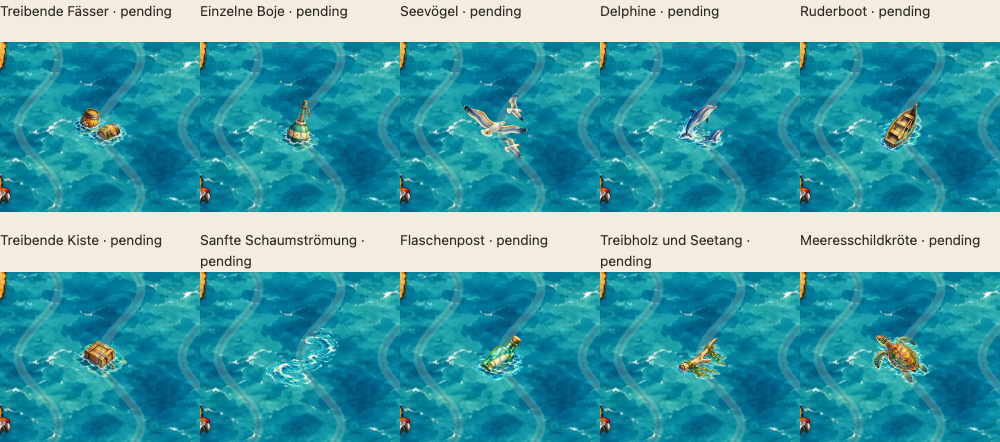

# Erste Minigrafik-Runde – PR #65

> Historischer Stand bis Commit 70487e9. Der aktuelle Abschluss mit sechs neu eingeordneten Ortsmotiven, freier Schaumströmung und letzter Wasserillustrationsrunde steht in [CARD-MOTIFS-FINALE-65.md](CARD-MOTIFS-FINALE-65.md); alle aktuellen Rollen/Freigaben in [ASSET-INVENTORY-65.md](ASSET-INVENTORY-65.md).

19.10.2026 · Branch `feature/asset-library-integration` · kein Merge.

Der [Freigabeabgleich](ART-APPROVAL-AUDIT-65.md) ist abgeschlossen: elf bestehende Freigaben stimmen exakt mit ihren ursprünglichen Freigabecommits und aktuellen Bildern überein; Tesoro v4 erhält nach ausdrücklicher Nutzerentscheidung die zwölfte Freigabe, ausschließlich für die unveränderte Version von `sea-blue-01`. Andere Varianten und Hintergründe erhalten keine Freigabe.

## Zehn neue Motive zur gemeinsamen Sichtung

Alle neuen Motive bleiben **künstlerisch UNFREIGEGEBEN / pending** auf sämtlichen drei Hintergründen. Es sind keine Approval-Hashes, Reviewer oder Freigabedaten gesetzt. Hashes in Export-/Browserberichten dienen ausschließlich dem technischen Nachweis der geprüften Bildbytes.

| Motiv für die Besprechung | Katalog-ID | PNG unter `assets/library/` |
|---|---|---|
| Treibende Fässer | `sea-life.accent.h1.barrels.v1` | `flavor-barrels-v1.png` |
| Einzelne Boje | `sea-life.accent.h1.buoy.v1` | `flavor-buoy-v1.png` |
| Seevögel | `sea-life.accent.h1.gulls.v1` | `flavor-gulls-v1.png` |
| Delphine | `sea-life.accent.h1.dolphins.v1` | `flavor-dolphins-v1.png` |
| Ruderboot | `sea-life.accent.h1.rowboat.v1` | `flavor-rowboat-v1.png` |
| Treibende Kiste | `sea-life.accent.h1.crate.v1` | `flavor-crate-v1.png` |
| Sanfte Schaumströmung | `sea-life.accent.h1.foam.v1` | `flavor-foam-v1.png` |
| Flaschenpost | `sea-life.accent.h1.bottle.v1` | `flavor-bottle-v1.png` |
| Treibholz und Seetang | `sea-life.accent.h1.driftwood.v1` | `flavor-driftwood-v1.png` |
| Meeresschildkröte | `sea-life.accent.h1.turtle.v1` | `flavor-turtle-v1.png` |

Die Bezeichnungen sind nur Besprechungstitel in der Entwicklungsgalerie. Keine logischen Orte, Ortslabels, orangefarbenen Ringe, Hinweisparameter oder neuen Assettypen. Verwendet wird unverändert der bestehende Typ `accent`, Rolle `decoration`, Familie `sea-life`, Geometrie `[[0,0]]`. Dekoration trägt laut bestehendem Schema kein `passable`-Feld und beeinflusst die Befahrbarkeit nicht; sämtliche gezeigten Felder bleiben befahrbar. Die noch nicht freigegebenen Grafiken dürfen nur im Entwicklungsmodus platziert werden. Der Produktionsvalidator weist sie weiterhin zurück.

## Herstellung und Export

Eingebautes `image_gen`, je Motiv ein eigener Auftrag mit echter Transparenz. [Vollständiger Promptsatz](reviews/minigrafiken/generation-prompts.json). Der freigegebene Leuchtturm und das diagonale Wrack dienen ausschließlich als Stilreferenzen; das aktuelle Meer als Kompositionsuntergrund. [Alle zehn Malmaster](reviews/minigrafiken/masters/) liegen unverändert im Repository.

`scripts/export-flavor-prototypes.py` nutzt den bestehenden Ganzbildexport aus `export-multihex-prototypes.py`: proportionales Resampling der vollständigen Leinwand und transparentes Auffüllen auf **360×408 RGBA PNG**. Keine geometrische Beschneidung oder Rotation, keine laufzeitabhängigen Maße. Nur der bereits getestete, geometrieunabhängige Filter für isolierte Alpha-1-Exportreste kommt zur Anwendung; bedeutungsvolle Alpha-Pixel und weiche Ränder bleiben erhalten. Die Schnittmenge der strengen Sicherheitsflächen aller **25** gültigen Einzelhexanker bestimmt die zulässige unbeschnittene Einpassung. Der unabhängige Pixelprüfer validiert anschließend jedes vollständige Pixelquadrat mit Alpha > 0 an allen Ankern.

## Vorhandene Galerie und Ansichten

[Minigrafiken in der bestehenden Assetbibliothek](http://127.0.0.1:4184/dev/asset-library.html#minigrafiken). Keine zusätzliche Galerieseite.

- Gemeinsame vollständige Karte mit zehn namenlosen Dekorationen.
- Alle zehn Motive bei **1 CSS-Pixel je Karteneinheit** mit offenem Meer und Nachbarfeldern; feste Spritegröße 90×102 Karteneinheiten.
- Wählbare vergrößerte Ansicht derselben Szene; nur die gesamte Vorschau wird größer, das Bildrechteck bleibt identisch.
- Hexgrenzen und echte Stundenmarkierungen/Route mit den vorhandenen Schaltern.
- Alle Motive im vorhandenen Einzelprüfmenü an geraden/ungeraden Rand- und Innenpositionen.

[Mit Hexgrenzen](reviews/minigrafiken/round-normal-hexes.png) · [Spielmarkierungen](reviews/minigrafiken/round-normal-overlays.png) · [vollständige Karte](reviews/minigrafiken/map-normal-clean.png).

Vergrößert: [Fässer](reviews/minigrafiken/barrels-enlarged.png), [Boje](reviews/minigrafiken/buoy-enlarged.png), [Vögel](reviews/minigrafiken/gulls-enlarged.png), [Delphine](reviews/minigrafiken/dolphins-enlarged.png), [Ruderboot](reviews/minigrafiken/rowboat-enlarged.png), [Kiste](reviews/minigrafiken/crate-enlarged.png), [Schaumströmung](reviews/minigrafiken/foam-enlarged.png), [Flaschenpost](reviews/minigrafiken/bottle-enlarged.png), [Treibholz](reviews/minigrafiken/driftwood-enlarged.png), [Schildkröte](reviews/minigrafiken/turtle-enlarged.png).

## Validierung und offene Punkte

Lokal vollständig bestanden:

- **106 Unit-Tests**, vier eindeutig lösbare Rätsel und Katalog-/Hashprüfung sämtlicher **33 Assets** auf drei Hintergründen, zwölf exakte Freigabepaare.
- Vollständige Alpha-Prüfung aller 33 Bilder; **13 Bild-Regressionsprüfungen** (449,6 Sekunden) und **fünf Export-/Flächenregressionen**, einschließlich historischer Tesoro-/Krabbenzangenprüfungen.
- Alle **250** Motiv-/Ankerkombinationen der neuen Grafiken mit **null** Pixeln außerhalb der Sicherheitsflächen. 64–81 % der erlaubten Einzelhex-Grafikfläche bleiben vollständig transparent; siehe [Größe und Wasserraum](reviews/minigrafiken/scale-and-air-audit.json).
- **36 Galerie-Browserfälle**: je 18 in Chromium und WebKit, Desktop und Mobil. Dazu vier Bildaufnahme-Konfigurationen mit exakten Dateiprüfsummen.
- Tatsächliches Veröffentlichungs-ZIP: **93 Dateien**, alle **33 Katalog-PNGs bytegleich**, einschließlich der zehn neuen. **Vier ZIP-Browserfälle** auf Desktop, Smartphone, iPhone und iPad, unter einem Auslieferungsunterpfad. Die zehn neuen Dateien werden vollständig dekodiert, mit den Repositorybytes verglichen und auf pending ohne Freigabefelder geprüft.

Frühe lokale Chromium-Läufe hatten unvollständige Modulantworten (Netzwerkstatus −1) beim bereits laufenden Server bzw. bei gleichzeitigem Betrieb mehrerer Browserprozesse. Der abschließende vollständige Lauf mit einem Worker und ohne gleichzeitigen WebKit-Prozess besteht **18/18**; WebKit besteht **18/18**. Keine Assertions oder Zeitlimits wurden geändert. Alle neuen Minigrafik-Browsertests bestanden auch in den früheren Läufen.

Die 27 Paket-Fehlerfixtures und alle sonstigen UI-Suiten wurden nicht vollständig erneut ausgeführt und werden nicht als lokal bestanden gezählt. [Prüfzusammenfassung](reviews/minigrafiken/validation-summary.json) · [ZIP-Beleg](reviews/minigrafiken/package-audit.json).

GitHub-CI nach Push wird separat in PR #65 und im Abschluss ausgewiesen. Lokale Ergebnisse werden nicht als GitHub-CI-Erfolg ausgegeben. [Erhaltung bisheriger Dateien und Freigaben](reviews/minigrafiken/preservation-audit.json) · [Pixelprüfung](reviews/minigrafiken/pixel-audit.json) · [Browserprüfung](reviews/minigrafiken/browser-audit.json).

Bekannter vorgelagerter CI-Fehler im Unit-Job des Ausgangsstands `ea4ae41`: `ModuleNotFoundError: No module named 'PIL'` bei `publication-archive.test.mjs` → Paketvalidator. [Jobprotokoll](https://github.com/roquas/Sams-Gezeitenkarten/actions/runs/39312851963/job/118266668009). Andere Asset- und Browserjobs dieses Ausgangsstands waren erfolgreich. Die bereits vorbereitete [Workflowkorrektur](reviews/tesoro-v2/unit-ci-pillow.patch) bleibt separat; kein Umgehen der Veröffentlichungskontrollen oder Abschwächen bestehender Tests.

**Offen bleibt die künstlerische Nutzerentscheidung für diese zehn exakten Minigrafiken**, insbesondere Motivgrößen, Schaum-/Wasseranteile, Lesbarkeit und mögliche Hinweiswirkung. Eine technische Prüfung genehmigt sie nicht. Issue #68 und sein Konzept kontextueller Ortslabels bleiben unverändert.
