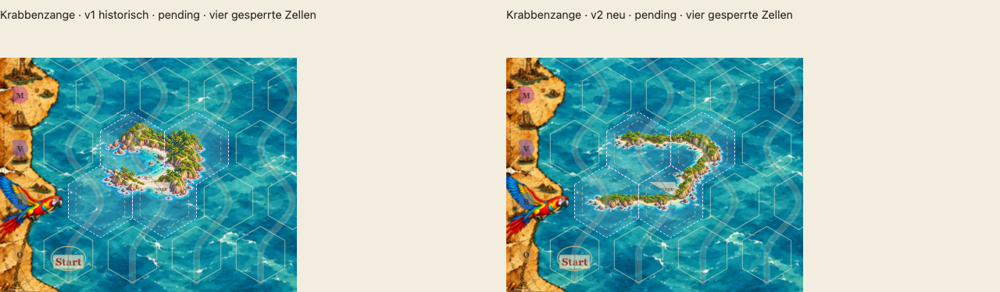
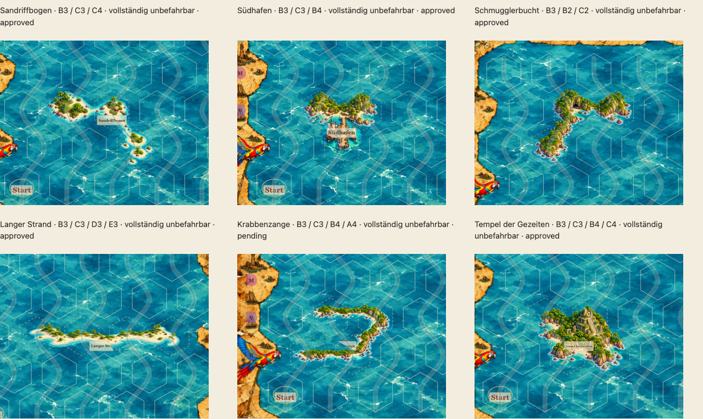

# Mehrhex-Bibliothek abschließen: fünf Freigaben, Krabbenzange v2 und Ortsnamen

Stand 19.10.2026 · bestehender PR #65 · ausschließlich `feature/asset-library-integration` · Ausgangsstand `5e3991f`. Kein Merge, keine Änderung an main. Der bestehende produktive Kartenrenderer, Geometrievertrag, Rätseldaten und Logbuchtexte bleiben unverändert. Die Entfernung permanenter orangefarbener Kartografenringe bleibt erhalten.

**Nachfolgender Auftrag:** [Tesoro](TESORO-PROTOTYPE-65.md) übernimmt den aktuellen Vierhex-Prüfplatz der Galerie. Beide Krabbenzangen sind jetzt historische, weiterhin nicht freigegebene Entwürfe. Die folgenden Aussagen zur bevorzugten v2 und ihren Screenshots dokumentieren den damaligen Stand bei `86bba51`; sie sind keine aktuelle Motivauswahl oder neue Freigabe.

## Fünf ausdrückliche künstlerische Freigaben

Der Nutzer hat folgende **unveränderten Bildversionen ausschließlich für die geprüfte Hintergrundversion `sea-blue-01`** freigegeben. Die Katalogreviews nennen roquas, Datum und SHA-256 beider konkreten Dateien.

| Motiv | Stabile Asset-ID | Unveränderte Bild-SHA-256 |
|---|---|---|
| Sandriffbogen | `land-coast.archipelago.h3.sand-reefs.v2` | `4ecc67e6704b9bb2124b3f56804799a8debacb93fa2e171619d3e220a037f78e` |
| Südhafen | `land-coast.island.h3.south-harbor.v1` | `cb4086c17282d8fc94cadf3c6508a8b41bd3287b88b78dfc348fe6f0f85b5f62` |
| Schmugglerbucht | `land-coast.island.h3.smuggler-cove.v1` | `ef714948e10fb923fc6c7e5299ea4cc7064468a8d267c5e0f6463dbe0c1d4075` |
| Langer Strand | `land-coast.island.h4.long-sand.v1` | `599ff785c04453aa9f75b9214b7c994a6596b3b63026b8bfd31d89c8870f2130` |
| Tempel der Gezeiten | `land-coast.island.h4.jungle-temple.v1` | `6b3a942beda696b1fca3039fb032d7a2719c9ecc42e5e3c9741a530479b31254` |

Die Hintergrund-SHA-256 ist `e33cf0d09477e93588cfc209bb0ab9b224d7624139d707fede23a390b14f2582`. Auf den beiden anderen Hintergründen bleiben diese fünf Motive pending. Der [Freigabe-/Bilderhaltungsbericht](reviews/multihex-completion/approval-preservation-audit.json) bindet jedes Motiv an seine unveränderten Bytes aus `5e3991f`.

Die sechs bereits bestehenden Freigabepaare einschließlich Palmenbuchten und Glutberg bleiben in sämtlichen Reviewfeldern erhalten. Damit existieren jetzt exakt **elf** freigegebene Asset/Hintergrund-Paare, alle ausschließlich auf `sea-blue-01`. Alle früheren Illustrations-PNGs bleiben bytegleich. [Erhaltungsbericht](reviews/multihex-completion/preservation-audit.json).

**Krabbenzange v1 und v2 bleiben auf allen Hintergründen pending.** Die bisherige v1 ist eine historische Referenz und kein bevorzugter Prüfkandidat mehr. Auch der ursprüngliche steile Archipel bleibt ausdrücklich ungeprüft beziehungsweise nicht freigegeben; die Freigabe des Sandriffbogens überträgt sich nicht auf ihn.

## Neue Krabbenzange v2: dieselbe Vierhexform, neu komponierte Landschaft

- Bevorzugtes Asset: `land-coast.island.h4.crab-claw.v2`.
- Eine einzige vollständige transparente RGBA-Datei: [crab-claw-h4-v2.png](../assets/library/crab-claw-h4-v2.png), feste **856×680 Pixel**.
- Unveränderte axiale Vierhexform: `[[0,0],[1,0],[0,1],[-1,1]]`.
- Alle **14 gültigen Kartenanker** werden vollständig geprüft: `B1 C1 D1 A2 B2 C2 D2 B3 C3 D3 A4 B4 C4 D4`.
- Alle vier Zellen einschließlich der offenen Lagune bleiben unbefahrbar; die Prüfplatzierung setzt jede davon in `blocked`.

Vor der Illustration wurde die [tatsächliche vereinigte Voronoi-Fläche](reviews/multihex-completion/geometry-claw-v2.png) untersucht und eine [neue Kompositionsskizze](reviews/multihex-completion/composition-claw-v2.png) angelegt. Die lange obere Landzunge folgt den beiden nördlichen Feldern. Die deutlich nach Westen versetzte untere Landzunge folgt der südlichen Reihe bis weit in das südwestliche Feld. Die Ostseite verbindet sie schräg nach Südwesten; dazwischen liegt eine große offene Lagune mit Riffen, Klippen, Brandung und kleinem Schiffswrack.

Die neue Landschaft wurde mit dem eingebauten **image_gen** gezeichnet, nicht durch Vergrößern der v1 erzeugt. Zwei frühe Quellen hatten eine zu senkrechte Ostseite. Ein sicherer Export der ersten dieser Fassungen hätte erneut nur eine kleine zentrale Zange ergeben; sie wurde verworfen. Die finale Generierung benutzt die Kompositionsskizze als erste und die freigegebenen Palmenbuchten als reine Stilreferenz. Der lebendige plastische, farbige Adventure-/Aquarellcharakter bleibt erhalten. [Vorabplan und erster Prompt](reviews/multihex-completion/composition-plan.json), [verworfener Korrekturversuch](reviews/multihex-completion/prompt-followup.json), [maßgeblicher finaler Prompt mit Bildrollen](reviews/multihex-completion/prompt-final.json).

### Nachprüfbare Nutzung der äußeren Bereiche

| Merkmal | Historische v1 | Neu komponierte v2 |
|---|---|---|
| Breite der Pixel mit Alpha ≥128 | 549 px | 721 px (**+31 %**) |
| Höhe derselben Pixelgrenze | 410 px | 427 px |
| Sichtbare Pixel im südwestlichen Feld, Alpha ≥16 | 13.819 | 23.719 (**+72 %**) |
| Westlicher Außenbereich des SW-Feldes: x mindestens 20 SVG-Einheiten westlich seines Zentrums, Alpha ≥16 | 0 | 1.296 |
| Östlicher Außenbereich des NE-Feldes: x mindestens 15 SVG-Einheiten östlich seines Zentrums, Alpha ≥16 | 0 | 5.312 |

Der [Abdeckungsvergleich](reviews/multihex-completion/coverage-comparison.json) nennt alle Zellwerte und Bildgrenzen. Der neue Regressionstest verlangt mindestens 25 % mehr sichtbare Breite und substanzielle zusätzliche Bildanteile in beiden beschriebenen Außenbereichen. Die bisherige Mindestabdeckung jeder deklarierten Zelle bleibt zusätzlich bestehen.

Diese Messungen erfassen auch Riffe, Wasser und Brandung, nicht ausschließlich Land. Die gesamte Zahl sichtbarer Pixel muss bei der nun wesentlich offeneren Lagune nicht steigen. Sie ersetzen keine künstlerische Entscheidung darüber, ob beide Landzungen lang und weit auseinandergezogen genug wirken. Die unvergrößerten Spielansichten zeigen deshalb beide Versionen nebeneinander.

[Versionen ohne technische Flächenüberlagerung](reviews/multihex-completion/claw-versions-clean.png).

## Bestehende Galerie

[Krabbenzange direkt begutachten](http://127.0.0.1:4179/dev/multihex-prototypes.html?asset=claw#clawGeometry), nach lokalem Start mit `python3 scripts/dev-server.py --port 4179`. Es ist dieselbe bestehende Mehrhex-Galerie, die aus der Assetbibliothek verlinkt ist; kein paralleler Viewer.

Die gemeinsame Sechserübersicht zeigt die fünf freigegebenen Motive mit dem aktuellen Katalogstatus und die neue pending-Krabbenzange. Palmenbuchten und Glutberg bleiben als unveränderte frühe Stilreferenzen sichtbar. Die Motivauswahl bevorzugt v2; v1 erscheint nur im ausdrücklich historischen Versionsvergleich und im Katalog.

Die Ansichten benutzen `drawMap`, `sea-blue-01`, echte Hexgrenzen und die tatsächlichen Pergamentlabels mit **unveränderten Ortsnamen**. Der neue Schalter im Versionsvergleich zeigt die tatsächlichen gestreckten Voronoi-Grafikzellen über dem normalen Kartenraster. Diese Entwicklungsüberlagerung verändert oder beschneidet keine Bilddatei und wird nicht im produktiven Renderer implementiert. Bildpositionen und -maße bleiben beim Umschalten identisch.

[Ohne Hexlinien](reviews/multihex-completion/comparison-clean.png) · [Mit Stundenzeichen und Route](reviews/multihex-completion/comparison-overlays.png) · [Smartphone](reviews/multihex-completion/comparison-mobile.png) · [Krabbenzange an Rand-/Innenpositionen beider Zeilenparitäten](reviews/multihex-completion/positions-claw.png).

## Unveränderter technischer Bildvertrag

Eine Platzierung erzeugt genau ein `<image>` für die gesamte Vierhexgrafik. Es gibt keine individuellen Laufzeit-Transforms, Rotation, Skalierungsparameter, Ausschnitte, inneren Masken oder Bildnähte. Vier Bildpixel entsprechen fest einer SVG-Einheit; nur die gesamte responsive Karte skaliert gemeinsam.

`scripts/export-claw-v2.py` bearbeitet ausschließlich die neue v2 über den etablierten Whole-Canvas-Exporter. Die vollständige generierte Quellleinwand wird einmal proportional resampelt und transparent aufgefüllt, nie geografisch beschnitten. Der feste Export verwendet 87 % des maximalen proportional in den rechteckigen Rahmen passenden Leinwandmaßstabs; das ist keine Landabdeckungsquote und kein Laufzeitfaktor. Der unabhängige Validator prüft alle vollständigen Viertelpixelquadrate bis Alpha 1 gegen die echte vereinigte Grafikfläche sowie die Schutzhülle an jeder gültigen Kartenposition.

Wie bisher werden nur abgesetzte Alpha-1-Exportreste außerhalb von acht Quellpixeln um Alpha ≥2 entfernt. Alle Pixel mit Alpha ≥2 und ihre weichen Alpha-1-Ränder bleiben erhalten. Keine globale Transparenzschwelle und kein Wegschneiden von Küsten. [Pixelbericht mit Quell-/Zielhashes, Abtastung, Rändern und allen Ankern](reviews/multihex-completion/pixel-audit.json).

Die Quelldateien und verworfenen Versuche liegen lokal unter `output/multihex-completion/`; die finale PNG liegt vollständig im Repository und wird bytegleich ins ZIP übernommen. Neugenerierungen sind nicht bytegleich reproduzierbar. Die Prüfung der ausgelieferten PNG benötigt die lokalen Quellen nicht. `scripts/capture-multihex-round2.mjs` erfasst die bestehende Galerie und schreibt nun standardmäßig nach `docs/reviews/multihex-completion`; ein optionales drittes Argument wählt ein anderes Ausgabeverzeichnis. Historische Belege der zweiten Runde bleiben unverändert.

## Verbindliche Namensregel

Die neue [Gestaltungsregel im Welt-/Styleguide](WORLD-AND-STYLE.md#verbindliche-gestaltungsregel-ortsnamen-auf-pergamentrollen) bevorzugt ein einzelnes charakteristisches Wort mit etwa **6–12 Zeichen**. Längere Namen benötigen eine Lesbarkeitsprüfung in der tatsächlichen Kartendarstellung. Keine extreme automatische Schriftverkleinerung. Prägnante, humorvolle oder ungewöhnliche Namen passen zur Welt von „Plötzlich Pirat:in“ und sollen die Orte klar unterscheidbar machen.

Die beispielhaften Verkürzungen sind unverbindlich. **Es wurden keine bestehenden Ortsnamen, Puzzledefinitionen, Logbuchtexte oder Labelalgorithmen geändert.** Die Regel gilt zunächst für künftige Gestaltung und Benennung; eine systematische Überarbeitung vorhandener Namen wäre ein separater Auftrag. [Entscheidungsvermerk](DECISIONS.md#kurze-lesbare-ortsnamen-19102026-pr-65).

## Künstlerisch noch offen

Die Nutzerbegutachtung betrifft die neue Krabbenzange v2: Ausdehnung und Verhältnis der beiden Arme, Lesbarkeit der offenen Lagune als insgesamt gesperrter Ort, Stil-/Wasserpassung und Überdeckung von Motivdetails durch das echte Pergamentlabel. Der technische Versionsvergleich ist eine Hilfe, keine Freigabe. Die fünf ausdrücklich freigegebenen Motive benötigen keine erneute Abnahme für dieselben Bild-/Hintergrundbytes. Ungeprüfte Hintergründe bleiben pending. Bestehende allgemeine PR-Folgepunkte werden nicht pauschal geschlossen.

## Prüfungen

- **101 Unit-Tests** und weiterhin vier Rätsel mit je genau einer Lösung bestanden.
- **19 Katalogbilder / drei Hintergründe**, exakt **elf** hashgebundene Freigabepaare validiert; **13 Bildregressionen** und **drei Export-/Zellabdeckungstests** bestanden. Die neue Krabbenzange wird unabhängig an sämtlichen **14 gültigen Ankern** geprüft, einschließlich vollständiger Pixelquadrate bis Alpha 1.
- Alle **16 betroffenen Chromium-Fälle** erfolgreich (15 im abschließenden Lauf, ein mobiler Kartenstart nach anfänglichem Lade-Timeout in gezielter Wiederholung). **16/16 WebKit-Galeriefälle** auf Desktop und Mobil ohne Fehler. Die Versionen, der Standardkandidat v2, fünf freigegebene Sechserübersichtsmotive, vier gesperrte Zellen und die unveränderte Bildgeometrie beim Umschalten der Voronoi-Flächen werden geprüft.
- Ein bestehender Tablet-Test war an einen festen lokalen Server gebunden. Er übernimmt jetzt die konfigurierte Basisadresse auch in seinem eigens erzeugten Browserkontext; keine Produktänderung und keine abgeschwächte Assertion.
- **4/4 Asset-Deploymentfälle** des frisch erzeugten ZIP unter einem Unterpfad bestanden: Desktop, Smartphone, iPhone/WebKit und iPad/WebKit. Alle 19 PNGs im ZIP sind bytegleich mit den geprüften Dateien; die Galerie ist nicht im Laufzeitpaket enthalten.
- Visuelle Prüfung und Bilddekodierung auf Chromium Desktop, WebKit Desktop und Chromium Smartphone/DPR 2 erfolgreich; [Browserbericht](reviews/multihex-completion/browser-audit.json) ohne Lade-/JavaScriptfehler.
- **27/27 Paketregressionen** bestanden; der Export enthält 79 Dateien. [Lokaler Abschlussbericht](reviews/multihex-completion/validation-summary.json). Die vollständige unveränderte CI-Matrix läuft nach dem Push auf [PR #65 / Checks](https://github.com/roquas/Sams-Gezeitenkarten/pull/65/checks).
