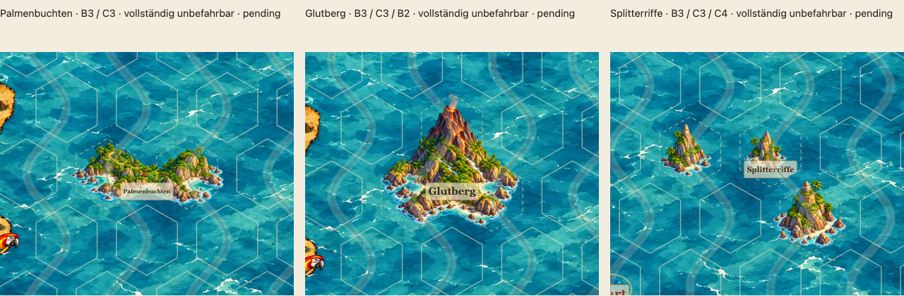
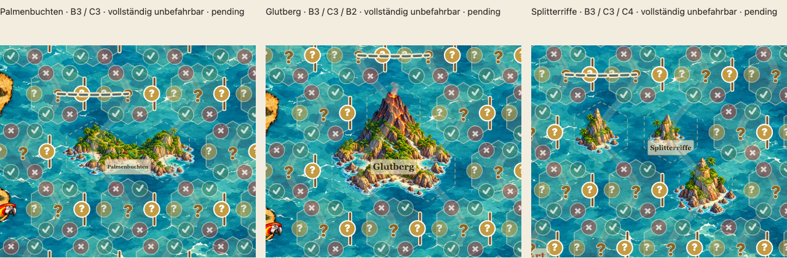

# Drei unbefahrbare Mehrhex-Prototypen – pending

Stand 19.10.2026, bestehender PR #65, Branch `feature/asset-library-integration`. **Keine künstlerische Freigabe.** Alle drei neuen Illustrationen und alle neun Hintergrundkombinationen stehen ausdrücklich auf `pending`. Die vier vorher freigegebenen Kombinationen einschließlich ihrer Bildhashes bleiben erhalten. Keine produktiven Rätseldaten oder neuen Spielfunktionen.

[Interaktive Prüfgalerie](http://127.0.0.1:4175/dev/multihex-prototypes.html) nach lokalem Start `python3 scripts/dev-server.py --port 4175`. Die bestehende [Assetbibliothek](../dev/asset-library.html) verlinkt die [Mehrhex-Galerie](../dev/multihex-prototypes.html). Die Galerie gehört ausschließlich zur Entwicklung und wird wie bisher nicht in das Laufzeit-ZIP gepackt.

## Motive und tatsächliche Architektur

| Motiv | Eine vollständige RGBA-PNG pro Objekt | Axiale Zellen | Feste Pixelmaße | Gültige Anker |
|---|---|---|---|---|
| Palmenbuchten: lange tropische West–Ost-Insel mit Buchten, Hügeln und dichter Vegetation | [tropical-bays-h2-v1.png](../assets/library/tropical-bays-h2-v1.png) | `[[0,0],[1,0]]` | 688×408 | 20 |
| Glutberg: massive zusammenhängende Vulkaninsel, dominanter plastischer Kegel, dunkler Basalt, tropische Basis, kleiner Kraterrauch | [massive-volcano-h3-v1.png](../assets/library/massive-volcano-h3-v1.png) | `[[0,0],[1,0],[1,-1]]` | 688×768 | 16 |
| Splitterriffe: gebogene Gruppe aus getrennten Inseln, Klippen, Riffen und offenen Wasserpassagen | [bent-reefs-h3-v1.png](../assets/library/bent-reefs-h3-v1.png) | `[[0,0],[1,0],[1,1]]` | 912×768 | 13 |

Die drei stabilen IDs lauten `land-coast.island.h2.tropical-bays.v1`, `land-coast.island.h3.massive-volcano.v1` und `land-coast.archipelago.h3.bent-reefs.v1`. Jede Platzierung erzeugt **genau ein `<image>` für die gesamte Gruppe**. Kein Zerlegen in Einzelhexdateien, keine inneren Masken, keine individuellen Laufzeit-Transforms, Drehungen, Ausschnitte oder Skalierungsparameter. Die feste Quelldichte beträgt wie zuvor vier Pixel je SVG-Einheit; nur die gesamte responsive Karte skaliert gemeinsam.

Untersucht wurden `src/assets/geometry.mjs`, `src/assets/library.mjs`, `src/ui/asset-layer.mjs`, `src/ui/map.mjs`, `src/ui/place-labels.mjs`, `dev/review-positions.mjs` sowie die tatsächlichen Katalogdaten. Die Grafikgrenzen sind **nicht** die sichtbaren regulären Hexpolygone mit Radius 36. Das tatsächliche versetzte Zentrenraster hat Schritte `(82,0)` und `(41,68)`. Die gestreckten Voronoi-Zellen erfüllen `|x|≤41` und die schrägen Mittelsenkrechten `±41x±68y≤(41²+68²)/2`; ihre Fläche beträgt 82×68. Die erlaubte Mehrhexfläche ist ihre Vereinigung, einschließlich der inneren Übergänge, an Randpositionen geschnitten mit der vorhandenen Spielgeometrie-Schutzhülle. Der symmetrische Bildrahmen wird um den Mittelwert aller Zellenzentren bestimmt und erhält vier SVG-Einheiten Reserve. Daher ist etwa die kompakte Dreierleinwand 192 SVG-Einheiten hoch, keine skalierte Einzelhexdatei.

Die Vorlagen wurden je Form direkt aus diesem Vertrag erzeugt: [West–Ost](reviews/multihex/geometry-tropical.png), [Vulkan mit nördlicher Spitze](reviews/multihex/geometry-volcano.png), [gebogener Archipel](reviews/multihex/geometry-archipelago.png). Die Vulkanform verwendet bewusst ein nördliches Feld für den Kegel und zwei südliche für die breite Basis. Das ist eine feste axiale Geometrie, keine Drehung eines anderen Assets.

Es gibt im bestehenden Schema **keine automatische Auswahl positionsspezifischer Bilddateien**. Derselbe PNG-Export muss deshalb an jedem für die Form gültigen Anker passen. Die Galerie deckt für jede Form alle vier Kombinationen aus gerader/ungerader Zeile und Rand/Innenbereich ab. Die Pixelregression prüft darüber hinaus sämtliche 49 gültigen Anker, einschließlich rechts/unten; nicht passende Anker, bei denen eine Zelle außerhalb der Karte läge, sind keine zulässigen Platzierungen.

## Spielregel und produktive Beschriftung

Alle drei Assets sind `geographic`, `illustration`, `passable: false`. Die Entwicklungsfixtures setzen **sämtliche** belegten Zellen in `blocked` und in denselben benannten Ort. Das offene Wasser im Archipel bleibt spielmechanisch gesperrt. Eine fehlende gesperrte Zelle wird vom bestehenden Platzierungsvalidator verworfen. Eine Freigabe für produktive Verwendung bleibt ebenfalls gesperrt, solange `pending` besteht.

Die Galerie benutzt direkt den produktiven `drawMap`, `drawAssetPlacements` und `placeLabelLayout`, den echten Meereshintergrund `sea-blue-01.webp`, die normalen Hexpolygone und die echte Pergamenttextur. Kein nachgebautes Label und keine entfernten Spieloverlays. Das Labelverfahren nutzt die zusammenhängenden logischen Ortszellen, deren Schwerpunkt und die verfügbare landseitige Beschriftungsfläche; es untersucht keine Landpixel der Illustration. Ein Archipel erhält daher einen gemeinsamen Ortsnamen trotz getrennter realer Inselchen. An allen gültigen Positionen wird geprüft, dass die reservierte Labelfläche in der Ortsfläche bleibt und keine befahrbaren Nachbarhexes überlappt; der Browser prüft zusätzlich die tatsächlichen Schriftmaße.

Die parallele Änderung `49f8f28` zur Entfernung permanenter orangefarbener Kartografenringe wurde vor der abschließenden Prüfung übernommen. Der Produktionsrenderer wurde durch diese Mehrhex-Arbeit nicht verändert. Markierungen im Prüffall betreffen nur befahrbare Nachbarfelder: Stundenzeichen, aktive Stundenkante und eine gültige benachbarte Route. Zusätzlich eingespielte Markierungen auf gesperrten Zellen werden vom produktiven Renderer unterdrückt.

## Prüfung im Kartenkontext

Die drei Detailansichten an B3 haben denselben 300×250-SVG-Ausschnitt und denselben Darstellungsmaßstab. Die PNGs selbst werden nicht beschnitten. Darunter zeigen vier vollständige Karten je ausgewähltem Motiv die reale Randlage und Ortsnamen. Auf schmalen Displays stehen die Ansichten untereinander.

**Echte Hexgrenzen und Pergament-Ortsnamen:**

**Stundenzeichen und Route auf Nachbarfeldern:**

**Ohne Hexlinien:**

Vollständige Karten: [Palmenbuchten](reviews/multihex/positions-tropical.png), [Glutberg](reviews/multihex/positions-volcano.png), [Splitterriffe](reviews/multihex/positions-archipelago.png). [Browser-/Gerätebericht](reviews/multihex/browser-audit.json).

## Erzeugung und nachvollziehbarer Export

Eingebautes **image_gen** mit echtem transparentem Hintergrund; Stilreferenz war die freigegebene wasserreiche Felsnadel. Je finalem Motiv eine vollständige generierte Grafik. Nach Kartenkontrolle und Prüfung der sichtbaren Bildanteile wurden drei frühere Archipelansätze und die ursprüngliche umgekehrt dreieckige Vulkanfassung verworfen. Der finale Archipel wurde anhand einer präzisen [Kompositionsvorlage](reviews/multihex/composition-archipelago.png) vollständig neu illustriert; seine Inseln liegen deutlich getrennt über allen drei Feldern. Der [vollständige Prompt-Satz](reviews/multihex/generation-prompts.json) nennt finale und verworfene Ansätze. Originale bleiben lokal unter `output/multihex/*-source.png`; ausgelieferte Bilddateien sind vollständig im Repository enthalten.

`scripts/export-multihex-prototypes.py` exportiert die ganze Quellleinwand proportional und ergänzt transparente Ränder. Es verwendet die tatsächliche Vereinigung und alle gültigen Positionsverträge zur Wahl eines zulässigen festen Exports; die Prüfflächen schneiden **keine** Küsten oder Brandung ab. Kein Cropping, keine Drehung, keine geometrischen Masken an inneren Grenzen. Technische Aufbereitung: entfernt werden ausschließlich räumlich abgesetzte Alpha-1-Exportreste, die weiter als acht Quellpixel von jedem Pixel mit Alpha ≥2 entfernt sind. Sämtliche Pixel mit Alpha ≥2 sowie die weichen Alpha-1-Ränder am Motiv bleiben erhalten. Das ist ausdrücklich keine globale Alpha-Schwelle und kein Wegschneiden außerhalb einer Hexmaske. Ein eigener Regressionstest prüft diese Grenze, den Erhalt schwacher Rauchpixel und die unveränderte Quelle.

[Pixelbericht](reviews/multihex/pixel-audit.json): Quell- und Zielhashes, Abtastungsgrößen, fest eingebackene Ränder, Zahl der entfernten Alpha-1-Rückstände sowie alle geprüften Anker. Der unabhängige bestehende `PixelFootprint`-Validator prüft die **vollständige Fläche jedes ¼×¼-SVG-Pixelquadrats bis hinab zu Alpha 1** gegen lokale Vereinigung und Randverträge. Eine Prüfung nur der Pixelmittelpunkte oder Einzelhexmasken wird nicht verwendet. Zusätzliche Regression: jede deklarierte Zelle muss einen substanziellen Anteil sichtbarer Bildpixel tragen, damit ein winziges mittiges Motiv nicht nur nominell mehrere Felder beansprucht.

## Offene künstlerische Punkte

- **Alle drei Illustrationen bleiben pending.** Technische Prüfungen oder diese Dokumentation ersetzen keine Nutzerfreigabe.
- Insbesondere die **Lesbarkeit des gesamten Archipels als unbefahrbares Gebiet** trotz der offenen, transparenten Wasserpassagen muss der Nutzer beurteilen. Der gemeinsame Pergamentname und die drei gestrichelten Hexgrenzen sind vorhanden; ohne Hexlinien bleibt diese Zuordnung weniger ausdrücklich.
- Die Pergamentnamen werden geometrisch gesetzt. Ob ihre konkrete Überdeckung von Küste, Vegetation oder Wasser im jeweiligen Motiv gefällt, ist an den vier Positionen je Form zu beurteilen. Es wurde keine neue motivabhängige Labelposition eingeführt.
- Stilpassung, relative Dominanz des Vulkans und die sichtbaren Übergänge der örtlichen türkisfarbenen Brandung zu `sea-blue-01` bleiben Gegenstand der künstlerischen Abnahme. Die drei Silhouetten sind bewusst sehr verschieden.
- Keine Freigabe für andere Meereshintergründe, keine veröffentlichte Rätselplatzierung, kein Merge. Die früheren allgemeinen offenen Punkte des PR werden hierdurch nicht geschlossen.

## Prüfergebnisse

- **93/93 Unit-Tests** bestanden, einschließlich aller gültigen Anker, vollständiger Sperrflächen, sicherer Labelpositionen und Ablehnung produktiver Nutzung ohne Freigabe. Vier Rätsel weiterhin mit jeweils genau einer Lösung.
- **12 Katalogbilder / drei Hintergründe** validiert; exakt die vier bisherigen Freigabepaare mit gültigen Hashes. **13/13 Bildregressionen** und **2/2 Export-/Zellabdeckungstests** bestanden. Alle neuen PNGs an sämtlichen **49 gültigen Ankern** ohne unzulässige sichtbare Pixel; vollständige Pixelquadrate, auch Alpha 1.
- **16/16 Chromium-Galeriefälle** und **16/16 WebKit-Galeriefälle**, jeweils Desktop und Mobil, bestanden. Das umfasst die bestehende Assetgalerie sowie die neue Mehrhex-Galerie, echte Schriftmaße, drei gemeinsame Ortsnamen, Markierungsunterdrückung auf Land, unveränderte Bildgeometrie und Schalter für Hexlinien/Markierungen.
- **27/27 Paketregressionen** bestanden; anschließend **4/4 Asset-Deploymentfälle** des frisch erzeugten ZIPs unter `/gk/pr38/` bestanden: Desktop, Smartphone, iPhone/WebKit, iPad/WebKit. Die drei PNGs im ZIP wurden zusätzlich bytegleich mit den geprüften Dateien verglichen. Galerie und Autorierungswerkzeug bleiben außerhalb des Laufzeitpakets.
- Visuelle Kontrolle und Rasterdekodierung auf Chromium Desktop, WebKit Desktop und Chromium Smartphone bei DPR 2: keine JavaScript- oder Bildladefehler. [Browserbericht](reviews/multihex/browser-audit.json). Die bestehende Ringentfernung, alle bisherigen Illustrationen und sämtliche produktiven Geometrie-/Rendererdateien wurden gegen `49f8f28` bytegleich kontrolliert.

Die vollständige unveränderte CI-Matrix läuft nach dem Push auf [PR #65 / Checks](https://github.com/roquas/Sams-Gezeitenkarten/pull/65/checks). Der neue Export-/Zellabdeckungstest ist in `test:assets` eingebunden, die neue Galerieprüfung in den bestehenden Chromium-/WebKit-Suiten. Keine Umgehung oder Abschwächung bestehender Prüfungen; der frühere Einzelhex-Test wurde auf sämtliche **gültigen** Mehrhex-Anker erweitert, und für Einzelhexes bleiben alle 25 Positionen vorgeschrieben.
