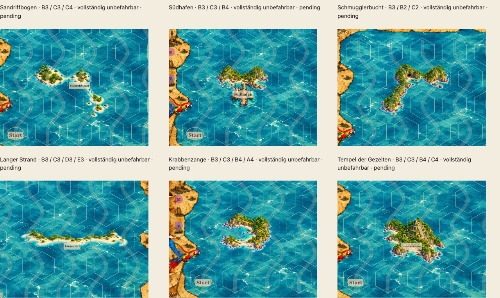

# Zweite Mehrhex-Entwicklungsrunde – sechs einzigartige Orte, alle pending

Stand 19.10.2026 · bestehender PR #65 · ausschließlich `feature/asset-library-integration`. Kein Merge. Die produktiven Renderer-, Geometrie-, Spiel- und Rätseldateien bleiben gegenüber `e74fd9c` unverändert; damit bleibt insbesondere die Entfernung permanenter orangefarbener Ortsringe aus `49f8f28` erhalten.

## Nutzerfreigaben und Grenzen

**Palmenbuchten und Glutberg sind ausdrücklich künstlerisch für `sea-blue-01` freigegeben.** Beide PNGs bleiben bytegleich zur ersten Runde. Die neuen Katalogeinträge zur Freigabe nennen roquas, Datum, SHA-256 der jeweiligen Illustration und SHA-256 des konkreten Meereshintergrunds. Die vier bestehenden Freigabepaare bleiben erhalten: insgesamt exakt sechs freigegebene Asset/Hintergrund-Paare, ausschließlich auf `sea-blue-01`.

- Palmenbuchten: `03f70eb90085f36ebf5d7a06db158e73048282f68be580465021d5bc0a31c773`
- Glutberg: `9dc2e28e8edba04cb768bc8650640ad4c4f3b2a5778f6519da4f713b6e79b828`
- `sea-blue-01.webp`: `e33cf0d09477e93588cfc209bb0ab9b224d7624139d707fede23a390b14f2582`

**Alle sechs neuen Motive bleiben auf allen drei Hintergründen pending.** Der alte Archipel `land-coast.archipelago.h3.bent-reefs.v1` bleibt unverändert als historischer Vergleich im Katalog, ausdrücklich NICHT freigegeben. Der aktive Mehrhex-Vergleich verwendet den neu illustrierten `land-coast.archipelago.h3.sand-reefs.v2`. Keine Platzierung in veröffentlichten Rätseln, keine künstlerische Selbstfreigabe.

## Form vor Illustration

Die [vorab festgelegten Formen und Kompositionspläne](reviews/multihex-round2/composition-plan.json) und sechs `geometry-*.png` wurden aus `imageContract` und dem echten Zentrenraster abgeleitet. Es sind keine regulären Vorlagenhexagone: Schritte `(82,0)` / `(41,68)`, gestreckte Voronoi-Zellen. Zulässig ist deren Vereinigung, an jeder gültigen Randlage zusätzlich mit der vorhandenen Spielgeometrie-Schutzhülle geschnitten. Die bestehende Architektur unterstützt die sechs Formen ohne Änderung und ohne neue Laufzeitparameter.

| Motiv / vollständige RGBA-Datei | Axiale Zellen | Feste Pixelmaße | Alle gültigen Anker | Anteil des maximalen proportionalen Leinwandexports |
|---|---|---|---|---|
| [Sandriffbogen](../assets/library/sand-reefs-h3-v2.png) | `[[0, 0], [1, 0], [1, 1]]` | 912×768 | 14 | 95 % |
| [Südhafen](../assets/library/south-harbor-h3-v1.png) | `[[0, 0], [1, 0], [0, 1]]` | 688×768 | 16 | 83 % |
| [Schmugglerbucht](../assets/library/smuggler-cove-h3-v1.png) | `[[0, 0], [1, -1], [2, -1]]` | 912×768 | 14 | 86 % |
| [Langer Strand](../assets/library/long-sand-h4-v1.png) | `[[0, 0], [1, 0], [2, 0], [3, 0]]` | 1344×408 | 10 | 94 % |
| [Krabbenzange](../assets/library/crab-claw-h4-v1.png) | `[[0, 0], [1, 0], [0, 1], [-1, 1]]` | 856×680 | 14 | 69 % |
| [Tempel der Gezeiten](../assets/library/jungle-temple-h4-v1.png) | `[[0, 0], [1, 0], [0, 1], [1, 1]]` | 856×680 | 14 | 81 % |

Der Prozentwert beschreibt ausschließlich den einmaligen Authoring-Export relativ zur maximal in den rechteckigen Bildrahmen passenden Quellleinwand, keine Landabdeckung und keinen Laufzeit-Skalierungsfaktor. Maßstab und Dichte bleiben danach unveränderlich: vier Bildpixel pro SVG-Einheit.

### Gestalterische Entscheidungen

1. **Sandriffbogen:** asymmetrische flache Inselgruppe mit breitem Sand, Buschwerk und wenigen Palmen; obere Inseln und südöstliche Kleininseln durch Riffe, schmale Untiefen und untergetauchte Sandbänke verbunden. Kleine Hütte und Steg. Sichtbare Wasserkanäle, keine drei steilen Einzelinseln. Die Originalanhänge der referenzierten ChatGPT-Unterhaltung lagen hier nicht vor; verwendet wurden die vorhandenen freigegebenen Stilbilder und die präzise Aufgabenbeschreibung. Die ursprüngliche Repository-Skizze mit drei separaten Felsmassen wurde nicht als künstlerische Zielvorlage übernommen.
2. **Südhafen:** zwingend zwei Felder oben und eines unten. Breite zusammenhängende Nordinsel mit geschütztem Hafenbecken; der massive südliche Anleger und zwei verschiedene Schiffe besetzen das untere Feld. Damit wird bewusst die zum Glutberg entgegengesetzte Dreiecksform getestet.
3. **Schmugglerbucht:** echte gespiegelte Bogenform, unterer Westarm und zwei obere Felder. Durchgehende zerklüftete Küste um tiefe geschützte Bucht; Höhle, Kisten und kleines Boot. Die axiale Darstellung wurde so verankert, dass B3 als Vergleichsanker gültig bleibt; die Spiegelung wird in der Illustration erzeugt, nicht durch eine Laufzeittransformation.
4. **Langer Strand:** vier horizontale Felder, ein zusammenhängender flacher heller Strand mit niedrigen Dünen und wenigen Palmen. Auf der 5×5-Karte gibt es für diese Form zehn gültige Anker, aber keine Innenlage: jede Platzierung berührt einen Rand. Die Galerie zeigt beide vorhandenen Zeilenparitäten und erfindet keine Innenposition.
5. **Krabbenzange:** vier gebogene Felder mit zwei ungleichartigen Landzungen um eine südwestlich offene Lagune und einem kleinen Wrack. Die zusammenhängende Nordostküste verbindet beide Arme. Die tatsächliche PNG-Silhouette zeigt die Zange; die logischen Zellen bleiben einschließlich der Lagune gesperrt.
6. **Tempel der Gezeiten:** kompakte Viererform für die überwucherte Maya-inspirierte Stufenpyramide, Treppe, Steinreliefs, verwitterte Ritualsteine und dichten Dschungel. Abenteuerhafte fiktive Kultstätte; ausdrücklich keine mittelalterliche Burg und kein europäisches Küstenfort. Die kleinen Ritualdetails sind in Spielgröße nur begrenzt erkennbar.

Die Formen wurden vor der ersten Generierung festgelegt und erwiesen sich als gültig. Anpassungsbedarf entstand in der **inneren Komposition**: Die frühen gebogenen Darstellungen waren zu panoramisch beziehungsweise hatten zu breite Küstensäume. Ihre sicheren Exporte füllten das südliche Feld zu wenig. Zwei zusätzliche präzise [Archipel-](reviews/multihex-round2/composition-archipelago.png) und [Schmuggler-Kompositionsskizzen](reviews/multihex-round2/composition-smuggler.png) bestimmten Inselzentren, schmale Übergänge und südliche Ausläufer. Daraufhin wurden beide Motive vollständig neu illustriert; der finale Export nutzt 95 % beziehungsweise 86 % des maximalen proportionalen Leinwandmaßstabs. Es wurden keine Küsten entlang einer Maske abgeschnitten. Zwei frühe Quellen mit am Bildrand angeschnittener Brandung wurden ebenfalls verworfen und mit image_gen korrigiert.

## Bestehende Galerie, echte Spielgröße

Start im Checkout: `python3 scripts/dev-server.py --port 4179`, dann [bestehende Mehrhex-Galerie](http://127.0.0.1:4179/dev/multihex-prototypes.html). Die [Assetbibliothek](../dev/asset-library.html) verlinkt diese bereits vorhandene Galerie. Kein neuer Viewer.

Die gemeinsame Übersicht zeigt alle sechs Motive auf echtem `sea-blue-01`, mit produktivem `drawMap`, echten Hexgrenzen und tatsächlich von `placeLabelLayout` gesetzten Pergamentnamen. Alle Detailausschnitte verwenden 380×300 SVG-Einheiten, auf Desktop höchstens 380 CSS-Pixel breit: gleicher Spielmaßstab ohne Abschneiden selbst der langen Sandinsel. Auf schmalen Geräten skaliert die gesamte Karte responsiv. Darunter stehen die zwei unveränderten freigegebenen Referenzen und je ausgewähltem Motiv alle vorhandenen Kombinationen aus Rand/Innenlage und Zeilenparität.

[Ohne Hexlinien](reviews/multihex-round2/comparison-clean.png) · [Mit Stundenzeichen und Route](reviews/multihex-round2/comparison-overlays.png) · [Smartphone, DPR 2](reviews/multihex-round2/comparison-mobile.png) · [Unveränderte freigegebene Referenzen](reviews/multihex-round2/approved-references.png).

Vollständige Kartenpositionen: [Archipel](reviews/multihex-round2/positions-archipelago.png), [Hafen](reviews/multihex-round2/positions-harbor.png), [Schmugglerbucht](reviews/multihex-round2/positions-smuggler.png), [Sandinsel](reviews/multihex-round2/positions-sand.png), [Krabbenzange](reviews/multihex-round2/positions-claw.png), [Tempel](reviews/multihex-round2/positions-temple.png).

## Ein Objekt, eine Grafik, unveränderte Spielregel

Jedes neue Objekt ist genau **eine vollständige transparente RGBA-PNG**, kein Kachelsatz. Der vorhandene Renderer erzeugt pro Platzierung genau ein `<image>` mit festen Maßen, ohne individuellen Transform, Rotation, Ausschnitt, Clip oder inneres Hexmaskieren. Die Vereinigung erlaubt durchgehende Küsten und Riffe über innere Hexgrenzen hinweg. Der bestehende Export resampelt die ganze Quellleinwand proportional und ergänzt transparente Ränder, niemals Ausschnitte.

Alle belegten Zellen sind `passable: false` und in den Prüffixtures vollständig `blocked`, einschließlich Hafenwasser, Bucht, Lagune und aller Archipel-Wasserpassagen. Der Platzierungsvalidator verwirft jede fehlende Sperrzelle. Die produktive Verwendung der sechs neuen Motive wird bis zur Nutzerfreigabe verworfen.

## Herkunft, Prompts und Export

Ausschließlich eingebautes **image_gen**, kein CLI-/API-Fallback, keine Stockbilder. Als Stilreferenz diente die unveränderte freigegebene Palmenbuchten-Grafik. [Erste vollständige Prompts](../dev/multihex-round2.json) und [sämtliche Korrektur-/Kompositionsprompts](reviews/multihex-round2/prompt-followups.json) sind eingecheckt. Für Archipel und Schmugglerbucht sind die jeweils letzten `*Composition`-Prompts maßgeblich; beim Tempel wurde die zusätzliche Randvorgabe aus `temple` angehängt. Die anderen vier finalen Quellen entsprechen dem ersten Motivprompt beziehungsweise dessen dokumentierter Randkorrektur.

Originale und verworfene Quellen liegen lokal in `output/multihex-round2/`; die sechs vollständig geprüften PNGs sind im Repository und im ZIP enthalten. Für eine Neuberechnung des Authoring-Exports sind diese lokalen Originale erforderlich; eine neue image_gen-Generierung ist nicht bytegleich reproduzierbar. Die unabhängige Prüfung der ausgelieferten PNGs benötigt die Originale nicht.

`scripts/export-multihex-round2.py` nutzt den bestehenden Exporter, lässt die zwei freigegebenen Bilder unberührt und schreibt einen getrennten [Pixelbericht](reviews/multihex-round2/pixel-audit.json). Dieser nennt Quell-/Zielhashes, ganze Abtastungsgrößen, feste Ränder, alle geprüften Anker und Null überstehende Pixel. Bereinigt werden ausschließlich räumlich abgesetzte Alpha-1-Exportreste außerhalb von acht Quellpixeln um Alpha ≥2. Alle Bildpixel mit Alpha ≥2 und ihre weichen Alpha-1-Ränder bleiben erhalten; keine globale Alpha-Schwelle, keine geografische Maske. Der vorhandene unabhängige `PixelFootprint` prüft vollständige Viertelpixelquadrate bis Alpha 1 gegen die Vereinigung und jeden gültigen Randvertrag. Der unveränderte Mindestwert von 4500 sichtbaren Pixeln (Alpha ≥16) pro deklarierter Zelle verhindert nominelle Mehrhex-Objekte mit leerem Außenfeld. Der [Zellabdeckungsbericht](reviews/multihex-round2/occupancy-audit.json) dokumentiert die tatsächlichen Werte sowie vollständig freie Quellbildränder; der [Erhaltungsbericht](reviews/multihex-round2/preservation-audit.json) bestätigt die bytegleichen Freigabebilder und unveränderten produktiven Dateibäume.

`scripts/capture-multihex-round2.mjs` erstellt mit laufendem lokalem Server die Dokumentationsbilder aus der vorhandenen Galerie. [Browserbericht](reviews/multihex-round2/browser-audit.json) enthält Chromium Desktop, WebKit Desktop und Chromium Smartphone/DPR 2, Bildgeometrie, tatsächliche Labelmaße und Ladefehlerkontrolle.

## Offene künstlerische Punkte

- Alle sechs benötigen weiterhin die Nutzerfreigabe für den konkreten Hintergrund. Technische Erfolge sind keine Freigabe.
- Wasserflächen bleiben spielmechanisch gesperrt. Insbesondere Archipel und weit offene Zange müssen als zusammengehöriger gesperrter Ort lesbar sein; ohne Hexlinien ist die Zuordnung weniger deutlich.
- Die produktiven Pergamentnamen können Details überdecken, besonders den Hafenanleger, die Bucht oder den Tempelvorplatz. Die Galerie zeigt diese tatsächliche Überdeckung. Es wurde keine neue motivabhängige Labelposition eingeführt.
- Hütte, Schiffe, Kisten, Wrack und Ritualsteine sind in Spielgröße klein; die Detailbilder sind keine Zusage ihrer vollständigen Lesbarkeit auf jedem Smartphone. Die sechs verschiedenen Silhouetten tragen die Hauptidentität.
- Lokale türkise Küstensäume bleiben sichtbar. Wasser-/Stilpassung und gewünschte Dominanz gegenüber den beiden freigegebenen Motiven sind Teil der Abnahme.
- Bestehende allgemeine Folgepunkte des PR, insbesondere B4 und B6, werden nicht als erledigt erklärt.

## Validierung

- **99/99 Unit-Tests** bestanden; die vier Rätsel besitzen weiterhin jeweils genau eine Lösung.
- **18 Katalogbilder / drei Hintergründe** und exakt sechs hashgebundene Freigabepaare validiert. **13/13 Bildregressionen** und **2/2 Export-/Zellabdeckungstests** bestanden. Alle sechs neuen PNGs an sämtlichen **82 gültigen Ankern** ohne unzulässige sichtbare Pixel; geprüft werden vollständige Pixelquadrate bis Alpha 1. Die neun Mehrhex-Illustrationen einschließlich historischer Fassung besitzen substanzielle Bildanteile in jeder deklarierten Zelle.
- **16/16 Chromium- und 16/16 WebKit-Galeriefälle**, jeweils Desktop/Mobil, bestanden; die finalen PNGs danach zusätzlich im gezielten Chromium-Lauf kontrolliert (**2/2**). Geprüft werden echte Meer-/Pergamenttexturen, Zellzuordnung, Labelschriftmaße, ein `<image>` pro Objekt, unveränderte Bildgeometrie beim Umschalten sowie Unterdrückung von Spielmarkierungen auf Land.
- **64/64 ausgeführte ZIP-Browserfälle** bestanden (ein unveränderter optionaler Vorhervergleich ohne lokalen Baseline-Server übersprungen). Darunter alle **4/4 Asset-Deploymentfälle** auf Desktop, Smartphone, iPhone und iPad. Die sechs PNGs im frisch erzeugten ZIP sind bytegleich mit den geprüften Dateien; Galerie und Autorierungswerkzeuge bleiben außerhalb des Laufzeitpakets.
- Visuelle Kontrolle und Rasterdekodierung auf Chromium Desktop, WebKit Desktop und Chromium Smartphone/DPR 2 ohne Bildlade- oder JavaScriptfehler. Die vollständigen Kartenansichten und Überdeckungen wurden geprüft.
- **27/27 Paketregressionen** bestanden; der frisch erzeugte Export enthält 78 Dateien. [Zusammengefasster lokaler Prüfbericht](reviews/multihex-round2/validation-summary.json). Die vollständige bestehende CI-Matrix bleibt unverändert aktiv: [PR #65 / Checks](https://github.com/roquas/Sams-Gezeitenkarten/pull/65/checks).
