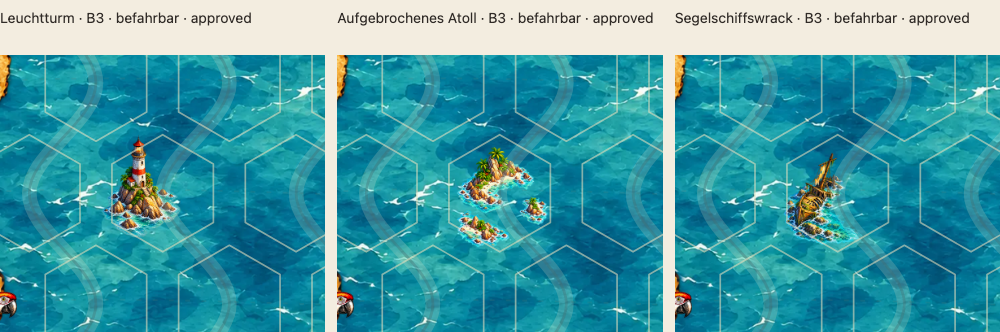
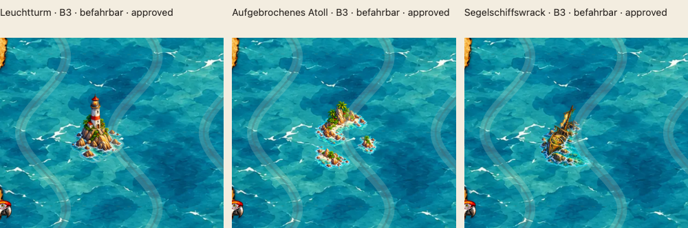
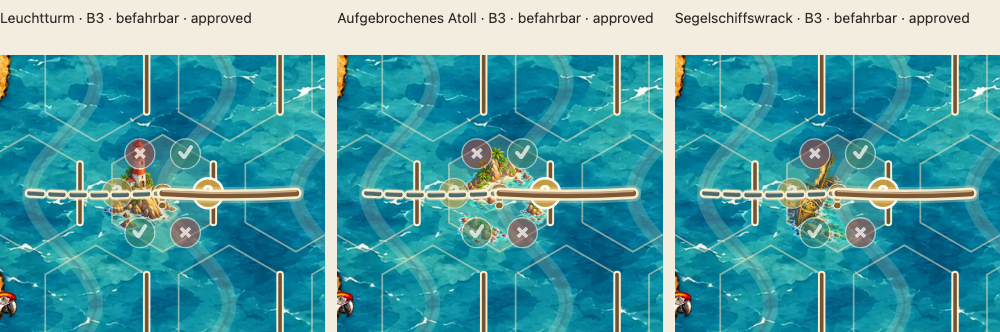
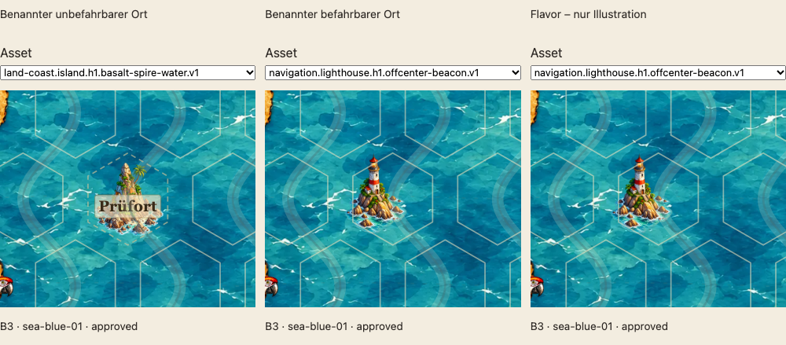

# Drei freigegebene befahrbare Einzelhex-Illustrationen

Stand **19.10.2026**, bestehender PR #65, Branch `feature/asset-library-integration`. Leuchtturm, aufgebrochenes Atoll und Wrack sind gemäß ausdrücklicher Nutzerentscheidung **künstlerisch erhaltenswert und für `sea-blue-01` freigegeben**: `stage: illustration`, `passable: true`, `geometry.cells: [[0,0]]`, Hintergrundprüfung `sea-blue-01: approved`. Das etwas felsige Atoll wird ausdrücklich unverändert behalten, weder umbenannt noch neu generiert. Die drei Freigaben in `assets/catalog/library.json` enthalten Prüfer, Datum sowie SHA-256 von Asset und konkretem Hintergrund. Andere Hintergründe bleiben `pending`; keine globale oder Familienfreigabe. Die wasserreiche Felsnadel bleibt auf `sea-blue-01` freigegeben, die wasserreduzierte Fassung bleibt `pending`. Alle fünf PNGs sind unverändert.

## Gemeinsamer Vergleich im Kartenkontext

Die **bestehende Galerie** `/dev/asset-library.html#passable-prototypes` enthält oben einen gemeinsamen Vergleich. Lokal nach `python3 scripts/dev-server.py --port 4173`:
[Galerie mit allen drei Prototypen](http://127.0.0.1:4173/dev/asset-library.html#passable-prototypes).

Alle drei stehen für den direkten Vergleich jeweils an **B3** im selben Originalmeer `assets/seekarte/sea-blue-01.webp`, umgeben von den echten Nachbarfeldern. Der Vergleich verwendet den **produktiven `drawMap`-Renderer ohne permanente Ortsringe**, einschließlich Meer, Rahmen, Koordinatenführungen und Spielmarkierungen. Die Galerie hat eine Projektwurzel als Dokumentbasis, damit dessen echte Bildpfade auch unter `dev/` korrekt aufgelöst werden; die Bildpfade und Architektur bleiben unverändert.

Die Bildrechtecke betragen durchgehend **90×102 SVG-Einheiten**, ohne individuellen Transform, Zuschnitt oder Clip. Der Ausschnitt `42 107 200 170` zeigt B3 und Nachbarn. Bei 1120 px Browserbreite erscheinen die drei vollständigen Assetleinwände jeweils rund **146×166 CSS-Pixel** groß; auf dem Smartphone rund **158×179 CSS-Pixel**. Das entspricht dem Kartenmaßstab einer ungefähr 916–985 px breiten Gesamtkarte. Die folgenden rund 1000 px breiten Vergleichsbilder sind Screenshots dieser Galerie bei DPR 1, keine isolierten Assets und keine nachträglich vergrößerten Motive. Auf schmalen Bildschirmen stehen die drei Karten untereinander.

**Mit echten Hexgrenzen, ohne permanente Ortsmarkierung und ohne Stundenzeichen/Route:**

**Ohne Hexlinien, permanente Ortsmarkierung und Stundenzeichen/Route:**

**Mit echten Spielmarkierungen:**

Der ausdrücklich beschriftete **Entwicklungs-Beispielzustand** zeigt an B3 Stunden 1–6 (`✓ / ? / × / ✓ / ? / ×`), die aktive Stunde 2 und die Route A3–B3–C3. Er ändert keine veröffentlichten Rätseldaten; die Freigabe stammt aus der Nutzerentscheidung. „Echte Stundenzeichen und Route anzeigen“ schaltet Stundenzeichen, aktive Stunde und Route; permanente Ortsringe werden nicht mehr gezeichnet; „Hexgrenzen anzeigen“ schaltet zusätzlich die normalen Zellpolygone. Die Stundenrandmarkierung gehört zum Beispielzustand. Anfangs sind Stundenzeichen und Route ausgeschaltet, damit sich die reinen Illustrationen klar vergleichen lassen. Der Vergleich bleibt absichtlich auf `sea-blue-01`, auch wenn für die darunterliegende technische Galerie ein anderer Hintergrund gewählt wird. Die grüne Grafikflächenprüfung beeinflusst den gemeinsamen Vergleich nicht.

**Aktuelle Gestaltungsentscheidung vom 19.10.2026:** Benannte unbefahrbare Orte erhalten weiterhin die Pergamentrolle mit Ortsnamen. Benannte befahrbare Orte und Flavor zeigen ausschließlich die Illustration, ohne permanenten Ortsring und ohne Pergamentschild. Die Unterscheidung bleibt in `placeId` und `places` erhalten. Die frühere Entscheidung für Kartografenringe ist damit aufgehoben. Route, zentrale Fragezeichen und Stundenkreise dürfen die Illustrationen weiterhin überdecken; das ist vom Nutzer ausdrücklich akzeptiert. Der Beispielzustand ist keine Prüfung sämtlicher möglicher Spielzustände.

### Drei Verwendungszustände vergleichen

[Verwendungsvergleich in der Galerie](http://127.0.0.1:4173/dev/asset-library.html#usage-previews): drei nebeneinander vergleichbare Ansichten, jeweils mit Assetauswahl, auf dem echten `sea-blue-01`. Standard: wasserreiche Felsnadel mit Pergamentname, benannter Leuchtturm ohne Ring/Schild und derselbe Leuchtturm als Flavor. Alle drei befahrbaren Motive sind sowohl im benannten befahrbaren Zustand als auch als Flavor wählbar. Die Auswahl für unbefahrbare benannte Orte enthält nur entsprechend klassifizierte Assets. Die bestehende Mehrhex-Geometrie wird ebenfalls unterstützt.

„Benannt vs. Flavor“ ist ausschließlich eine **Eigenschaft der Platzierung im Rätsel**, keine neue Assetklasse und kein Assetflag. Die Entwicklungsfixtures setzen für benannte Verwendung `placeId` und `puzzle.places`, für Flavor lassen sie beides weg. Assetrolle, Befahrbarkeit, Bilddatei und Katalogobjekt bleiben unverändert; ein unbefahrbares Asset bleibt auch ohne Ortsnamen gesperrt. Der Beispielname „Prüfort“ gehört nur zum Galeriefixture.

Alle drei Zustände laufen über den produktiven `drawMap` einschließlich `placeLabelLayout`, realem Meer und Pergamenttextur. Permanente Ringpfade sind aus dem Renderer entfernt. Es werden keine Symbole nachgebaut oder nachträglich entfernt. Hexlinien und Stundenzeichen/Route sind unabhängig von den Pergamentnamen schaltbar; auf gesperrten Feldern werden keine Segelroute oder Stundenzeichen vorgespiegelt. Einzel- und Mehrhex-Pergamentlayouts funktionieren mit den vollständigen `HEXES`/`byId` und den zum Asset passenden `blocked`-Zellen. Die Änderung am Produktionsrenderer entfernt ausschließlich die permanente Ringzeichnung; Layoutfunktionen, Spielmechanik und Label-Architektur bleiben unverändert.

## Motive und Einordnung

| Motiv / Asset-ID | PNG | Komposition |
| --- | --- | --- |
| Leuchtturm · `navigation.lighthouse.h1.offcenter-beacon.v1` | [lighthouse-offcenter-v1.png](../assets/library/lighthouse-offcenter-v1.png) | Rot-weißer markanter Turm auf kleinem Felsen links/hinten; rechts bleibt offene See. |
| Atoll · `land-coast.atoll.h1.broken-passages.v1` | [atoll-broken-v1.png](../assets/library/atoll-broken-v1.png) | Drei asymmetrische, getrennte Sand-/Korallenstücke mit Felsen und Palmen. Breite Öffnungen verbinden Innenraum und Außenmeer; kein fast geschlossener Ring. |
| Wrack · `navigation.wreck.h1.offcenter-sloop.v1` | [wreck-offcenter-v1.png](../assets/library/wreck-offcenter-v1.png) | Diagonaler halb versunkener Holzrumpf mit gebrochenem Mast und Segelresten, nach links versetzt; freie See rechts. |

Der größere Atollteil ist in diesem ersten Durchgang felsiger und höher ausgefallen als eine flache Sandbank. Die drei Wasserpassagen bleiben im realen Kartenkontext sichtbar. Beim Wrack macht die etwas kleinere Einpassung die Rechtsdurchfahrt deutlicher. Diese gestalterischen Eigenschaften einschließlich des felsigeren Atolls sind vom Nutzer akzeptiert und für `sea-blue-01` freigegeben. Befahrbarkeit ist die explizite logische Klassifikation des gesamten Einzelhexes; es wird kein neues pixelgenaues Schiffs-Kollisionsmodell eingeführt.

## Herstellung und technischer Export

**Ein gemeinsamer Produktionsdurchgang, genau eine eingebaute `image_gen`-Generierung je Motiv**, jeweils mit echter Transparenz. Stilreferenz war die Originalquelle der ausdrücklich freigegebenen wasserreichen Felsnadel: plastische, farbenfrohe, detailreiche Abenteuer-/Brettspielillustration mit Aquarellcharakter. Die frühere Dreierstudie wurde nicht benötigt. [Vollständiger Prompt-Satz](reviews/passable-prototypes/generation-prompts.json).

Alle Ausgaben sind statische **360×408-RGBA-PNGs**. Die vollständigen 1177×1336-Quellleinwände wurden proportional mit Lanczos3 verkleinert und transparent ergänzt. Kein Bild wurde an einer Zellmaske abgeschnitten; kein Alpha-Schwellwert, kreisförmiger Verlauf oder geometrischer Küstenrand wurde ergänzt. Lokale türkisfarbene Flachwasserflächen und Brandung bleiben erhalten. Ihre Farbabweichung vom echten Meer bleibt sichtbar und wird nicht durch eine allgemeine verbindliche Wasserregel bewertet.

| Export | Abgetastete Quelle | Transparenter linker/oberer Rand | Sichtbare Pixel | Alpha 1 |
| --- | --- | --- | --- | --- |
| Leuchtturm | 313×355 | 23 / 33 | 24.679 | 864 |
| Atoll | 247×280 | 56 / 72 | 29.308 | 1.462 |
| Wrack | 218×247 | 43 / 91 | 23.706 | 1.238 |

Der Wrackexport setzt die komplette abgetastete Quelle beim Authoring **28 px weiter links** als eine zentrierte Einpassung. Die dafür nötige geringere Größe bewahrt sämtliche Alpha-Ränder an allen Kartenpositionen. Das ist fest in der PNG enthalten; die Platzierung im Renderer bleibt geometrisch zentriert. [Leuchtturm-Export](reviews/passable-prototypes/lighthouse-export.json), [Atoll-Export](reviews/passable-prototypes/atoll-export.json), [Wrack-Export](reviews/passable-prototypes/wreck-export.json) enthalten Quellhash, Abtastung und Ränder. Die Originalgenerierungen und das Exportwerkzeug sind lokal unter `output/passable-prototypes/` im übergeordneten Aufgabenordner erhalten; die ausgelieferten PNGs liegen vollständig im Branch.

## Prüfbelege

- **Alle drei jeweils 25/25 Positionen A1–E5 bestanden**, zusätzlich lokaler Voronoi-Vertrag und Originalmaske `single.png`: **0 unzulässige sichtbare Pixel**, einschließlich Alpha 1. Geprüft werden vollständige ¼×¼-SVG-Pixelquadrate mit dem unveränderten `check_image` / `PixelFootprint` aus `scripts/check-library-images.py`. [Vollständiger Pixelbericht mit SHA-256](reviews/passable-prototypes/pixel-audit.json).
- Der vorhandene Bildregressionstest prüft jetzt **alle Illustrationen** automatisch an allen 25 Ankern. Die ursprünglichen beiden Felsnadeldateien und ihre Freigabehashes bleiben unverändert.
- Katalog: neun Assets, drei Hintergründe, **genau vier freigegebene Kombinationen**, sämtlich auf `sea-blue-01`: wasserreiche Felsnadel, Leuchtturm, aufgebrochenes Atoll und Wrack. Der Unit-Test prüft exakte Freigabepaare, gültige Hashes, Verwerfung geänderter Hashes und die fortbestehende Sperre aller anderen Hintergründe. Keine produktive Rätselplatzierung wird hinzugefügt.
- Frühere Produktionsprüfung vor Nutzerfreigabe: **89/89 Unit-Tests**, vier Rätsel mit weiterhin jeweils genau einer Lösung, **13/13 Bildregressionen**, **12/12 Chromium-Galeriefälle und 12/12 WebKit-Galeriefälle**. Die Browserfälle prüfen den echten Meerpfad, drei befahrbare B3-Felder, Stundenzeichen, Route, Ebenenreihenfolge und beide Schalter. Ergänzende Aufnahmen: Chromium/WebKit Desktop und Chromium Smartphone mit DPR 2, ohne Bildlade- oder JavaScriptfehler; [Browserbericht](reviews/passable-prototypes/browser-audit.json).
- Frühere Produktionsprüfung zusätzlich **27/27 Pakettests und 4/4 Asset-Deploymenttests** des frisch erzeugten ZIPs bestanden (Desktop, Smartphone, iPhone/WebKit, iPad/WebKit, jeweils im Unterpfad). Die vollständige bestehende CI wird für den gepushten Stand über [PR #65 / Checks](https://github.com/roquas/Sams-Gezeitenkarten/pull/65/checks) nachvollziehbar. Die Deploymentregression dekodiert alle fünf Illustrationen aus dem tatsächlich erzeugten ZIP, einschließlich der drei neuen befahrbaren Prototypen.

### Prüfung dieser Aktualisierung

Die aktuellen Galerieprüfungen testen alle drei befahrbaren Motive als benannten Ort und als Flavor, echte Pergamenttextur für unbefahrbare Orte, unveränderte Bildgeometrie, Mehrhex-Ortsnamen, echten Meerpfad und Pergamentnamen bei ausgeschalteten Stundenzeichen/Route. Ein Unit-Test prüft zusätzlich, dass dieselbe Illustration als Flavor weder `placeId` noch Ortseintrag benötigt und dabei Katalogdaten sowie Befahrbarkeit unverändert bleiben. Die Deploymentprüfung erwartet genau die vier freigegebenen Paare im erzeugten ZIP. **Ergebnisse der vorherigen Freigabe-/Verwendungsaktualisierung:** 90/90 Unit-Tests, vier Rätsel mit jeweils genau einer Lösung, Katalog-/Hashprüfung und 13/13 Bildregressionen, 14/14 Chromium-Galeriefälle und 14/14 WebKit-Galeriefälle (je Desktop und Mobil), 27/27 Pakettests und 4/4 Asset-Deploymentfälle am frisch erzeugten ZIP. Ergänzende [visuelle Kontrolle auf drei Browser-/Gerätekonfigurationen](reviews/passable-prototypes/usage-browser-audit.json) ohne Bildlade- oder JavaScriptfehler. Beim ersten lokalen parallelen Browserstart wurden zwei Modulabrufe durch Verbindungsabbrüche unterbrochen; die vollständige lokale Galerieprüfung mit einem Worker besteht ohne Wiederholungsversuche. Die bestehende CI-Konfiguration bleibt unverändert. [CI des PR](https://github.com/roquas/Sams-Gezeitenkarten/pull/65/checks).

Keine veröffentlichten Platzierungen, keine Änderung von Spielmechanik, Voronoi-Geometrie, `main` oder Architektur; kein Merge. Die ursprünglichen offenen Punkte B4/B6 bleiben im bestehenden PR dokumentiert.

### Entfernung der permanenten Ortsringe (19.10.2026)

Die orange/goldenen Ortsringe werden vollständig aus der produktiven Kartenansicht entfernt. Die Galerie übernimmt diese Änderung direkt aus dem echten Renderer und die Vergleichsbilder werden erneuert. Normale Hexgrenzen, Stundenmarkierungen, aktive Stundenkante, Routen, Startmarkierung und Pergamentnamen auf benannten unbefahrbaren Orten bleiben erhalten. Die Rätseldaten und die vier konkreten künstlerischen Freigaben werden nicht verändert. Regressionen prüfen Ringfreiheit, visuelle Gleichheit benannter befahrbarer Verwendung mit Flavor bei gleichem Motiv sowie weiterhin sichtbare Pergamentnamen und Spielmarkierungen.

Eine mögliche spätere, vorübergehende Hervorhebung ausdrücklich genannter Referenzorte beim Auswählen eines Logbuchhinweises ist ausschließlich [als Idee vorgemerkt](DECISIONS.md#spätere-idee-referenzorte-eines-logbuchhinweises); sie wird hier nicht implementiert.

Lokale Prüfung der Ringentfernung: **90/90 Unit-Tests**, unverändert vier eindeutige Rätsel, Katalog-/Freigabehashprüfung, **6/6 direkt betroffene Chromium- und 6/6 WebKit-Regressionen** (Galerieverwendung, produktive Karte, Rätselwechsel) sowie **16/16 Auslieferungsprüfungen** am frischen ZIP. Der neue Galerietest vergleicht Illustration, Zell- und Routenzeichnung von benannter befahrbarer Verwendung und Flavor; Pergamentnamen auf unbefahrbaren Orten und normale Spielmarkierungen werden unabhängig geprüft. Die aktualisierten Vergleichsaufnahmen bestehen zusätzlich auf Chromium/WebKit Desktop und Chromium Smartphone.

Der zusätzliche breitere lokale Lauf war nicht vollständig grün: native Auswahl per Tastatur reagierte in dieser lokalen Browserumgebung nicht auf die erwartete Tastenfolge; derselbe Effekt ist mit dem unveränderten Renderer aus dem Ausgangscommit reproduziert. Weitere lokale Testartefakt-/Bedienfehler werden nicht durch sachfremde Produktänderungen behoben. Die vollständige CI des gepushten Commits ist unter [PR #65 / Checks](https://github.com/roquas/Sams-Gezeitenkarten/pull/65/checks) nachvollziehbar.
