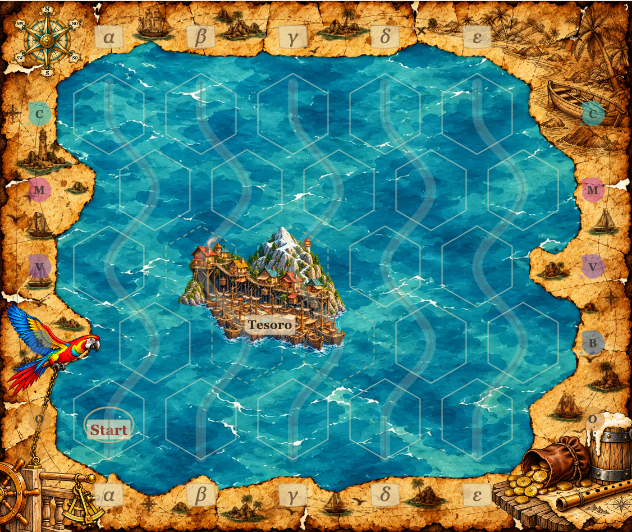
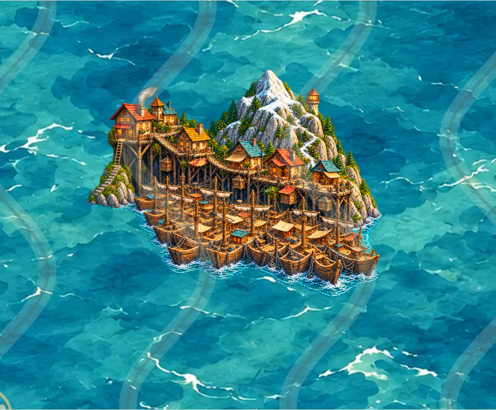

# Tesoro – integrierter Vierhex-Prototyp für PR #65

Stand 19.10.2026 · Branch `feature/asset-library-integration` · Ausgangsstand `86bba51`. **Künstlerische Nutzerfreigabe ausstehend.** Kein Freigabe-Hash, keine Kennzeichnung als genehmigt, kein Merge nach main.

## Motiv und Quellen

Tesoro übernimmt den aktuellen Vierhex-Prüfplatz in der **bestehenden Multihex-Galerie**. Die Krabbenzangen v1 und v2 bleiben als historische, nicht freigegebene Entwürfe vollständig erhalten. Die fünf zuletzt freigegebenen Mehrhex-Motive sowie Palmenbuchten und Glutberg sind unverändert sichtbar.

Die [aktuelle Weltreferenz](TESORO-WORLD-REFERENCE.md) trennt Audio-ASR, Episodenbeschreibung, ausdrückliche Erzählerergänzung und Gestaltung. Maßgeblich ist die neue Raumfolge: Schiffsteppich → steile Steinstufen → Strickleiter am Stadtende → zweigeschossige Eingangswirtschaft → verbundene Holzplattformen mit einzelnen Untergeschossen → gegenüberliegende Steilklippe → verschneiter Pfad um den Gipfel → teilweise verdeckter Leuchtturm jenseits des Gipfels. Die Gebäudezahl ist frei. Die frühere Annahme eines mittigen Zugangs wurde nicht übernommen.

Die [erste Kompositionsskizze](reviews/tesoro/composition-tesoro.png) und die [breitere Überarbeitung](reviews/tesoro/composition-tesoro-v2.png) wurden vor den jeweiligen Bildaufrufen erstellt. Die zweite Fassung vergrößert die Stadt im nordwestlichen Feld und versetzt den unteren Schiffsteppich entsprechend dem tatsächlichen Raster nach rechts. Eine abschließende [Zugangskorrektur](reviews/tesoro/generation-access-correction.json) präzisiert den Weg durch die Wirtschaft und nimmt den linken Schiffsausläufer zurück. Generiert wurde ausschließlich mit dem eingebauten **image_gen**, mit den projektinternen freigegebenen Palmenbuchten als Stilreferenz und dem vorhandenen Meeresuntergrund als Farbkontext. [Erster Prompt](reviews/tesoro/generation-prompt.json) · [breitere Komposition](reviews/tesoro/generation-followup.json) · [finaler Bearbeitungsprompt](reviews/tesoro/generation-access-correction.json).

Die Details der Durchquerung der Wirtschaft und des um den Gipfel führenden Pfads sind durch die Perspektive teilweise verdeckt. Die Illustration deutet sie über Leiter, Eingangsgebäude, rückwärtige Brücke und Schneeweg an; sie ist kein vollständiger begehbarer Stadtplan. Kleine Ausstattungsdetails und die konkrete Links-/Rechtsanordnung sind gestalterische Interpretation.

## Datei und technischer Vertrag

- Asset-ID: `land-coast.settlement.h4.tesoro.v1`.
- Eine einzige vollständige transparente RGBA-PNG: [tesoro-h4-v1.png](../assets/library/tesoro-h4-v1.png), **856×680 Pixel**.
- Etablierte kompakte 2×2-Geometrie wie beim Tempel: **`[[0,0],[1,0],[0,1],[1,1]]`**. Die nach rechts versetzte untere Reihe ist kein gewöhnliches Quadrat und nicht die gespiegelte Krabbenzangenform.
- Alle **14** gültigen Kartenanker: **A1 B1 C1 D1 A2 B2 C2 A3 B3 C3 D3 A4 B4 C4**.
- Sämtliche vier Felder bleiben **unbefahrbar**; ein einziges platziertes Bild, keine individuelle Laufzeitskalierung, Rotation, Beschneidung oder inneren Bildnähte. Keine festen Ortsnamen im Bild. Der echte Kartenrenderer setzt das bestehende Pergamentlabel „Tesoro“.
- Auf allen drei Hintergründen explizit **pending**. Technische Bildhashes im Prüfbericht sind **keine Freigabe-Hashes**. Die drei neuen Revieweinträge enthalten weder Reviewer noch Freigabedatum noch Asset-/Hintergrundfreigabehash.

Die Illustration wird über `scripts/export-tesoro.py` mit dem bestehenden Whole-Canvas-Exporter exportiert. Die komplette generierte Leinwand wird **nur beim Authoring** proportional resampelt und transparent aufgefüllt. Keine geometrische Maske schneidet das Motiv zurecht. Die strenge Alpha-Prüfung umfasst vollständige Viertelpixelquadrate bis Alpha 1, die vereinigten tatsächlichen Grafikzellen und die Schutzhülle **an jedem** gültigen Anker. [Geometrievertrag](reviews/tesoro/image-contract.json) · [für alle Anker gemeinsame Fläche](reviews/tesoro/geometry-every-anchor.png) · [Pixelbericht](reviews/tesoro/pixel-audit.json).

Als zusätzliche Authoring-Bedingung verlangt Tesoro mindestens **15.000 sichtbare Pixel mit Alpha ≥16 je Zelle**. Der Exporter wählt deshalb einen unbeschnittenen Ganzbildmaßstab und eine feste transparente Auffüllung, die alle vier Zellen sinnvoll belegen. Das ist keine neue Laufzeitoption. Bei bisherigen Aufrufern bleibt diese zusätzliche Bedingung standardmäßig ausgeschaltet; frühere Exporte werden nicht neu erzeugt. Der unabhängige Regressionstest prüft die 15.000 Pixel für Tesoro erneut; der bisherige Mindestwert von mehr als 4.500 Pixeln bleibt für alle früheren Mehrhex-Bilder erhalten.

Wie bisher entfernt der Export nur abgesetzte Alpha-1-Exportreste außerhalb von acht Quellpixeln um Alpha ≥2. Bedeutungsvolle Bildpixel und ihre weichen Ränder bleiben erhalten. Prompts und Quellhashes sind dokumentiert; eine Neugenerierung ist nicht bytegleich reproduzierbar. Die ausgelieferte PNG lässt sich ohne lokale Generierungsquelle vollständig prüfen.

Die [vollständige hochaufgelöste Malvorlage](reviews/tesoro/tesoro-master.png) bleibt für spätere Vergrößerungen und Überarbeitungen im Repository erhalten. Sie ist kein zweites Laufzeitasset und wird nicht ins Spiel-ZIP aufgenommen. In einem frischen Checkout kann `python3 scripts/export-tesoro.py` diese Quelle automatisch übernehmen und den dokumentierten Ganzbildexport erneut erzeugen.

## Begutachtung in zwei Maßstäben

[Galerie mit Tesoro öffnen](http://127.0.0.1:4183/dev/multihex-prototypes.html?asset=tesoro#tesoro), lokal gestartet mit `python3 scripts/dev-server.py --port 4183`.

Die normale Kartenansicht benutzt den unveränderten produktiven Renderer, `sea-blue-01.webp`, die echten Hexgrenzen und das echte Ortslabel. Die Detailansicht vergrößert denselben SVG-Ausschnitt, der die komplette PNG einschließlich transparenter Ränder enthält. Ihr Ortsname lässt sich separat einblenden; zunächst bleibt er für die Betrachtung der Schiffdetails verborgen. Dieser Schalter betrifft ausschließlich die Entwicklungsvergrößerung. Sie verändert weder Bildattribute noch Platzierung und fügt keine individuelle Asset-Transformation hinzu. Der Browserregressionstest vergleicht die Bildattribute beider Ansichten und vor/nach dem Umschalten direkt. Beide bisherigen Krabbenzangen bleiben im historischen Versionsvergleich und im Katalog verfügbar.

[Unvergrößerter Motivausschnitt](reviews/tesoro/tesoro-normal.png) · [mit echten Hexgrenzen vergrößert](reviews/tesoro/tesoro-enlarged.png) · [vier Rand-/Innenpositionen beider Zeilenparitäten](reviews/tesoro/tesoro-positions.png) · [mit Stundenzeichen und Route](reviews/tesoro/tesoro-map-overlays.png) · [Smartphone](reviews/tesoro/tesoro-mobile.png) · [gemeinsamer Motivvergleich](reviews/tesoro/comparison.png).

## Erhaltung und Validierung

Der [Erhaltungsbericht](reviews/tesoro/preservation-audit.json) vergleicht alle bisherigen Katalogbilder und vollständigen Revieweinträge mit `86bba51`. Alle bisherigen Bildbytes und Freigabefelder bleiben erhalten. Produktiver Renderer, Geometrie, Spielregeln, Rätseldaten, Logbuchtexte und bisherige Seekartengrafiken werden durch diese Tesoro-Ergänzung nicht verändert. Das ZIP enthält die neue PNG bytegleich; die Entwicklungsgalerie und Recherchedateien gehören nicht ins Produktivpaket.

Der [Browserbericht](reviews/tesoro/browser-audit.json) dokumentiert Chromium Desktop, WebKit Desktop und Chromium Smartphone/DPR 2, dekodierte Bilder, feste Bildgeometrie, Beschriftung und alle vier gesperrten Felder. Der [Validierungsbericht](reviews/tesoro/validation-summary.json) nennt die tatsächlich abgeschlossenen Testläufe und ihre Grenzen. Technische Prüfungen ersetzen keine künstlerische Nutzerentscheidung.

Lokal bestanden: **102 Unit-Tests**, weiterhin **vier eindeutige Rätsel**, **20 Katalogbilder** mit gültigen bisherigen Freigabebindungen, **13 Bildregressionen** und **drei Exportregressionen**. Die Galerie-/Rendererintegration bestand **32** Browserfälle; nach der letzten Bild- und Detailansichtsänderung bestand der Tesoro-Fall erneut auf **allen vier** Desktop-/Mobilvarianten von Chromium und WebKit. Der vollständige Veröffentlichungsvalidator erzeugte das ZIP mit **80 Dateien**; [alle 20 Katalog-PNGs sind bytegleich enthalten](reviews/tesoro/package-audit.json). Vier tatsächliche ZIP-Auslieferungsfälle auf Desktop, Smartphone, iPhone und iPad bestanden. Die vollständige unveränderte GitHub-CI läuft separat nach dem Push; lokale Teilprüfungen werden nicht als ihr Abschluss ausgegeben.

Sichtbare Tesoro-Pixel je deklarierter Zelle bei Alpha ≥16: **42.375 / 65.007 / 42.040 / 32.570**, in der Reihenfolge des Geometrievertrags. Das sind Abdeckungsnachweise, keine künstlerische Freigabe und keine Behauptung vollständiger Landbedeckung bis an jede Hexkante. Die Illustration enthält kein großes offenes Hafen- oder Lagunenbecken; zwischen den dicht belegten Rümpfen bleiben schmale Fugen. Die ganze Vierhexfläche bleibt gesperrt.
