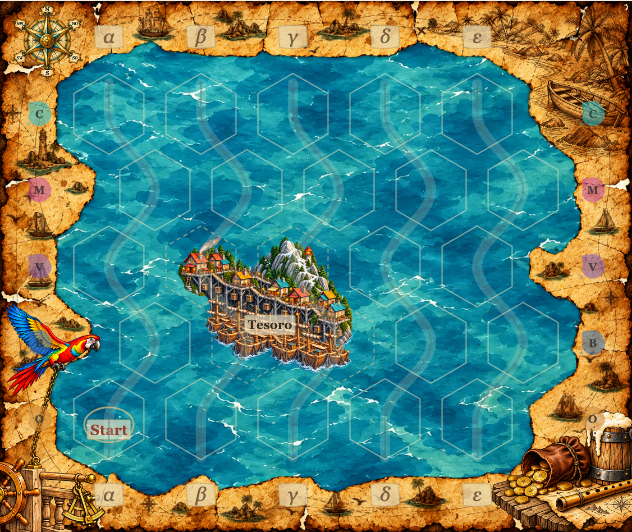
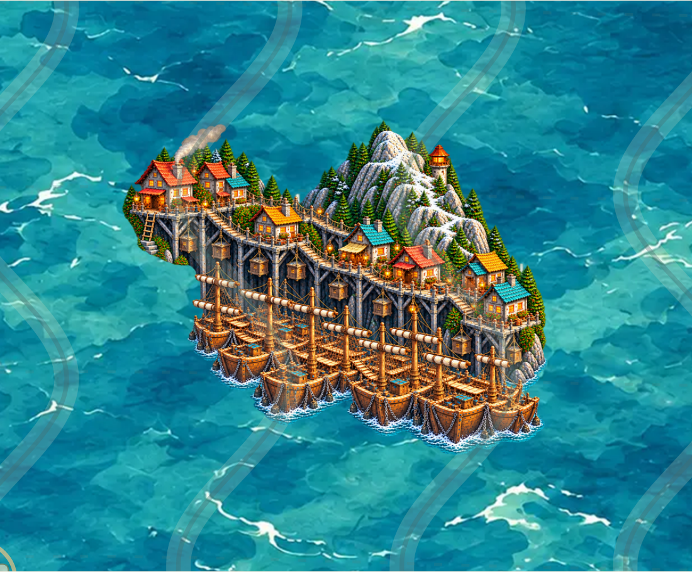

# Tesoro v2 – Überarbeitung für PR #65

**Historischer Entwurf:** Aktuell ist [Tesoro v3 mit umgekehrter Komposition](TESORO-V3-65.md). Die folgenden Bilder und Ergebnisse dokumentieren v2.

Stand 19.10.2026, aufbauend auf `5a8be54`, Branch `feature/asset-library-integration`. **Künstlerische Freigabe ausstehend.** Kein Freigabe-Hash und kein Merge nach main.

## Nutzerauftrag und Quellen

Die Überarbeitung erweitert die Stadt links oben und rechts unten, ergänzt den Schiffsteppich links unten und trennt kühles Pfahl-/Gebäudeholz von warmen Schiffsrümpfen. Zusammengerollte Segel sollen an den Rahen lesbar sein. Diese Farb- und Kompositionsentscheidungen sind **gestalterische Interpretation nach Nutzerauftrag**, keine zusätzlichen Audiobelege. Die getrennten Quellenkategorien und die verbindliche Raumfolge in der [Weltreferenz](TESORO-WORLD-REFERENCE.md) bleiben maßgeblich.

Tesoro v1 samt Malvorlage, PNG, Prüfberichten und Revieweinträgen bleibt unverändert erhalten. Die Galerie zeigt v2 als aktuellen Kandidaten; v1 bleibt im historischen Abschnitt und über die Motivauswahl verfügbar. Die historischen Krabbenzangen und alle bisher freigegebenen Assets bleiben erhalten.

## Bild und Integration

Aktuelle Datei: [tesoro-h4-v2.png](../assets/library/tesoro-h4-v2.png), ein einziges transparentes RGBA-Bild mit 856×680 Pixeln. Asset-ID `land-coast.settlement.h4.tesoro.v2`. Unveränderte kompakte Vierhex-Geometrie `[[0,0],[1,0],[0,1],[1,1]]`, alle vier Felder unbefahrbar und alle drei Hintergrundprüfungen **pending**, ohne Freigabefelder.

Die eingebaute Bildgenerierung (`image_gen`, Bearbeitung/Skizzenreferenz) erstellt die Malvorlage. Die [Erweiterungsskizze](reviews/tesoro-v2/expansion-guide.png) und der [Flächenplan](reviews/tesoro-v2/full-footprint-plan.png) sind ausschließlich technische Kompositionshilfen. Der bestehende Ganzbildexport resampelt die vollständige generierte Leinwand proportional und fügt transparente Ränder hinzu; er beschneidet keine Illustration anhand einer Hexmaske. Keine individuelle Skalierung, Rotation oder Beschneidung zur Laufzeit. Der Export verlangt bei v2 mindestens 35.000 sichtbare Pixel je Zelle (Alpha ≥16); v1 behält seine bisherige Grenze von 15.000. `python3 scripts/export-tesoro.py` exportiert v2 aus der gespeicherten Malvorlage; `--version v1` reproduziert den früheren Export.

[Erster Bearbeitungsprompt](reviews/tesoro-v2/generation-prompt.json) · [Segel-/Materialkorrektur](reviews/tesoro-v2/generation-sails.json) · [Flächenkomposition](reviews/tesoro-v2/generation-footprint.json) · [finaler Umriss-/Segelprompt](reviews/tesoro-v2/generation-final.json). Ein weiterer [Randkorrekturversuch](reviews/tesoro-v2/generation-boundary.json) wurde verworfen, weil der Ganzbildexport wieder kleiner ausfiel und links oben weniger belegte als v1. Ausgeliefert wird die davor technisch und visuell bessere Fassung. Die endgültige Komposition und ihre technische Abdeckung werden im Prüfbericht dokumentiert; verworfene Zwischenstände gelten nicht als Endergebnis.

## Ansichten und Prüfung

[Bestehende Multihex-Galerie](http://127.0.0.1:4183/dev/multihex-prototypes.html?asset=tesoro#tesoro).

[Pixelprüfung](reviews/tesoro-v2/pixel-audit.json) · [Browserprüfung](reviews/tesoro-v2/browser-audit.json) · [Erhaltungsprüfung](reviews/tesoro-v2/preservation-audit.json) · [Abgeschlossene Prüfungen](reviews/tesoro-v2/validation-summary.json).

Der vorherige Unit-CI-Lauf scheiterte im auf GitHub zusammengeführten PR-Stand bei der dort hinzugekommenen Paketvalidierung mit `ModuleNotFoundError: No module named 'PIL'`. Die vorbereitete Installation von Pillow im Unit-Job liegt als [separater Patch](reviews/tesoro-v2/unit-ci-pillow.patch) bei. **Die Workflow-Korrektur ist nicht angewendet:** GitHub wies den Push der Workflow-Datei zurück, weil der verwendeten OAuth-App der `workflow`-Scope fehlt. Der separate CI-Commit wurde aus der ungepushten Historie entfernt; die Tesoro-Änderungen werden ohne Workflow-Änderung gepusht. Die Prüfung selbst wird nicht abgeschwächt. Der CI-Abhängigkeitsfehler bleibt offen. Die übrigen vorherigen CI-Jobs waren erfolgreich; lokale Prüfungen und neuer GitHub-Lauf werden getrennt ausgewiesen.

## Ergebnis und Grenzen der Flächennutzung

Bei Alpha ≥16 wächst die sichtbare Bildfläche von **181.992 auf 200.770 Pixel (+10,3 %)**. In den drei fest definierten Außenbereichen des [Vergleichsberichts](reviews/tesoro-v2/coverage-comparison.json) steigt die Belegung links oben von **12.785 auf 13.394**, links unten von **16.334 auf 25.890** und rechts unten von **11.645 auf 21.373 Pixel**. Der Regressionstest verlangt in jedem dieser Bereiche einen Zuwachs und insgesamt mindestens zehn Prozent mehr sichtbare Bildfläche.

Die vier vollständigen Zellen enthalten jetzt **39.686 / 56.034 / 56.020 / 49.030** sichtbare Pixel. Der Zuwachs konzentriert sich auf die unteren Felder; die gesamten beiden oberen Zellen sind weniger dicht belegt als bei v1, obwohl der linke obere Außenbereich zunimmt. Die belegte Fläche entspricht **56,3 % der lokalen Grafikzellvereinigung** gegenüber 51,0 % bei v1. **Die vier Hexfelder sind weiterhin nicht lückenlos bis zu jeder Außenkante ausgemalt.** Der natürliche Umriss und transparente Randbereiche bleiben sichtbar; dies ist ausdrücklich Teil der ausstehenden künstlerischen Beurteilung, keine Behauptung vollständiger Landbedeckung. Alle vier Zellen sind unabhängig davon vollständig gesperrt.

Lokal abgeschlossen: **103 Unit-Tests**, **vier Export-/Abdeckungsregressionen**, alle **14 gültigen Anker** mit vollständiger Alpha-Prüfung, **vier Galerie-Browserfälle** in Chromium/WebKit auf Desktop und Mobil, vier eindeutige Rätsel und **21 Katalogbilder** mit unveränderten Freigabebindungen. Der vollständige bestehende Veröffentlichungsvalidator erzeugt ein ZIP mit **81 Dateien**; sämtliche **21 PNGs** sind bytegleich enthalten. Die Browserbelege zeigen exakt die technische Bildprüfsumme des ausgelieferten Assets. Auch die vier tatsächlichen ZIP-Auslieferungsfälle auf Desktop, Smartphone, iPhone und iPad bestehen. Die neue GitHub-CI läuft separat nach dem Push.
