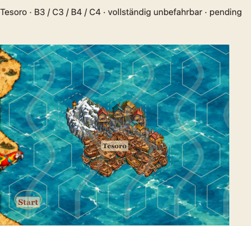
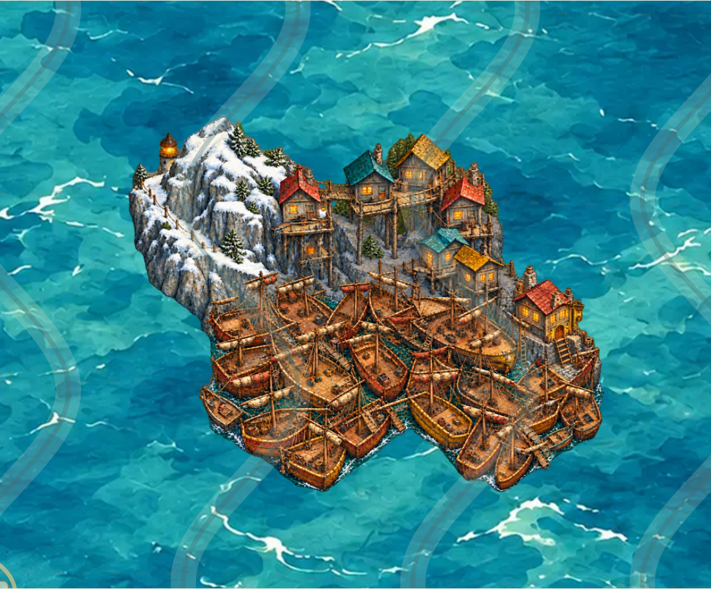

# Tesoro v3 – umgekehrte Komposition und chaotischer Schiffsteppich

Stand 19.10.2026, Branch `feature/asset-library-integration`, Ausgangsstand `c78abf6`. **Künstlerische Nutzerfreigabe ausstehend.** Kein Freigabe-Hash, kein Merge nach main.

## Gestaltungsauftrag und Weltreferenz

Die aktuelle Nutzerkritik betrifft den unbefriedigenden Motivabschluss und die regelmäßigen Reihen von Untergeschossen und Segeln. v3 übernimmt die vorgeschlagene umgekehrte Anordnung: Klippe und Leuchtturm links oben, Eingangswirtschaft mit Strickleiter rechts unten. Beide unteren Hexfelder sollen weitgehend durch eine ungeordnete Masse verketteter Schiffe geprägt sein. Schiffgrößen, Blickrichtungen, Takelage und geborgene Segel wechseln; zusätzliche Räume unter Plattformen sind einzelne asymmetrische Anbauten.

Dies ist **gestalterische Interpretation nach Nutzerauftrag**, kein neuer Audiobeleg. Die [Weltreferenz](TESORO-WORLD-REFERENCE.md) trennt weiterhin Audio-ASR, Episodenbeschreibung und ergänzte Erzählerangaben. Die Raumfolge bleibt Schiffe → Steinstufen/Strickleiter → zweigeschossige Eingangswirtschaft → Plattformstadt/Hängebrücken → gegenüberliegende Klippe → Schneeweg um den Gipfel → dahinter teilweise sichtbarer Leuchtturm. Links/rechts sind keine belegten Himmelsrichtungen.

## Bild und Integration

Eine einzige transparente RGBA-PNG: [tesoro-h4-v3.png](../assets/library/tesoro-h4-v3.png), 856×680 Pixel; Asset-ID `land-coast.settlement.h4.tesoro.v3`. Unveränderte kompakte Geometrie `[[0,0],[1,0],[0,1],[1,1]]`, alle vier Zellen vollständig unbefahrbar und sämtliche Hintergrundprüfungen **pending**, ohne Freigabefelder.

Die eingebaute Bildgenerierung (`image_gen`) setzt den [Kompositionsplan](reviews/tesoro-v3/composition-guide.png) um und benutzt v2 nur als Stil-/Materialreferenz. [Generierungsprompt](reviews/tesoro-v3/generation-prompt.json) · [Kompositionskorrektur](reviews/tesoro-v3/generation-refinement.json) · [Erweiterung der Schiffsloben](reviews/tesoro-v3/generation-expansion.json) · [steilere Vogelperspektive](reviews/tesoro-v3/generation-aerial.json) · [Material-/Segelkorrektur](reviews/tesoro-v3/generation-materials.json) · [Strickleitereingang](reviews/tesoro-v3/generation-ladder.json). Der natürliche Motivabschluss entsteht in der Malvorlage; es werden keine Schiffsrümpfe oder Gebäude durch eine geometrische Maske abgeschnitten. Die vorhandene Ganzbildpipeline resampelt die komplette Leinwand proportional und fügt transparente Ränder hinzu. Keine individuelle Laufzeitskalierung, Rotation oder Beschneidung. Die strenge Alpha-Prüfung umfasst die ganze Pixeloberfläche bis Alpha 1 sowie alle 14 gültigen Platzierungen. Für v3 wählt der Ganzbildexport eine legale feste Auffüllung mit mindestens 35.000 sichtbaren Pixeln in jeder oberen und mindestens 62.500 in jeder unteren Zelle (Alpha ≥16). Diese optionale zellspezifische Authoring-Vorgabe betrifft weder alte Aufrufer noch die Laufzeit. Ein unabhängiger Regressionstest verlangt mindestens 70 % sichtbare Belegung in jeder unteren Zelle und überprüft, dass die Malvorlage keine opaken Bildteile an der Leinwandkante abschneidet.

`python3 scripts/export-tesoro.py` exportiert v3 aus dem [gespeicherten Malmaster](reviews/tesoro-v3/tesoro-master.png); `--version v1` und `--version v2` erhalten die bisherigen Exporte. Beide früheren Tesoro-Fassungen bleiben mit unveränderten Bildbytes, Asset- und Revieweinträgen im Katalog und im historischen Galerieabschnitt erhalten. Alle elf bestehenden Freigabepaare bleiben erhalten. Produktiver Renderer, Spiellogik, Rätsel und Meeresuntergrund werden nicht geändert.

## Integrierte Ansichten

[Bestehende Multihex-Galerie](http://127.0.0.1:4183/dev/multihex-prototypes.html?asset=tesoro#tesoro).

[Pixelprüfung](reviews/tesoro-v3/pixel-audit.json) · [Zellabdeckung im Versionsvergleich](reviews/tesoro-v3/coverage-comparison.json) · [Browserbelege](reviews/tesoro-v3/browser-audit.json) · [Erhaltungsprüfung](reviews/tesoro-v3/preservation-audit.json) · [Validierung](reviews/tesoro-v3/validation-summary.json).

Der bekannte CI-Abhängigkeitsfehler bei Pillow bleibt separat offen; die vorbereitete [Workflow-Korrektur](reviews/tesoro-v2/unit-ci-pillow.patch) konnte wegen fehlendem OAuth-`workflow`-Scope nicht gepusht werden. Diese Überarbeitung verändert keine Workflow-Dateien. Lokale Prüfungen werden getrennt von der GitHub-CI ausgewiesen.

## Ergebnis und Prüfstand

Die finale Malvorlage verwendet eine steilere Vogelperspektive. Dadurch sind die ineinander verkeilten Decks und unterschiedlich ausgerichteten Rümpfe als breite Schiffmasse lesbar. Der Turm liegt teilweise hinter der linken Bergflanke; die zweigeschossige Eingangswirtschaft und kurze Strickleiter stehen rechts unten. Einzelne Untergeschosse sitzen asymmetrisch an verschiedenen Gebäuden. Vollständig geborgene Segeltücher wechseln in Größe, Farbe und Ausrichtung; etliche Spieren bleiben frei.

Sichtbare Belegung bei Alpha ≥16, Reihenfolge NW / NE / SW / SE: **50.349 / 57.433 / 71.778 / 64.302 Pixel**. Die unteren Zellen erreichen **80,45 % / 72,07 %** ihrer gesamten Grafikfläche, gegenüber **62,79 % / 54,96 %** bei v2. Die gesamte sichtbare Fläche wächst von 200.770 auf **243.862 Pixel (+21,5 %)**. Diese Werte messen alle sichtbaren Bildbestandteile einschließlich Takelage und der Eingangswirtschaft; sie sind keine semantische Segmentierung ausschließlich von Schiffsholz. Kleine Wasserfugen und natürliche transparente Randbereiche bleiben; alle vier Zellen sind weiterhin unbefahrbar.

Die eingefärbten [Fit-Diagnosen](reviews/tesoro-v3/fit-diagnostic.png) und [Erweiterungsfelder](reviews/tesoro-v3/fit-expansion-guide.png) dokumentieren verworfene flachere Zwischenstände. Sie sind keine Masken des ausgelieferten Bilds. Die endgültige Vogelperspektive wurde aus dem Kompositionsplan neu gemalt, anschließend wurden Segel-/Materialdetails und die Strickleiter korrigiert. Kein Deck, Bug oder Gebäude wurde durch eine geometrische Maske beschnitten. Die Leinwandränder der Malvorlage enthalten keine opaken Bildteile. Die größeren Nachweise und technischen Prüfsummen ersetzen keine künstlerische Nutzerfreigabe.

Lokal bestanden: **104 Unit-Tests**, **fünf Export-/Abdeckungsregressionen**, strenge Alpha-Prüfung an allen **14 gültigen Ankern**, **vier Galerie-Browserfälle** in Chromium/WebKit auf Desktop und Mobil, vier weiterhin eindeutige Rätsel und **22 Katalogbilder** mit gültigen bisherigen Freigabebindungen. Die Browseraufnahmen auf Chromium/WebKit und Smartphone dokumentieren exakt die ausgelieferte Bildprüfsumme. Der vollständige bestehende Veröffentlichungsvalidator erzeugt ein ZIP mit **82 Dateien**; alle **22 Katalog-PNGs** sind bytegleich enthalten, ohne Entwicklungs- oder Recherchedateien. Auch die vier tatsächlichen ZIP-Auslieferungsfälle auf Desktop, Smartphone, iPhone und iPad bestanden. Der neue GitHub-Lauf folgt separat nach dem Push.
