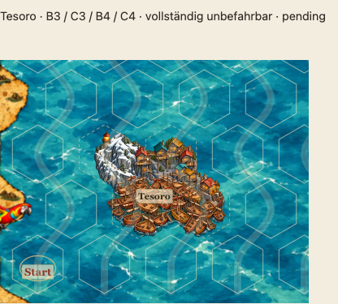
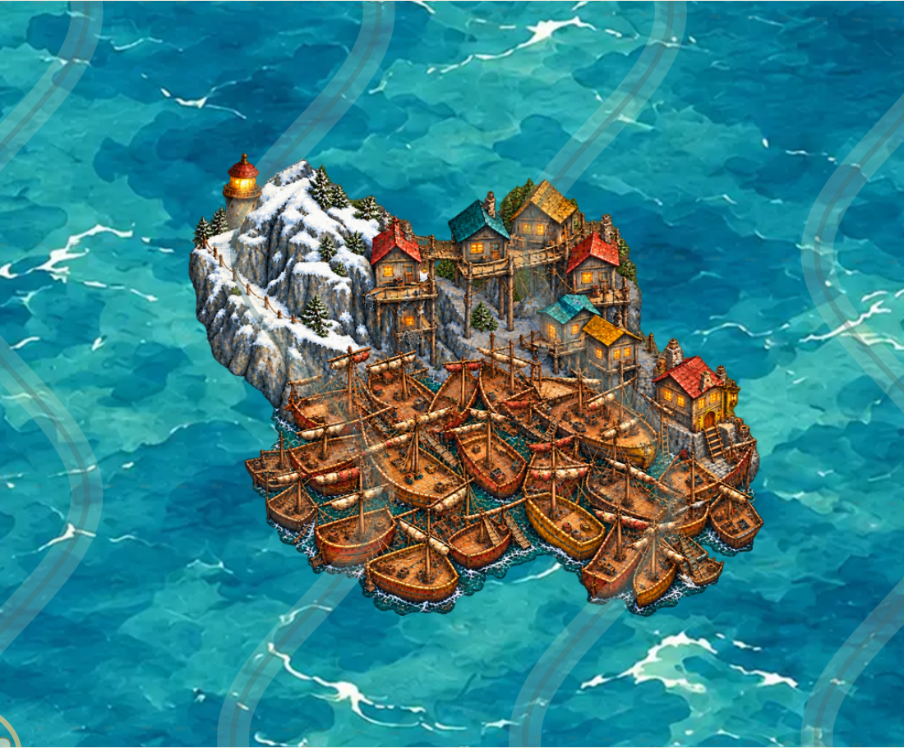

# Tesoro v4 – prominenterer Leuchtturm und freierer Bootsrand

Stand 19.10.2026, Branch `feature/asset-library-integration`, Ausgangsstand `71c218c`. **Künstlerische Nutzerfreigabe ausstehend.** Kein Freigabe-Hash, kein Merge nach main.

Die aktuelle Nutzerkorrektur wünscht einen prominenter hinter dem Berg hervorschauenden Leuchtturm und Boote, die das Hexfeld weniger genau ausfüllen. v4 vergrößert den sichtbaren oberen Turm und lockert den äußeren Schiffsumriss: unterschiedlich gedrehte, versetzte vollständige Rümpfe und kleine Rücksprünge statt zweier zugespitzter, dem Raster eng folgender Vorderkanten. Die Flotte bleibt dicht und chaotisch. Die steile Vogelperspektive, kühles Stadtholz, warme Rümpfe, einzelne asymmetrische Untergeschosse und der Eingang mit Strickleiter rechts unten bleiben maßgeblich.

Diese Änderungen sind **gestalterische Interpretation nach Nutzerauftrag**, keine neuen Audiobelege. Die [Weltreferenz](TESORO-WORLD-REFERENCE.md) und ihre getrennten Quellenkategorien bleiben bestehen. Der Leuchtturm steht weiterhin jenseits der Bergflanke; sein Fuß wird vom Vordergrund verdeckt.

## Integration und Flächenvorgaben

Eine einzige transparente RGBA-PNG: [tesoro-h4-v4.png](../assets/library/tesoro-h4-v4.png), 856×680 Pixel; Asset-ID `land-coast.settlement.h4.tesoro.v4`. Unveränderte kompakte Geometrie `[[0,0],[1,0],[0,1],[1,1]]`, sämtliche vier Felder unbefahrbar und alle drei Hintergrundprüfungen **pending**, ohne Freigabefelder.

Das eingebaute `image_gen` bearbeitet den bisherigen Malmaster mit dem [gespeicherten Prompt](reviews/tesoro-v4/generation-prompt.json). Der bestehende Ganzbildexport resampelt die gesamte Leinwand proportional und füllt transparent auf. Keine geometrische Beschneidung der Illustration, keine individuelle Skalierung, Rotation oder Beschneidung zur Laufzeit. Alpha bis 1 und alle 14 gültigen Kartenanker werden streng geprüft.

**Die neue künstlerische Vorgabe ersetzt das frühere Ziel möglichst maximaler unterer Hexfüllung.** v4 verwendet die allgemeine Mindestbelegung von 35.000 sichtbaren Pixeln je Zelle, ohne die v3-spezifische 62.500-Pixel-Vorgabe für die unteren Zellen. Der historische v3-Export und sein unabhängiger 70-Prozent-Regressionstest bleiben unverändert bestehen. Es werden keine bisherigen Prüfungen abgeschwächt und keine zuvor genehmigten Bildbytes ersetzt.

`python3 scripts/export-tesoro.py` exportiert v4 aus dem [gespeicherten Malmaster](reviews/tesoro-v4/tesoro-master.png). Die Optionen `--version v1`, `--version v2` und `--version v3` erhalten die früheren Fassungen samt ihren damaligen Bedingungen. Alle bisherigen Tesoro-Bilder, Katalogeinträge und Reviewdatensätze bleiben erhalten und sind im historischen Galerieabschnitt verfügbar. Produktiver Renderer, Rätsel, Spiellogik, Meeresuntergrund und Workflow-Dateien werden nicht geändert.

## Integrierte Ansichten

[Bestehende Multihex-Galerie](http://127.0.0.1:4183/dev/multihex-prototypes.html?asset=tesoro#tesoro).

[Pixelprüfung](reviews/tesoro-v4/pixel-audit.json) · [Flächenvergleich](reviews/tesoro-v4/coverage-comparison.json) · [Browserbelege](reviews/tesoro-v4/browser-audit.json) · [Erhaltung](reviews/tesoro-v4/preservation-audit.json) · [Validierung](reviews/tesoro-v4/validation-summary.json).

Der bekannte separate Pillow-Abhängigkeitsfehler der GitHub-Unit-CI bleibt offen. Die vorbereitete [Workflow-Korrektur](reviews/tesoro-v2/unit-ci-pillow.patch) konnte wegen fehlendem OAuth-`workflow`-Scope nicht gepusht werden. Lokale Prüfungen und GitHub-CI werden getrennt ausgewiesen.

## Ergebnis und abgeschlossene lokale Prüfungen

Der Turm hebt sich mit größerer sichtbarer Steinsäule, terrakottafarbenem Dach und goldener Laterne bereits im normalen Kartenmaßstab deutlich vom Schnee ab. Sein unterer Fuß bleibt hinter der Bergflanke verborgen. Die äußeren Boote sind unterschiedlich versetzt und gedreht, mit kleinen Rücksprüngen und offenen Fugen am Rand; die breite dichte Flotte und die natürliche Vollständigkeit einzelner Rümpfe bleiben erhalten. Die Änderung wurde in normaler Kartenansicht und Vergrößerung auf `sea-blue-01` visuell geprüft.

Lokal bestanden: **105 Unit-Tests**, **fünf Export-/Abdeckungsregressionen** einschließlich des unveränderten historischen v3-Dichtetests, strenge Alpha-Prüfung an sämtlichen **14 Ankern**, **vier Galerie-Browserfälle** in Chromium/WebKit auf Desktop und Mobil, vier eindeutige Rätsel und **23 Katalogbilder** mit gültigen bisherigen Freigabebindungen. Alle Browseraufnahmen verwenden exakt dieselben Bildbytes wie das ausgelieferte Asset. Die Malvorlage enthält keine opaken Bildteile an ihren Leinwandkanten.

Der vollständige bestehende Veröffentlichungsvalidator erzeugte ein ZIP mit **83 Dateien**; alle **23 Katalog-PNGs** sind bytegleich enthalten. Vier tatsächliche ZIP-Auslieferungsfälle unter einem Unterpfad auf Desktop, Smartphone, iPhone und iPad bestanden. Die frühere vollständige Bildfixture-Suite und der gesamte lokale 27er-Paketregressionslauf wurden nicht erneut ausgeführt und werden nicht erneut als bestanden gezählt. GitHub-CI läuft getrennt von diesen lokalen Nachweisen. Technische Prüfungen ersetzen keine künstlerische Freigabe.

Der [Flächenvergleich](reviews/tesoro-v4/coverage-comparison.json) dokumentiert die sichtbaren Pixel zur Nachvollziehbarkeit, ohne sie als künstlerische Zielgröße zu verwenden. Natürliche Außenränder und Wasserfugen bleiben unabhängig von der vollständigen Unbefahrbarkeit aller vier Zellen.
