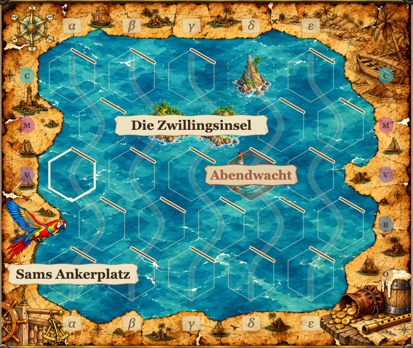
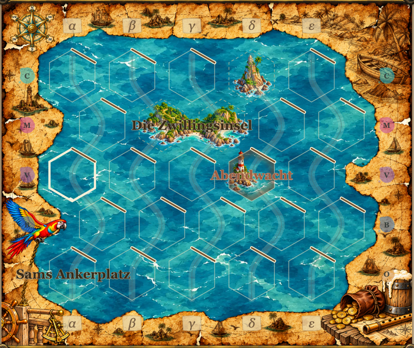
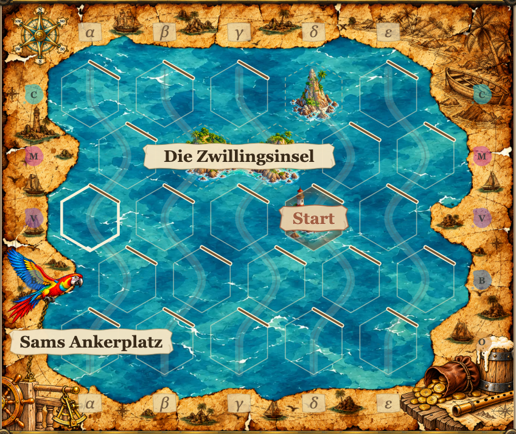

# A2b – Benannte Startorte und visuelle Differenzierung

Basis: `abeb1824d6278b6fc646a101f44f71d4d89b1f16` (main nach PR #130). Auftrag vom 25. November 2026; Referenzverträge aus PR #114, #117 und #118.

## Verhalten

`namedStartPlaceId` verbindet ausschließlich das benannte, befahrbare logische Einhex-Objekt mit `puzzle.start`. Der tatsächliche Name und die Objekt-ID bleiben erhalten. Die initiale beziehungsweise manuelle Startanforderung wird in dieselbe ID-Menge wie die Hinweisreferenzen aufgenommen: ein Ort, ein Pergament. Gibt es keinen passenden benannten Ort, erscheint zusätzlich der bisherige Fallback „Start“.

Gewöhnliche Hinweiswechsel zeigen ausschließlich ihre vorhandenen Referenzen. Eine explizite Startortreferenz erhält dieselbe besondere Gestaltung; andere Referenzen bleiben regulär. Die Vorrangregel von `cluePlaceRefs` einschließlich `[]` und der strukturierte `placeId`-Fallback sind unverändert.

Das auf main eingeführte Ausschneiden des Starthex aus Mehrhex-Orten und dessen Kollisionsausweichlogik entfallen. Beschriftungen verwenden wieder die vollständige Objektinstanz und deren Schwerpunkt gemäß PR #118. Ein Mehrhex-Ort wird durch seine Überschneidung mit dem Starthex weder umbenannt noch implizit zur besonderen Startortbeschriftung. Keine neue Kollisionsvermeidung.

## Farbwahl

| Merkmal | Regulärer Ort (unverändert) | Startort / Fallback |
|---|---|---|
| Papier | `#f3e5c5` | `#e5cda6` |
| Rand | `#9e7b45`, 0,5 SVG-Einheiten | `#a15f43`, 1,1 SVG-Einheiten |
| Schrift | `#392b19` | `#a15f43` |
| Helle Schriftkontur | `#f6e8cd`, 0,8 SVG-Einheiten | gleich |

Der bisherige Startschriftton war `#8c3e2c`. Statt einer weiteren roten Variante verwenden Rand und Schrift jetzt exakt den vorhandenen warmen Rotbraunton `#a15f43` des **aktuellen A3-Richtungspigments** in `src/ui/route-ink.mjs`. Der braune Routenpinsel (`#694934`), die dunkleren inaktiven Richtungssegmente (`#452d21`) sowie die bordeauxfarbene aktive Routennummer (`#893625`) bleiben unverändert. Der Browsertest vergleicht den Startschriftton mit dem tatsächlich gerenderten aktuellen Routengradienten.

Die Schriftfarbe liegt auf dem unabhängigen Ink-Track und bleibt daher auch nach dem Ausblenden des Papiers erhalten. Organische Form, Georgia, Ausgangsgröße 18, gemessene Textanpassung, Textur und Kartenbegrenzung sind unverändert. Kein Zusatzsymbol und kein Namenszusatz.

## Abdeckung

| Anforderung | Nachweis |
|---|---|
| Benannter Start, Name statt „Start“, initial mit/ohne Startreferenz | Zwei initiale Browsertests und Resolver-Integrationstest |
| Unbenannter Start | Initial, gespeicherter Reload, manuelle X-Aktion und nachfolgender Hinweiswechsel |
| Freies Starthex | UI-Controller-Prüfung mit initialer/manueller Einblendung und erneutem Mount nach Reload |
| Deduplizierung | Objekt-ID, exakte Namenlisten und genau eine Startbeschriftung |
| Explizite Startreferenz bei Hinweiswechsel | `cluePlaceRefs` und strukturierter `placeId`-Fallback |
| Andere/keine Referenzen | Exakte Namenliste beziehungsweise keine Labels, keine zusätzliche Startbeschriftung |
| Dieselbe Karte, anderer Start | Identische Karte, Assets und Namenszuordnung; identische Labelnamen, Flächen, Transformationen und Breiten; nur Startklasse und Innenschein wechseln |
| Reload und Rätselwechsel | Beide Startrichtungen, Rückwechsel, abgebrochene alte Tracks mit entfernten Zielen |
| Visuelle Differenzierung | Berechnete Papier-/Rand-/Schriftfarben in Papier- und Schriftphase; Vergleich mit Routengradient |
| Animation und Bereinigung | Bestehende Phasen-, native Abschluss-, Neuauslösungs- und Redraw-Verträge; neue 6-Track-Prüfung und vollständige Bereinigung |
| Eingaben und Reduced Motion | Native Maus-/Touch-Eingabe durch benanntes Startlabel; bestehende Route-/Radar-/Undo-/Persistenzregression; Präferenzwechsel und 3000-ms-Tracks |

Ein freies Starthex ist im bestehenden Engine-Datenvertrag nicht als öffentlich spielbares Rätsel zulässig (`logic.start` verlangt ein befahrbares Objekt). Deshalb wird dieser defensive UI-Fallback direkt am echten Controller geprüft; Engine und Datenmodell werden dafür nicht erweitert.

Die PR-#117/#118-Verträge bleiben erhalten: 4900 ms native Trackdauer, getrennte Papier-/Schriftphasen, gemeinsame Starts, eigene Abschlusszustellung und Aufräumfrist, sofort behandelte Abbruch-Promises, Subpixel-Toleranz beim Textfit und bestehende eng begrenzte WebKit-Gesamtbudgets. Keine neuen Sleeps oder höheren Timeouts. Der neue Reduced-Motion-Wechsel wartet auf beobachtete 3000-ms-Tracks; Trackstartzeiten werden vor dem gezielten Pausieren für Bilder erfasst.

## Validierung

- Engine, Integration und Geometrieverträge: **190/190** über Hauptlauf und nachgeprüfte sieben Abhängigkeitstests bestanden.
- Inhaltstests, öffentliche Rätselvalidierung und `git diff --check`: bestanden.
- Chromium Desktop/Pixel 7: **80 bestehende Regressionen bestanden, 2 passende Eingabeart-Skips**; abschließender Lauf aller neuen Fälle **16/16 bestanden**, ohne Retry. Die zuerst fehlerhaften neuen Testannahmen sind unten dokumentiert; kein fehlerfreier erster Gesamtlauf behauptet.
- WebKit Desktop/iPhone 13: gesamter abschließender Lauf **96 bestanden, 2 passende Skips, 0 Flaky, 0 Retries**, 202,4 s.
- Alle vier Profile: jeweils vier repräsentative Vergleichsbilder, insgesamt **16 Screenshots**.
- Native WebKit-Beobachtungen für natürlichen Abschluss und schnelle Neuauslösung: [Desktop natürlich](observations/webkit-desktop-natural-animation-timing.json), [Mobil natürlich](observations/webkit-mobile-natural-animation-timing.json), [Desktop Neuauslösung](observations/webkit-desktop-rapid-place-lifecycle.json), [Mobil Neuauslösung](observations/webkit-mobile-rapid-place-lifecycle.json).

Der erste lokale Engine-/Integrationslauf bestand 183/190 Fälle; sieben unveränderte Flavor-Produktionsfälle scheiterten ausschließlich am fehlenden Pillow im Standard-Python. Mit der vorhandenen Python-Umgebung samt Pillow/NumPy bestanden diese sieben vollständig. Anwendung und Tests wurden dafür nicht verändert.

Während der Entwicklung wurden neue Test-Fixtures auf eindeutig lösbare Richtungen korrigiert. Außerdem wurden Schriftfit statt gleicher Endschriftgröße, asynchrone Media-Query-Zustellung und das native `startTime=null` nach Pausierung in den neuen Tests korrekt berücksichtigt. Die bestehenden fachlichen Animationstests und deren Grenzen wurden nicht gelockert.

Reproduktion (Python mit Pillow/NumPy für die bestehenden Produktionsprüfungen erforderlich):

```sh
node --test tests/engine/*.test.mjs tests/integration/*.test.mjs tests/contracts/graphic-geometry.test.mjs tests/contracts/chart-asset-contract.test.mjs
npm run test:content
npm run test:puzzles
npx playwright test tests/browser/named-start-places.spec.mjs tests/browser/place-references.spec.mjs tests/browser/k-final-route.spec.mjs tests/browser/multihex-radar.spec.mjs tests/browser/model.spec.mjs --workers=1
npx playwright test tests/browser/named-start-places.spec.mjs tests/browser/place-references.spec.mjs tests/browser/k-final-route.spec.mjs tests/browser/multihex-radar.spec.mjs tests/browser/model.spec.mjs --config=playwright.webkit.config.mjs
```

Die vollständige unveränderte PR-CI wird für diesen Anwendungscode als `full` ausgeführt. Der exakte Review-Head und der abgeschlossene CI-Lauf werden im PR genannt; dieses Dokument enthält absichtlich keinen selbstreferenziellen Commit-Hash.

## Vergleichsbilder

Die Bilder stammen aus nativen Browseraufnahmen mit unveränderten Kartenassets. Für reproduzierbare Bildphasen werden nur die aktiven Labelanimationen auf 650 ms (Papier) beziehungsweise 3000 ms (reine Schrift) gesetzt; der separate natürliche Abschlusstest greift nicht in Animationen ein. „Abendwacht“ auf D3 und „Sams Ankerplatz“ auf A5 gehören in beiden Rätseln zu identischen Ortsobjekten. Die Gegenaufnahme wechselt ausschließlich die besondere visuelle Zuordnung; die reguläre Zwillingsinsel bleibt gleichzeitig sichtbar.

| Profil | Benannter Start + reguläre Orte | Andere Abfahrt, gleiche Namen | Reine Schriftphase | Unbenannter Start |
|---|---|---|---|---|
| Chromium Desktop | [Bild](chromium-first-start.png) | [Bild](chromium-other-start.png) | [Bild](chromium-ink.png) | [Bild](chromium-unnamed-object.png) |
| Chromium Pixel 7 | [Bild](mobile-chromium-first-start.png) | [Bild](mobile-chromium-other-start.png) | [Bild](mobile-chromium-ink.png) | [Bild](mobile-chromium-unnamed-object.png) |
| WebKit Desktop | [Bild](webkit-desktop-first-start.png) | [Bild](webkit-desktop-other-start.png) | [Bild](webkit-desktop-ink.png) | [Bild](webkit-desktop-unnamed-object.png) |
| WebKit iPhone 13 | [Bild](webkit-mobile-first-start.png) | [Bild](webkit-mobile-other-start.png) | [Bild](webkit-mobile-ink.png) | [Bild](webkit-mobile-unnamed-object.png) |






## Vollständige CI: Bordbuch-Verträge nachgezogen

Der erste vollständige Lauf [45634296567](https://github.com/roquas/Sams-Gezeitenkarten/actions/runs/45634296567) auf `01be36d605b9602ad2e1f9e9499fdb76dbc0d4f5` fand weitere veraltete Erwartungen in den Bordbuchtests: Die Hinweisaktion `showCluePlace` erwartete neben den beiden explizit referenzierten Mehrhex-Orten noch das implizite „Start“. Im WebKit-Log sind zunächst genau zwei korrekte Beschriftungen und nach deren regulärem Ablauf null zu sehen. Das Warten auf drei Labels kann daher nicht erfolgreich sein; die Frist ist nicht die Ursache.

Alle vier betroffenen Assertions in `logbook-overview.spec.mjs` und `logbook-skeuomorphic.spec.mjs` erwarten nun weiterhin die **exakte** Ortsnamenliste `['Roberts Boot','Zwilling']` und zusätzlich ausdrücklich **null** Startbeschriftungen. Die Prüfungen für unveränderte Gruppenidentität beim Abhaken, erneute Auslösung der Hinweisaktion, Tastatur-/Touch-Eingaben, Spielzustand und Undo bleiben bestehen. Keine Anwendungscode-, Timeout- oder Konfigurationsänderung. Initial- und X-Aktionsprüfungen behalten ihren zusätzlichen Fallback „Start“.

Nachprüfung aller vier betroffenen Fälle: Chromium Desktop/Mobil **8/8**, WebKit Desktop/Mobil **8/8**, jeweils ohne Retry. Der vollständige CI-Lauf wird auf dem korrigierten Head neu gestartet.
