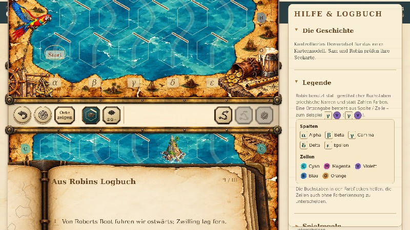
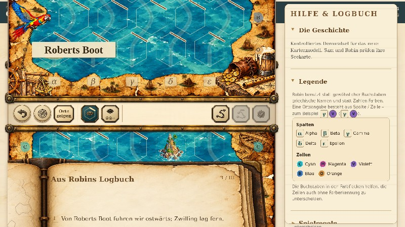
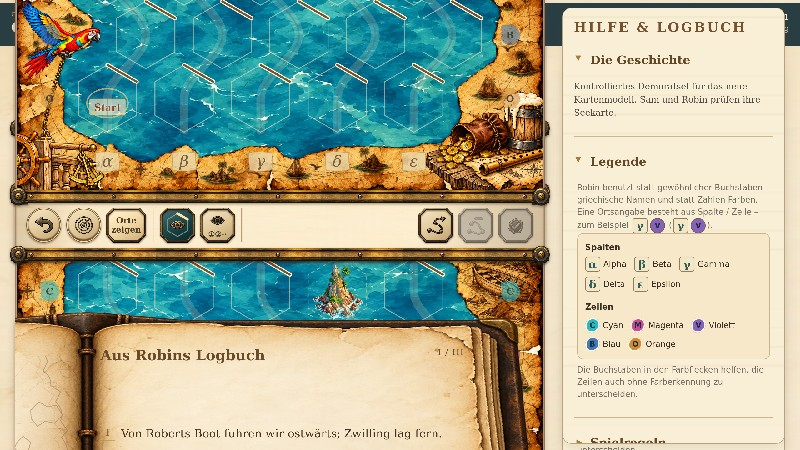

# WebKit: Wandzeit ist keine gesampelte Animationszeit

Dieser Bericht dokumentiert den ersten Fix (`627d0c7`). Die nachfolgende
vollständige PR-CI blieb wegen des separaten Ersetzungstests rot; dessen
[Untersuchung und Korrektur](WEBKIT-RAPID-REPLACEMENT.md) ergänzen diesen Befund.

## Befund und Abgrenzung

Der Fehler aus [PR #115 / Lauf 44749575218](https://github.com/roquas/Sams-Gezeitenkarten/actions/runs/44749575218)
ist eine unzuverlässige Testannahme: Nach 650 ms im Node-Testprozess ist die
Web Animation unter Linux/WebKit noch nicht zwingend gestartet beziehungsweise
im Renderer gesampelt. Ein dauerhafter Ausfall der Ortsnamendarstellung wurde
nicht bestätigt. Der Anwendungscode bleibt unverändert; ebenso S04-B.

Untersuchte Basis ist main `d7632321e7a626e37a29fb10ff3fa7b428cef2c5` nach
Integration von PR #114. Der Diff von PR #115 verändert weder Controller noch
betroffenen Browsertest. Eine isolierte Linux-Diagnose auf dieser main-Basis
reproduziert denselben Fehler, ohne S04-B-Code zu integrieren.

## Originalfehler und grüne Baseline

Der Controller in `src/ui/place-references.mjs` erzeugt pro Auslöser eine
SVG-Gruppe und eine gemeinsame Web Animation: 400 ms Einblendung, 3000 ms
Haltephase, 2000 ms Ausblendung, Gesamtdauer 5400 ms, `fill: 'both'`.
Neue Auslöser brechen die alte Animation ab; deren abgelehntes `finished`-Promise
wird behandelt. Nur der Abschluss der noch aktuellen Gruppe darf diese entfernen.
Normale Karten-Neuzeichnungen erhalten die Animation. Reduzierte Bewegung
verwendet 3000 ms ohne Übergänge.

Der alte Test verbindet dagegen 650 ms Wandzeit und eine Textabfrage mit einer
sofortigen, nicht wiederholenden Opazitätsassertion. Später setzt er weitere
3300 ms Wandzeit mit der Ausblendphase gleich. Beides setzt eine verlässlich
fortschreitende und zeitnah gesampelte Renderer-Zeitleiste voraus.

- [Grüne PR-114-Baseline 44718310398](https://github.com/roquas/Sams-Gezeitenkarten/actions/runs/44718310398):
  Desktop-Lifecycle im ersten Versuch bestanden, 14,476 s Testdauer.
- PR #115: beide Versuche scheitern mit erwarteter Opazität 1 und gemessener 0;
  Testdauer 9,356 s beziehungsweise 8,824 s. Kein globaler 30-s-Timeout.
  Die Auswertung kommt etwa 1,07 beziehungsweise 1,08 s nach Rückkehr des Klicks
  beim Testprozess an. Text und Gruppe sind vorhanden.
- Diese Original-Traces enthalten **keine** Messungen von `currentTime`,
  `startTime`, `playState` oder `pending`. Die Playwright-Meldung „visible“
  beweist keine nicht transparente Darstellung: Playwrights Sichtbarkeitsbegriff
  schließt Elemente mit Opazität 0 ein. Ein nach dem Fehler erzeugter Screenshot
  ist außerdem keine zeitgleiche Aufnahme der fehlgeschlagenen Assertion.
- Die grüne Baseline enthält für diesen bestandenen Test keinen aufbewahrten
  Trace. Aus ihrer Gesamt-Testdauer wird keine Animationszeit abgeleitet.

## Reproduktion mit nativer Linux-WebKit-Zeitleiste

[Einmaliger Diagnoselauf 44778787823](https://github.com/roquas/Sams-Gezeitenkarten/actions/runs/44778787823)
auf `d2a19e853616c1c94b14119df383850c80418360`, ausgehend von der oben genannten
main-Basis. Die ausschließlich auf dem Analysezweig liegende Workflow-Änderung
führt Originaltest und Probe aus; sie gehört nicht zum Fix. Ubuntu, Node 22,
Playwright 1.64.0, unveränderte WebKit-Geräteprofile (Desktop DPR 2, Mobil DPR 1),
ein Worker, keine Retries. Der Originaltest scheitert erneut auf Desktop mit
`1 !== 0`; Mobil besteht.

Die Probe umhüllt ausschließlich im Testkontext `Element.prototype.animate`,
gibt dieselbe native Animation zurück und beobachtet `ready`, `finished` und
Zustandsproben. Kein Pause/Seek/Finish, keine geänderten Keyframes, Dauern oder
Playback-Raten. Der native Klick bleibt erhalten. Vollständiger Probequelltext,
Rohmesswerte, Versuchsergebnisse und ZIP-Hashes stehen in
[webkit-start-time-evidence.json](webkit-start-time-evidence.json).

| Desktop-Probe | `currentTime` | `startTime` | `playState` | `pending` | CSS-Opazität |
| --- | ---: | ---: | --- | --- | ---: |
| direkt nach `animate()` | 0 | null | running | true | 0 |
| Abfrage nach den alten 650 ms | 0 | null | running | true | 0 |
| Intervallprobe bei +1255 ms | 0 | null | running | true | 0 |
| `ready` bei +1306 ms | 1275 | 3892 | running | false | 1 |
| spätere Ausblendprobe | 4774 | 3892 | running | false | 0,622516 |
| `finished` bei +5983 ms | 5400 | 3892 | finished | false | 0 |
| nach Controller-Bereinigung | null | null | idle | false | Gruppe entfernt |

`startTime` ist ein absoluter Wert der DocumentTimeline; +Zeit bezieht sich auf
Erzeugung der manuellen Animation. `ready` setzt die Zeitleiste nicht erst bei
0 in Gang: Beim Abarbeiten des ausstehenden Play-Tasks kann der Browser bereits
verstrichene Timeline-Zeit berücksichtigen. Deshalb ist die Aussage „die Animation
beginnt exakt 1,3 s später“ zu stark. Belegt sind der anfangs ausstehende Start
und verzögerte Renderer-Samples. Zeitabfragen können währenddessen weiterlaufen,
während CSS-Opazität noch den vorherigen Sample widerspiegelt. Die Probe zeigt
auch solche verzögerten Ausblend-Samples.

In der Mobilprobe wird `ready` bei +330 ms aufgelöst; `finished` folgt bei
+5469 ms. Beide nativen Proben entfernen alle Labels ohne Eingriff regulär.
Die Seite ist jeweils `document.visibilityState === 'visible'`; die Gruppe hat
positive Geometrie und sichtbare CSS-Eigenschaften. Die Desktop-Screencast-Bilder
belegen zusätzlich tatsächlich gezeichnete Pixel. Durch den nativen Klick ist
nur der untere Kartenausschnitt im Viewport; darin ist „Roberts Boot“ sichtbar.

| Vor sichtbarem Sample | Haltephase |
| --- | --- |
|  |  |

| Ausblendung | Entfernt |
| --- | --- |
|  |  |

Die Daten belegen die Testursache und funktionierende spätere Darstellung.
Sie isolieren nicht den internen Grund für WebKits verzögerten Play-Task oder
seine langsamen Compositor-Frames. Eine allgemeine Aussage über alle möglichen
WebKit-Darstellungsfehler folgt daraus nicht. Die historischen Fehler lassen sich
mangels damaliger Telemetrie nicht rückwirkend mit denselben Zustandswerten
versehen; die unabhängige Reproduktion zeigt jedoch exakt denselben Fehlertyp
auf unverändertem main.

## Korrektur und Regression

Nur der betroffene Lifecycle-Test wird ersetzt und ein ergänzender Phasentest
hinzugefügt; Controller, Layout und übrige Verhaltenstests bleiben unverändert.

1. Vor dem nativen Klick wird die neue Gruppe mit einem MutationObserver erfasst.
   Ein Beobachter sammelt alle 100 ms Browserzustand und berechnete Darstellung.
   Das ist Zustandsbeobachtung, keine feste Wartefrist und keine Veränderung der
   Animation. Die Historie erhält Phasen auch bei langsamen Protokollantworten.
2. Die natürliche Wiedergabe muss eine sichtbare, im Viewport liegende Gruppe
   mit **Opazität exakt 1**, `pending: false` und laufender Animation während der
   Haltephase erreichen. Danach muss ein Sample eine echte Ausblendung zeigen.
   `finished`, vollständige DOM-Entfernung, null Kartenanimationen und der
   unveränderte Startmarker werden geprüft. Die bisherigen 3,5 s für die
   Entfernung ab beobachteter Ausblendung bleiben erhalten. Beobachtete Zustände
   werden bei Erfolg und Fehler als `place-lifecycle` angehängt.
3. Ein separater Renderingtest pausiert die echte Animation und setzt deren
   `currentTime` auf 0, 200, 400, 1900, 3399, 3400, 4400 und 5399 ms. Er prüft
   Opazität 0, partielle Einblendung, die vollständige Haltephase, partielle
   Ausblendung und Annäherung an 0 bei unveränderter Gesamtdauer. Anschließend
   spielt die Animation das letzte Stück natürlich ab und muss die Gruppe
   entfernen. Dieses Seeking kann einen hängenden nativen Ablauf nicht
   verdecken, weil der erste Test keinerlei Zeitsteuerung verwendet.

Damit bleibt jede fachliche Assertion erhalten oder wird präzisiert. Keine
Erhöhung der Schlafzeiten, kein Entfernen der Opazitätsprüfung, keine Änderung
des Produktverhaltens und kein CI-Neustarten als Ursachenklärung.

## Prüfungen

- Gezielte macOS-WebKit-Prüfung beider neuen Tests: **4/4 bestanden**, keine Retries.
- Referenzdaten und Labelgeometrie: **6/6 Integrationstests bestanden**.
- Vollständige macOS-WebKit-Ortsreferenz-Matrix: **20 bestanden, 2 zur Eingabeart passende Skips**, keine Retries.
- Vollständige Chromium-Ortsreferenz-Matrix (Desktop/Mobil): **20 bestanden, 2 zur Eingabeart passende Skips**, keine Retries.
- JavaScript-Syntax und `git diff --check`: bestanden.
- Ergänzende Linux-CI des Fix-PRs: siehe PR-Status.

Reproduktion der Regressionen:

```sh
npx playwright test --config playwright.webkit.config.mjs tests/browser/place-references.spec.mjs --retries=0 --trace=on
npx playwright test tests/browser/place-references.spec.mjs --workers=1 --retries=0 --trace=on
node --test tests/integration/place-references.test.mjs tests/integration/place-labels.test.mjs
```
