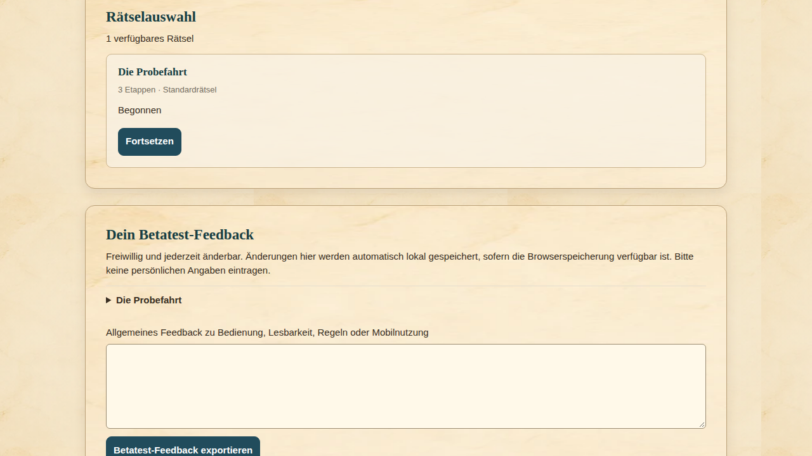
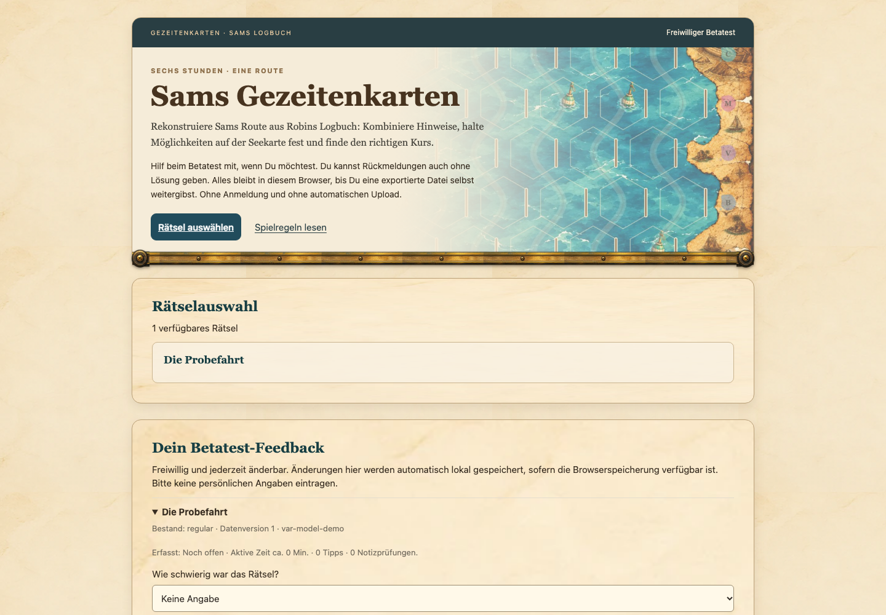
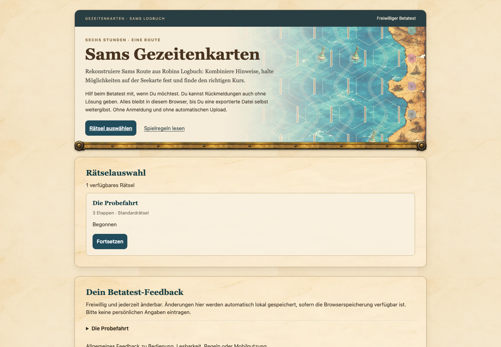

# PR #119: unabhängige Nachprüfung der drei Browser-CI-Befunde

Geprüfte Basis: `6e1b108fcb372b8c72d863ec0ebb29ce127c02ec`.
[Fehlgeschlagener Lauf 45006843715](https://github.com/roquas/Sams-Gezeitenkarten/actions/runs/45006843715).
Alle drei Jobs scheiterten an **Flakiness**: Der jeweilige vorhandene CI-Retry
bestand, `failOnFlakyTests` ließ den Job zu Recht rot. Keine neue Wiederholung,
Fristverlängerung oder Skip-Regel wurde dafür eingeführt.

Die Nachprüfung begann mit den Original-Logs und dem originalen Chromium-Trace.
Das 368.195.413-Byte-Artefakt wurde gegen den von GitHub bestätigten SHA-256
`c9495a126097ed414bf2ab7925afff1dba78625ebdcca5df78703f7e7344f21f`
geprüft. Nur der betroffene Trace, Fehlerkontext und Screenshot wurden extrahiert.
Die nachfolgend beschriebenen Fehler wurden mit bytegleichem Produktcode erneut
kontrolliert hergestellt; Warnungen zu DBus/GPU sind kein Nachweis ihrer Ursache.

## 1. Chromium: Feedback nach Katalogrevision

[Job 137160222652](https://github.com/roquas/Sams-Gezeitenkarten/actions/runs/45006843715/job/137160222652).
Der Timeout betraf **das erste Kommentarfeld „Version eins“**, nicht Version 2:
`#feedbackRecords details:first [name=comment]`. Die CI wiederholte 117-mal
„element is not visible“. Der Screenshot zeigt den zugeklappten Feedbackbereich:



**Der Zweirätselkatalog war nicht die Ursache.** Die globale Testfixture hatte
bereits auf genau `model-demo` eingeschränkt. Beide im Trace gelieferten Manifeste
enthalten nur diese ID. Beide geladenen Rätsel-DTOs haben Datenversion 1.
Die Überlagerung für Datenversion 2 wird erst nach dem fehlgeschlagenen `fill`
registriert und wurde in diesem Versuch noch gar nicht angefordert.
[Aus dem originalen Trace extrahierte Requests und Aktionen](original-ci-feedback.json).

Die tatsächliche Grenze ist der zweistufige Seitenaufbau in `showLanding()`:

1. Vor dem asynchronen Katalogladen zeigt `renderFeedback()` vorhandene Records.
2. Die bisherige Testhilfe öffnet sofort den ersten dieser Bereiche.
3. Nach dem Laden ruft die Seite erneut `renderFeedback()` auf.
   `replaceChildren()` ersetzt die geöffneten `details` durch neue, geschlossene.
4. Der Live-Locator findet nun das neue, verborgene Kommentarfeld und wartet
   vergeblich auf Sichtbarkeit. Längeres Warten würde es nicht wieder öffnen.

Der originale Trace setzt den Summary-Klick in genau dieses Fenster:
Klickausführung ab 34689,673 ms, Ende der Rätselantwort 34698,302 ms,
Klick abgeschlossen 34706,342 ms, anschließender `fill` ab 34749,963 ms.
Der vorläufige Formularaufbau und sein abschließender Ersatz existieren bereits
auf B1-main (`928dd1a`); PR #119 hat diese `renderFeedback`-Aufrufe nicht eingeführt.

**Negativer Gegenlauf:** Die zweite Rätselantwort wird zurückgehalten. Die alte
Testhilfe öffnet den vorhandenen Bereich. Nach Freigabe der Antwort ist der alte
Knoten abgetrennt und sein Ersatz geschlossen; derselbe `fill` scheitert an
„not visible“. Genau eine Rätsel-ID, Datenversion 1 und unveränderte Produktdateien.
Der kurze 1000-ms-Timeout dient ausschließlich der erwarteten Diagnose dieses
bereits festgestellten negativen Zustands; das reguläre Testbudget bleibt 60 s.

| Vor Abschluss des Ladens | Nach dem abschließenden Rendern |
| --- | --- |
|  |  |

**Eng begrenzte Korrektur:** Die Testhilfe wartet auf den geladenen Aktionslink
der vorgesehenen Demo-Karte. In dieser Testfixture folgt danach kein weiterer
asynchroner Ladeschritt vor dem abschließenden Feedbackaufbau. Sie adressiert
anschließend ausdrücklich Rätseltitel und Datenversion, öffnet diesen Bereich
und verlangt ein sichtbares Kommentarfeld. Keine pauschale Verzögerung und kein
gewaltsames Öffnen per JavaScript.

Der Revisionstest behält sämtliche bisherigen Assertions. Zusätzlich schreibt
er „Version zwei“ in das Formular der Version 2 und prüft nach Katalogentfernung
beide Texte samt `pub-revision-two`. Ein nicht geladener oder falsch zugeordneter
Revisionsdatensatz kann diese Prüfung nicht bestehen. Eine kontrolliert
zurückgehaltene Katalogantwort deckt die Bereitschaftsgrenze separat ab.

**Einordnung:** Testsynchronisationsfehler an einer bestehenden asynchronen
UI-Grenze; keine nachgewiesene Datenverlust-, Schema- oder Exportregression.
Die frühe vorläufige Anzeige kann im Produkt weiterhin einen bereits geöffneten
Bereich beim Katalogabschluss schließen. Dieses bestehende UX-Verhalten wird
hier nicht umgebaut und erhält durch die Testkorrektur keine visuelle Freigabe.

## 2. WebKit Desktop: 3968 statt mindestens 4000 ms

[Job 137160222031](https://github.com/roquas/Sams-Gezeitenkarten/actions/runs/45006843715/job/137160222031).

Der Test wartete bereits auf „läuft“. **Noch einmal nur auf Lock-Besitz zu warten
reicht daher nicht.** Die aktive Zeit verwendet `performance.now()`, gehört nur
der aktuellen offenen Phase und zählt ausschließlich sichtbare, nicht pausierte
Zeit unter logischem Lock-Besitz. Speicherung erfolgt unter anderem beim
5000-ms-Intervall, bei Aktivität, Pausieren und Verlassen.

Dieses Intervall wird **vor der asynchronen nativen Lock-Zuteilung** eingerichtet.
Die Zuteilung setzt den monotonen Ausgangspunkt neu. Der erste Intervalltick
enthält damit nur den seit dieser Zuteilung vergangenen Anteil. Nach
`page.clock.runFor(6000)` kann dieser erste Teil schon gespeichert, die restliche
aktive Zeit bis zum nächsten Flush aber noch nicht gespeichert sein. Die
Mindestwertannahme setzt unbemerkt eine ausreichend frühe Startzuteilung voraus.
Das ist kein Beleg für verlorene aktive Zeit und keine erlaubte Begründung,
die 4000-ms-Assertion einfach zu reduzieren.

**Negativer Gegenlauf mit echter exklusiver Web Lock:** Ausschließlich die
Zustellung ihres initialen Callbacks wird im Test zurückgehalten. Die ursprüngliche,
automatisch laufende Playwright-Uhr läuft dabei weiter. Im versionierten Gegenlauf
beginnt die Zuteilung bei 1849 ms; der erste Tick bei 5206 ms speichert **3357 ms**.
Die originale Mindestassertion scheitert. Beim anschließenden realen Pausieren
wird korrekt auf **6205 ms** bis Zeitpunkt 8054 ms aufgefüllt: kein Zeitverlust.
Der unabhängige erste Diagnoselauf lieferte entsprechend 3433/6412 ms.

**Korrektur ausschließlich im Test:** Wie in den bereits vorhandenen
deterministischen B1-Tests wird die virtuelle Uhr vor der Navigation installiert
und angehalten. Während nativer Startzuteilung und Seitenaufbau verstreicht
keine unkontrollierte virtuelle Startzeit. Erst nach dem exakten Status
„Aktive Zeit läuft · Näherungswert“ werden dieselben 6000 ms vorgespult und
weiterhin **mindestens 4000 ms** verlangt. Im kontrollierten positiven Vergleich
stehen nach dem ersten Tick 5000 ms, nach Pausieren 6000 ms im Store.

## 3. WebKit Mobil: 3851 statt mindestens 4000 ms

[Job 137160222152](https://github.com/roquas/Sams-Gezeitenkarten/actions/runs/45006843715/job/137160222152).
Dieselbe ungültige Startphasenannahme in demselben Test, separat auf iPhone/WebKit
nachgeprüft. Im versionierten Gegenlauf liefert die alte Uhr **3369 ms** vor
Pausieren und korrekt **6044 ms** danach; mit angehaltener Startphase wiederum
**5000 ms** beim ersten Tick und **6000 ms** beim Pausieren. Die ursprüngliche
4000-ms-Grenze ist unverändert.

Die originalen CI-Traces loggen keine native Lock-Zeitachse. Ein exakter
Zuteilungszeitpunkt der ursprünglichen 3968-/3851-ms-Versuche wird deshalb nicht
nachträglich behauptet. Quellcode, gemessene Zustellung/Ticks im kontrollierten
Gegenlauf und das korrekte Auffüllen beim Flush belegen die fehlerhafte
Testannahme und reproduzieren dieselbe Fehlerrichtung auf beiden Profilen.
Kein Nachweis einer Produktregression oder eines ausschließlichen CI-Infrastrukturfehlers.

[Alle Rohmesswerte, unveränderte Produktdatei-Hashes und Zustellereignisse](negative-controls.json).

Die frühere PR-#116-Korrektur wartete bei **Wiederaufnahme** auf native Ownership,
bevor sie virtuelle Zeit vorgab. Sie bleibt unverändert einschließlich ihres
Regressionstests. Der neue Regressionstest prüft die andere Grenze, die initiale
Intervallphase: 1500 ms ohne zugestellte Ownership zählen **0**; nach Zustellung
enthält der erste Tick exakt **3500** und der Flush nach insgesamt 6000 ms
Ownership exakt **6000 ms**, auch im Export. Warten ohne Lock wird damit nicht
durch die neue Synchronisation unsichtbar mitgezählt.

## Nachweise, Reproduktion und Änderungsumfang

[Strukturierte Testresultate samt Einzelversuchen und Retries=0](test-results.json).
Die zwei Originaltests wurden bytegleich vom geprüften Head kopiert und auf
Chromium, WebKit Desktop und WebKit Mobil je dreifach ausgeführt: **18/18 grün**
auf dem ruhigeren lokalen Rechner. Das widerlegt die Rennen nicht; die
kontrollierten negativen Gegenläufe stellen sie gezielt her.

Die beiden korrigierten Tests und ihre zwei neuen Grenzfalltests wurden auf
Chromium Desktop/Pixel 7 und WebKit Desktop/iPhone **je fünfmal ohne Retries**
ausgeführt: **80/80 bestanden**, keine Skips. Die 36 relevanten Integrationstests
für B1-Speicherung/Uhr/Transport sowie A2b-Orte, Route, Logbuch, Radar und
Spielzustand bestehen ebenfalls vollständig.

Die anschließenden B1-/A2b-Browsermatrizen (`beta`, `beta-a2b`, `place-references`,
`k-final-route`) bestehen auf Chromium und WebKit jeweils mit **94 bestandenen
Fällen und zwei unveränderten Geräte-Skips**, ohne Fehler oder Retries. Desktop
und Mobil wurden in beiden Browserfamilien geprüft. Es wurden ausschließlich
Serveradresse/Ergebnisverzeichnis für den isolierten lokalen Server angepasst;
die regulären Profile und Workerzahlen (Chromium 2, WebKit 1) blieben erhalten.

Der neue vollständige CI-Lauf wird im [bestehenden PR #119](https://github.com/roquas/Sams-Gezeitenkarten/pull/119)
mit ihrem tatsächlichen abschließenden Status festgehalten.

Reguläre Zieltest-Wiederholung, jeweils ohne Retries:

```sh
npx playwright test --config=playwright.b1.config.mjs \
  --grep 'revision and catalog removal|timer persists reload|feedback waits for the final|initial delayed lock grant' \
  --repeat-each=5 --retries=0
```

Kontrollierter Vorher-/Nachher-Gegenlauf (erwartete Diagnosefehler werden erfasst,
keine Produktmodule verändert; die absichtliche 1500-ms-Verzögerung liegt nur
in diesem manuellen Diagnoseprogramm):

```sh
python3 scripts/dev-server.py --port 4195
node tests/diagnostics/b1-browser-ci.mjs
# Messwerte und echte Zustandsbilder: .dev/b1-browser-ci-probe/
```

Integration:

```sh
node --test tests/integration/{beta-storage,beta-context,place-references,route-ink,bordbook,game-state,distance-overlay}.test.mjs
```

Geänderte Programmdateien: ausschließlich `tests/browser/beta.spec.mjs` und das
neue manuelle Diagnoseprogramm `tests/diagnostics/b1-browser-ci.mjs`. Hinzu kommen
diese Nachweise. **Keine Änderung an Produktcode, Gestaltung, Regeltexten,
Koordinatenaufbereitung, Bildmaterial, Rätsel/Validierungsbelegen, Engine, Solver,
Generator, A2b oder Feedback-/Phasen-/Exportformat.** Alle bisherigen fachlichen
Assertions bleiben erhalten; die Revisionserhaltung wird zusätzlich präzisiert.
Keine Testfälle entfernt, keine größeren Budgets, zusätzlichen Retries oder neuen Skips.

Keine Mergefreigabe. Die visuelle Abnahme bleibt beim Auftraggeber.
