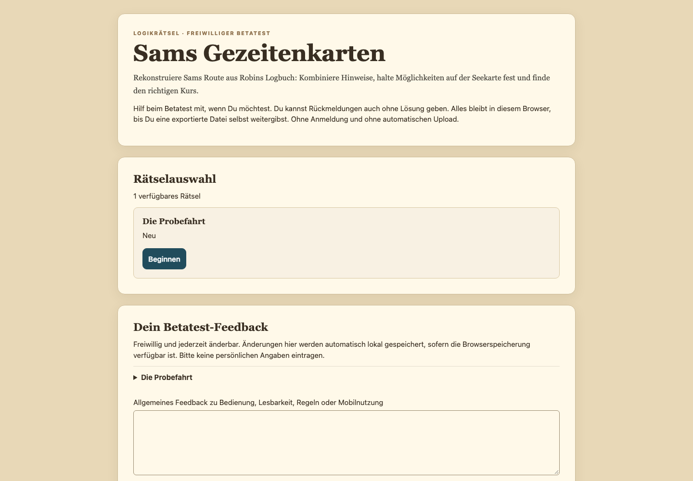
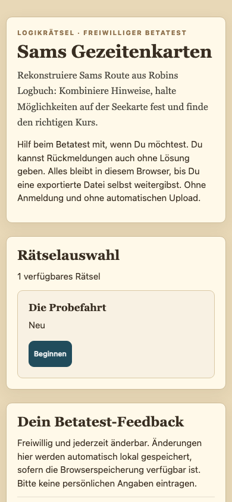
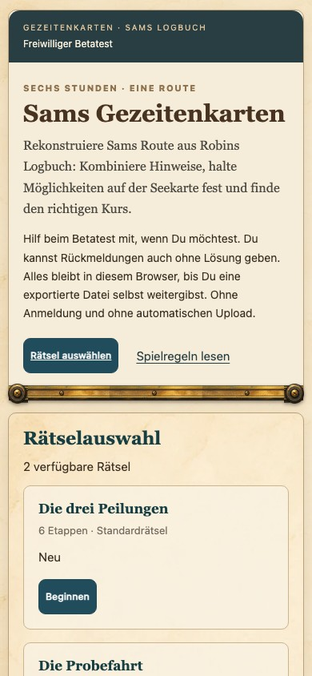

# B1-Folgearbeiten: Landingpage und bebilderte Regeln

Basis ist `928dd1a5e5d043c962612b07be998686a025ba7b`, der tatsächliche Merge
von PR #116 auf main am 22.11.2026 um 07:42:58 UTC. Darin enthalten sind
#118 (`4d7c3ac`) und #115 (`8dafebf`). Eigenständiger Branch
`codex/b1-illustrated-rules`; keine Bearbeitung anderer Featurebranches.
Bezug: [Issue #31](https://github.com/roquas/Sams-Gezeitenkarten/issues/31).

## Gestaltung und Regeln

Die Landingpage übernimmt die abgesetzte Logbuch-Kopfzeile, Petrol, Georgia,
Papier und die vorhandene Messingleiste. Dahinter liegt ein ausgeblendeter
Ausschnitt des echten Renderers. Auf Mobil entfällt das Hintergrundbild.
Die Auswahl bleibt direkt hinter dem Titel; das Standardrätsel steht zuerst.
Keine neue Bibliothek oder Animation.

Die ausführliche Einführung und ihr Ton bleiben erhalten. Korrigiert sind
insbesondere Start/Stunde 0 plus sechs folgende Etappen, die unabhängigen
Stundenkarten, große und kleine Notizen, beide Radierer, tatsächliche
Werkzeugpositionen, „Route zurück“, gerichtete Segmente, Nummern und
Ortsreferenzen aus A2b. Radar (auch auf Land und bei mehrzelligen Orten),
Notizprüfung, kostenlose Routenprüfung und wiederholte Tippkosten entsprechen
der Implementierung. Die Abbildungen sind Bedienbeispiele, keine Lösung.

Eine HTML-Quelle bleibt in `index.html`. `src/ui/rules.mjs` bereitet sie in beiden
Ansichten auf. `prepareCoordinates` aus `src/ui/coordinates.mjs` bearbeitet
Textknoten und überspringt vorhandene Badges: keine Transformation von Attributen,
kein Neuaufbau von Überschriften/Links, keine verschachtelten Koordinatensymbole.
`role="img"` und der ausgeschriebene zugängliche Name bleiben gemeinsam mit
Farben und Buchstabenkürzeln erhalten. Der Rätselwechsel aktualisiert nur die
jeweils passenden Etappenzahlen; die Sechsstunden-Abbildungen sind ausdrücklich
als solche gekennzeichnet.

## Herkunft der Abbildungen

Erzeugung ausschließlich mit Playwright/Chromium aus dem echten Spiel. Keine
Bildgenerierung, keine nachgezeichneten Bedienelemente, keine Konzeptkarte.

```sh
python3 scripts/dev-server.py --port 4175
node scripts/capture-rule-figures.mjs
```

[Zustände, Viewports, Pixeldichte, Browser und Bildhashes](figure-provenance.json)
liegen neben diesem Bericht. Die vier PNGs enthalten echte Bildschirmaufnahmen
von HTML-Bedienelementen und SVG-Kartenausschnitten. Ein zweites Browserdokument
ordnet diese unveränderten Aufnahmen auf Papier an; das ist die einzige Montage.
Die Werkzeugleisten stammen aus der echten 390-px-Anordnung; die Kartenausschnitte
aus 1440 px. Zwei Gerätepixel pro CSS-Pixel halten Symbole beim Skalieren lesbar.
Die kurze Beispielroute umfasst zwei legale Etappen und ist keine Lösung des
Standardrätsels. Das Titel-JPEG stammt aus demselben Renderer nach dem echten
Löschen der Notizen und Zurücknehmen der Route. Es zeigt keine vorgegebene Fahrt.

Alle benötigten Kartenmotive stammen unverändert aus dem freigegebenen lokalen
Assetkatalog. Die Regelbilder liegen unter `assets/rules/` und werden vom normalen
statischen Paketierer als Laufzeitressourcen aufgenommen. Regelbilder haben
Alt-Texte, knappe Bildunterschriften, intrinsische Maße und Lazy Loading.

## Wahl des Standardrätsels

Auf main ist der reguläre Katalog bisher nur die dreistündige technische
Probefahrt. Daneben gibt es eingefrorene S01-/S02-/BC-/S03-Entwicklungsbestände
und die positive redaktionelle Sechsstundenreferenz V2. Die vorhandene Pipeline
kann Quellenbindungen, öffentliche Projektion, Eindeutigkeit, Irredundanz und
lokale Nachweise prüfen. Ein neuer Suchlauf ist für diesen Auftrag nicht nötig.

Gewählt ist **Die drei Peilungen**, Quelle `B2-POSITIVE-V2-01`. Gründe:

- Sechs Etappen und sechs einzeln notwendige Hinweise; genau eine Lösung.
- Zwei Richtungsangaben, Entfernungen zwischen Stunden/zu Orten und eine echte
  Zählbedingung. Keine triviale Abfolge von sechs expliziten Kursen.
- Alle 64 Teilhinweiszustände sind mit den bestehenden lokalen Prämissen und
  dem unabhängigen Solver geprüft; der Zählschluss führt zu weiterer Festlegung.
- Ein auf main dokumentierter menschlicher Spieltest war erfolgreich und
  beschrieb den Weg als nachvollziehbar und angenehm. Das ist keine belastbare
  Schwierigkeitsbewertung. Der Katalog vergibt deshalb keinen Schwierigkeitsgrad.
- Ausschließlich befahrbare Felder und vier vorhandene, freigegebene Ortsmotive
  begrenzen die visuelle Komplexität für den Einstieg. Küsten-/Landmechanik bleibt
  in den allgemeinen Regeln beschrieben, ist hier aber nicht nötig.

[Technischer Prüfstand der Quelle](../B2-positive-v2-validation.md) und
[qualitative Beobachtung](../B2-positive-v2-playtest-observation.md).
[Neuer lösungsfreier Prüfbeleg](standard-puzzle-validation.json).

`puzzles/drei-peilungen.json` ist die öffentliche Projektion dieser unveränderten
Logik. Eine eigene öffentliche Rätsel-ID, eine angepasste Einführung und vier
kontextbezogene Tipps sind die einzigen redaktionellen Ergänzungen.
Karten-, Instanz- und Variantenidentitäten werden über die vorhandenen
`logicalFingerprints`/Projektionsfunktionen übernommen. Eine archivierte
`sourcePublicationId` wird nicht erfunden; das vorhandene öffentliche Format
unterstützt diese redaktionelle Projektion ohne Archivveröffentlichung.
Alle Motiv-/Hintergrundfreigaben und die normalen Veröffentlichungsprüfungen
gelten weiter. Es wurden keine Qualitätsbedingungen abgeschwächt.
`model-demo` und die historischen Quellen bleiben bytegleich.

Die bestehenden Entwicklungsadapter übernehmen automatisch den regulären
Katalog. Deshalb prüfen ihre Tests die neue vollständige Auswahl. Historische
Exporthashes bleiben erhalten: Ein Testhelfer prüft zuerst exakt die autorisierte
zusätzliche Katalogzeile samt Standard-ID und dann den historischen Export mit
seinem ursprünglichen Katalog. Kein Kandidat, Beweis oder historischer Hash wird
neu geschrieben oder pauschal von der Prüfung ausgenommen.

## Visuelle Abnahme

Vorherbilder stammen vom unveränderten main vor Bearbeitung, aufgenommen mit
1440 × 1000 und 390 × 844 CSS-Pixeln, DPR 1. Nachherbilder zeigen dieselben
Viewportgrößen; zusätzlich ist 320 px geprüft. In den Tests werden CSS-Pixel
exportiert, damit auch Mobilbilder direkt im Repository lesbar sind.

| Ansicht | Vorher | Nachher |
| --- | --- | --- |
| Desktop, Einstieg |  |  |
| Mobil, Einstieg |  |  |
| Regeln Desktop | [Vollständige vorherige Regeln](before-rules-desktop.png) | [Stunden](rules-hours-1440.jpg) · [Notizen](rules-marks-1440.jpg) · [Werkzeuge](rules-tools-1440.jpg) · [Route](rules-route-1440.jpg) |
| Regeln Mobil | [Vollständige vorherige Regeln](before-rules-mobile.png) | [Stunden](rules-hours-390.jpg) · [Notizen](rules-marks-390.jpg) · [Werkzeuge](rules-tools-390.jpg) · [Route](rules-route-390.jpg) |
| 320 px Hochformat | — | [Einstieg](after-320.jpg) · [Stunden](rules-hours-320.jpg) · [Notizen](rules-marks-320.jpg) · [Werkzeuge](rules-tools-320.jpg) · [Route](rules-route-320.jpg) |

Die lange Einführung bleibt absichtlich vollständig und direkt zugänglich.
Sprunglinks führen zur Auswahl bzw. zu den Regeln. Bei 320 px kein horizontaler
Überlauf; Symbole werden proportional skaliert. Bilder stehen neben ihren
jeweiligen Erklärungen. Die Spielansicht behält ihre schmale Regelspalte: [Desktop](game-rules-tools-1440.jpg), [Mobil](game-rules-tools-390.jpg).

## Prüfungen

[Maschinenlesbare Ergebnisse](test-results.json), [Ausgaben der abgeschlossenen Läufe](test-summary.txt)
und [verbleibender lokaler Offline-Viewer-Timeout](catalog-proof-timeout.txt).

| Prüfung | Tatsächliches Ergebnis |
| --- | --- |
| Vollständige Node-Unit-/Vertrags-/Integrationssuite | **457/457 bestanden**, keine Skips; auch CI auf dem Anwendungscommit erfolgreich |
| Finale Engine-/Integrationstests nach UI-Scopekorrektur | **163/163 bestanden** |
| Inhalte / reguläre Rätsel | **20/20**, beide Rätsel eindeutig |
| Paket-Vertragstests nach isolierter Fixturekorrektur | **20/20 bestanden** |
| Normale ZIP-Veröffentlichungsvalidierung | **130 Dateien**, 24.652.056 Bytes; [Inventar und SHA-256](package-validation.json) |
| Echtes ZIP unter `/gk/pr38/`, vier Geräteprofile | **48/48 bestanden** |
| Finale relevante Chromium-Matrix | **123 bestanden, 1 Download-Timeout**; isolierter unveränderter Nachlauf **1/1 bestanden**. Alle 124 Fälle mindestens einmal bestanden; kein fehlerfreier Gesamtlauf behauptet. |
| Finale relevante WebKit-Matrix | **160 bestanden, 2 bestehende Geräteskips**, kein Fehler |
| Offline-Katalog-/Kontaktbogen-Nachlauf | **8 bestanden, 1 vorhandener Geräteskip, 1 Timeout** im unveränderten Offline-Katalogviewer |
| Historische Reproduktionen mit Node v24.19.0 | Lokal zunächst **6/9**, nach präziser Katalogabgrenzung **4/5** im Nachlauf; verbleibender lokaler B2-Suchtimeout. **Beide zuständigen CI-Jobs erfolgreich**, damit alle neun Prüfungen auf Linux bestanden. |

Der erste breite Chromium-Lauf hatte 467 bestandene, 37 fehlgeschlagene,
drei übersprungene und drei nach einem Setup-Abbruch nicht ausgeführte Fälle.
Die erste WebKit-Teilmatrix hatte 156 bestandene, zwei fehlgeschlagene und zwei
übersprungene Fälle. Diese Läufe werden nicht nachträglich für grün erklärt.
Die breite Matrix fand insbesondere die zu weit gefasste Koordinatenanbindung,
die Rätselkennungen wie `B2` im Titel veränderte. Sie ist auf Regeln und explizite
Legendenprosa begrenzt; ein neuer Test erhält Überschriften, Auswahltext und
Optionswerte ausdrücklich. Die betroffenen B2-/S03-Bestände bestehen im finalen
Chromium-Nachlauf. Die verbliebenen Notiz-/Zeit-/A2b-Prüfungen bestehen in der
finalen WebKit-Matrix ohne neue Fristen, Skips oder Retries.

Der lokale Offline-Katalogtest erreicht auch isoliert sein unverändertes
240-s-Gesamtbudget beim SVG des 15. Assetdetails (`data-detail="14"`). Die acht
Kontaktbogenfälle bestehen. Offline-Viewer, Katalogprüfung, Testbudget und
Generator wurden für diesen UI-Auftrag nicht verändert. Der lokale historische
B2-Suchvergleich erreicht seine bestehende 170-s-Unterprozessgrenze; derselbe
gepinnt ausgeführte Test besteht in der Linux-CI.

[CI-Lauf 45005776024](https://github.com/roquas/Sams-Gezeitenkarten/actions/runs/45005776024)
prüft Anwendungscommit `3e8dcab`: Unit-Suite, Katalogarchiv und beide historischen
Reproduktionsjobs sind erfolgreich. Sein Deployment-Job fand eine weitere alte
Testannahme: `test_package.py` verkleinerte die Assets auf `model-demo`, behielt
aber den erweiterten Katalog. Die Fixture beschränkt nun Rätsel **und** Assets
explizit auf die technische Referenz. Ein separater Test prüft weiterhin den
vollständigen regulären Bestand, das Sechsstundenrätsel und alle Regelressourcen.
Alle 20 Paket-Vertragstests bestehen lokal mit unveränderten negativen Gates.
Der finale CI-Lauf nach dieser reinen Test-/Dokumentationskorrektur wird im PR
verlinkt. Ein grüner Gesamtstatus wird erst nach dessen Abschluss behauptet.

Frühe lokale Anläufe ohne Pillow und mit nicht kanonischem macOS-Temporärpfad
scheiterten an der Testumgebung. Die vollständige Node-Suite bestand danach mit
denselben Assertions. Keine Assertions, Budgets oder Geräteskips wurden gelockert.

Reproduktion der neuen gezielten Prüfungen:

```sh
node scripts/prepare-landing-puzzle.mjs
node --test tests/contracts/landing-puzzle.test.mjs
npx playwright test tests/browser/illustrated-rules.spec.mjs
npx playwright test --config=playwright.webkit.config.mjs tests/browser/illustrated-rules.spec.mjs
```

macOS-Testumgebung: Pillow aus vorhandener isolierter Testumgebung; für
Git-/CLI-Verträge `TMPDIR=/private/tmp` (kanonischer Pfad statt `/var`-Alias).
Eingefrorene Reproduktionen verwenden den vorhandenen Node v24.19.0;
die reguläre Suite läuft mit Node 22.

## Offene Abnahmefragen

Die gestalterische und redaktionelle Freigabe steht aus. Insbesondere bitte
Titelmotiv/Messingleiste, Dichte der vier Bilder und Eignung des unbewerteten
Standardrätsels für den ersten Einstieg beurteilen. Die frühere Rückmeldung zu V2
bestätigt keinen neuen Deduktionsaufbau gegenüber der ersten positiven Referenz;
dieser Auftrag behauptet das auch nicht. Echte Mobilgeräte und VoiceOver bleiben
sinnvolle manuelle Abnahme. Kein Merge durch den Agenten.
